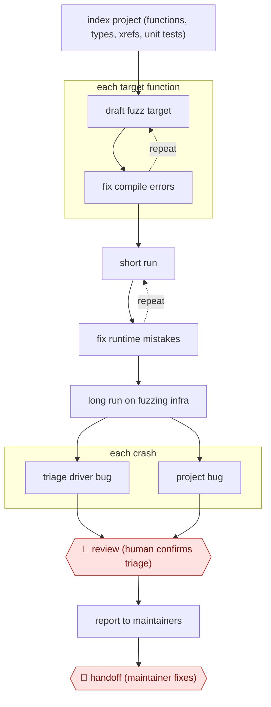

# AI fuzz-target hunting

`TEC › ITS › APPSEC` · checkpointed · evidence A · **draft: needs a reference example** ([how to add one](../../../../../CONTRIBUTING.md#1-add-an-example-run))

**Shape:** `index project (functions, types, xrefs, unit tests) → each target function: (draft fuzz target ⟲ fix compile errors) → (short run ⟲ fix runtime mistakes) → long run on fuzzing infra → each crash: triage driver bug | project bug → 🛑 review (human confirms triage) → report to maintainers → 🛑 handoff (maintainer fixes)`
**How it differs:** AWF-0067 Sanitizer-bug autopatch: AWF-0067 starts from a known sanitizer finding and delivers a patch signed off by the code owner. This workflow finds new bugs: its deliverables are fuzz harnesses and triaged vulnerability reports, and the gates are triage review and a handoff to an external maintainer.
**Variants:** `oss-fuzz-gen` · `clusterfuzz`

<!-- shape diagram: generated by scripts/build_diagrams.py from `shape`; don't edit -->

<!-- end shape diagram -->

## Steps
1. Index each project automatically: functions, type definitions, cross-references and existing unit tests. This gives the prompts project-specific context and cuts hallucination. [[1]](#sources)
2. For each target function, the LLM drafts a fuzz target. Compilation errors go back to the LLM until it builds. [[1]](#sources)
3. Run the target briefly. If it crashes instantly (a setup error, not a project bug), the LLM fixes it. [[1]](#sources)
4. Run the corrected target for a long period on ClusterFuzz. [[1]](#sources)
5. For each crash, the LLM gets the stack trace, target source and project code, and labels it 'bug in fuzz driver' or 'bug in project', with an analysis. [[1]](#sources)
6. 🛑 **Review**: humans still review the triage before a report goes out. Removing this step is stated as a future goal. [[1]](#sources)
7. 🛑 **Handoff**: confirmed vulnerabilities go to project maintainers to fix (the OpenSSL CVE was reported September 16 and fixed October 16). [[1]](#sources)

**Output:** New fuzz targets added to the project's OSS-Fuzz setup, plus confirmed vulnerability reports sent to maintainers.
**Failure modes → guards:** Hallucinated APIs in targets → indexed project context plus compile-fix loop. Driver bugs mistaken for real vulns → LLM triage plus human review before reporting. Coverage gain mistaken for safety → keep generating new targets even for code already fuzzed.

## Public runs

Coverage as of 2026-11-06: **Strong**: a first-hand, detailed run that matches most of the shape. Collected and re-checked in [Second collection pass](../../../../../research/2026-11-second-pass.md).

- [Google, Leveling Up Fuzzing](https://security.googleblog.com/2024/11/leveling-up-fuzzing-finding-more.html) (2024-11-20). 272 C/C++ projects, 370k+ new lines covered; includes CVE-2024-9143 in OpenSSL. "This led to the discovery of 26 new vulnerabilities". *First-hand: yes; confidence: high.*

## Sources

1. Google Online Security Blog, Leveling Up Fuzzing: Finding more vulnerabilities with AI, 2024-11-20. https://security.googleblog.com/2024/11/leveling-up-fuzzing-finding-more.html
