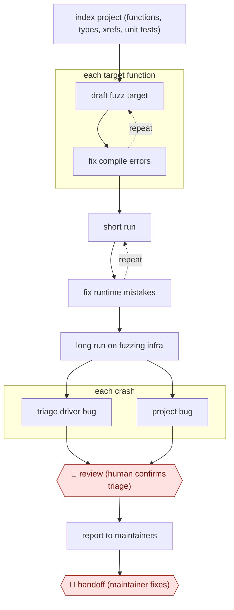

# AI fuzz-target hunting

`TEC › ITS › APPSEC` · checkpointed · evidence A · **draft: needs a reference example** ([how to add one](../../../../../CONTRIBUTING.md#1-add-an-example-run))

**Shape:** `index project (functions, types, xrefs, unit tests) → each target function: (draft fuzz target ⟲ fix compile errors) → (short run ⟲ fix runtime mistakes) → long run on fuzzing infra → each crash: triage driver bug | project bug → 🛑 review (human confirms triage) → report to maintainers → 🛑 handoff (maintainer fixes)`
**Variants:** `oss-fuzz-gen` · `clusterfuzz`

<!-- shape diagram: generated by scripts/build_diagrams.py from `shape`; don't edit -->

<!-- end shape diagram -->

## Background

Software security researchers look for inputs that make a program fail in ways its developers did not expect. A fuzzer generates and mutates inputs, but somebody must first write a small driver that calls the right functions with valid setup. A broken driver can produce crashes that say nothing about the program under test. This workflow lets an agent draft and repair drivers, submit longer test runs and prepare crash analyses. People confirm which crashes are real vulnerabilities before reporting them, and the project's maintainers decide the fixes.

**Terms:**
- **Fuzzing / fuzz target / harness**: testing with generated inputs, the function being exercised, and the driver connecting inputs to that function.
- **Compilation / runtime**: building executable code and running it.
- **Cross-reference (xref)**: a link showing where code calls or refers to another symbol.
- **Stack trace**: the chain of function calls recorded when a program fails.
- **Triage**: deciding whether a crash belongs to the driver or the tested project.
- **CVE**: a public identifier assigned to a disclosed vulnerability.
- **Coverage**: which parts of a program executed during tests; coverage does not establish safety.

- **LLM / API**: a large language model, and the interface through which a program calls another component.

## Build it with an agent

**Form:** `service`. Longer fuzzing jobs and later crash arrivals need a persistent queue rather than a person remaining in a conversation.

**You need:** authorised project source and build instructions; an isolated compiler and fuzzing environment; job submission and result retrieval scripts; a persistent job/crash store and a private review queue. Keep undisclosed vulnerability details inside the approved reporting environment; the agent has no public issue-posting tool.

| Step | Built as |
|---|---|
| index project → each target function: draft fuzz target ⟲ fix compile errors | A Skill reads source, types and tests; `claude -p` (headless) takes each queued target and revises the driver against compiler output. |
| short run ⟲ fix runtime mistakes | The Skill invokes the isolated runner, preserves crash artifacts and checks setup assumptions before accepting a driver. |
| long run on fuzzing infra | A script beside the Skill submits the approved driver to the existing fuzzing infrastructure; job identifiers and status live outside the conversation. |
| each crash: triage driver bug or project bug | A later headless run reads the crash, driver and project source, then writes an evidence-linked analysis. |
| 🛑 review → report to maintainers → 🛑 handoff | The service creates a private review item; a person confirms and sends the report through the project's disclosure process. |

**Checkpoints:** `review`: the queue includes reproduction inputs, stack trace, driver assumptions and the proposed classification. The agent cannot send a disclosure or open a public issue. `handoff`: a person delivers confirmed reports to maintainers, who own the repair; the service records that transfer rather than applying a fix itself.

**Since the sources:** The source dates from 2024-11. In 2026-11 its URL returned a title and navigation without the article body, so its claims were not re-verified. Searches found the [OSS-Fuzz-Gen repository](https://github.com/google/oss-fuzz-gen), opened in 2026-11, marked archived and read-only on 2026-11-10. Retain `oss-fuzz-gen` as the historical variant, not a recommendation for a maintained dependency. This design uses a general coding agent's Skill for the compile/run loop and an operator-maintained fuzzing backend; it does not assume the archived framework is a current service or that better tooling removes human crash review.

*A design based on this entry's steps and the tool documentation as of 2026-11, not a reported run.*

## Steps

*As reported by the sources.*

1. The system indexes each project automatically: functions, type definitions, cross-references and existing unit tests. This gives the prompts project-specific context and cuts hallucination. [[1]](#sources)
2. For each target function, the LLM drafts a fuzz target. Compilation errors go back to the LLM until it builds. [[1]](#sources)
3. The system runs the target briefly. If it crashes instantly (a setup error, not a project bug), the LLM fixes it. [[1]](#sources)
4. The system runs the corrected target for a long period on ClusterFuzz. [[1]](#sources)
5. For each crash, the LLM gets the stack trace, target source and project code, and labels it 'bug in fuzz driver' or 'bug in project', with an analysis. [[1]](#sources)
6. 🛑 **Review**: humans still review the triage before a report goes out. Removing this step is stated as a future goal. [[1]](#sources)
7. 🛑 **Handoff**: confirmed vulnerabilities go to project maintainers to fix (the OpenSSL CVE was reported September 16 and fixed October 16). [[1]](#sources)

**Output:** New fuzz targets added to the project's OSS-Fuzz setup, plus confirmed vulnerability reports sent to maintainers.
**Failure modes → guards:** Hallucinated APIs in targets → indexed project context plus compile-fix loop. Driver bugs mistaken for real vulns → LLM triage plus human review before reporting. Coverage gain mistaken for safety → keep generating new targets even for code already fuzzed.

**How it differs:** AWF-0067 Sanitizer-bug autopatch: AWF-0067 starts from a known sanitizer finding and delivers a patch signed off by the code owner. This workflow finds new bugs: its deliverables are fuzz harnesses and triaged vulnerability reports, and the gates are triage review and a handoff to an external maintainer.

## Public runs

Coverage as of 2026-11-06: **Strong**: a first-hand, detailed run that matches most of the shape. Collected and re-checked in [Second collection pass](../../../../../research/2026-11-second-pass.md).

- [Google, Leveling Up Fuzzing](https://security.googleblog.com/2024/11/leveling-up-fuzzing-finding-more.html) (2024-11-20). 272 C/C++ projects, 370k+ new lines covered; includes CVE-2024-9143 in OpenSSL. "This led to the discovery of 26 new vulnerabilities". *First-hand: yes; confidence: high.*

## Sources

1. Google Online Security Blog, Leveling Up Fuzzing: Finding more vulnerabilities with AI, 2024-11-20. https://security.googleblog.com/2024/11/leveling-up-fuzzing-finding-more.html
