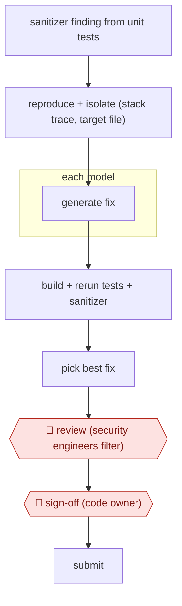

# Sanitizer-bug autopatch

`TEC › ITS › APPSEC` · checkpointed · evidence A · **draft: needs a reference example** ([how to add one](../../../../../CONTRIBUTING.md#1-add-an-example-run))

**Shape:** `sanitizer finding from unit tests → reproduce + isolate (stack trace, target file) → each model: generate fix → build + rerun tests + sanitizer → pick best fix → 🛑 review (security engineers filter) → 🛑 sign-off (code owner) → submit`
**Variants:** `gemini-internal-pipeline` · `github-copilot-autofix` · `snyk-agent-fix`

<!-- shape diagram: generated by scripts/build_diagrams.py from `shape`; don't edit -->

<!-- end shape diagram -->

## Background

A sanitizer is a testing tool that notices unsafe behavior while software runs, such as accessing memory that is no longer valid. Security engineers have to reproduce the failure, locate its cause and propose a code change without breaking other behavior. Large projects accumulate these findings faster than each can receive immediate attention. An agent can prepare and test candidate patches from the recorded failure. Security engineers still filter the candidates, and code owners make the final submission, because passing one test does not prove that a change preserves the program's intent.

**Terms:**
- **Sanitizer / memory safety**: an execution-time bug detector and the rules preventing invalid access to program memory.
- **Unit test / stack trace**: a focused code test and the recorded chain of function calls at failure.
- **LLM**: large language model, used here to propose code changes.
- **Regression**: previously working behavior broken by a change.
- **False positive / code owner**: a reported problem that does not warrant the proposed fix, and the developer responsible for the affected code.
- **Data race / serialization**: conflicting concurrent access and forcing work to run sequentially instead.

## Build it with an agent

**Form:** `service`. Findings enter a queue and tested candidates are delivered for human filtering, without a person starting every run.

**You need:** authorised source code; sanitizer findings with reproduction inputs and stack traces; isolated build and test scripts; a candidate store and private review queue. Keep undisclosed vulnerabilities and proprietary code within approved systems. Preserve a protected copy of tests and expose no upstream submission or merge tool.

| Step | Built as |
|---|---|
| sanitizer finding → reproduce + isolate | `claude -p` (headless) takes a queued finding. A Skill reproduces it and records the affected source and test command. |
| each model: generate fix | The Skill prepares candidate diffs in separate workspaces; model comparison is optional and requires independently configured providers. |
| build + rerun tests + sanitizer → pick best fix | The Skill runs deterministic checks; a read-only Subagent inspects the diff for removed tests, weakened checks and regressions. A Hook blocks edits to protected tests. |
| 🛑 review → 🛑 sign-off → submit | Candidates and test logs go to the security-review queue; approved candidates then go to the code owner. |

**Checkpoints:** `review`: security engineers see the reproduction, diff, unchanged tests, sanitizer output and remaining uncertainty. `sign-off`: only the code owner can submit the final change; the agent has no upstream write credentials. A passing build only makes a candidate eligible for these reviews.

**Since the sources:** Sources date from 2024-01 to 2025-10; the report landing page, PDF and CodeMender article were opened in 2026-11. Searches found [Google Cloud's managed CodeMender preview announcement](https://cloud.google.com/blog/products/identity-security/find-and-fix-software-vulnerabilities-with-codemender?hl=en), dated 2026-07 and opened in 2026-11, which retains developer review and approval of generated patches. A general agent can now carry the edit/test procedure as a Skill rather than requiring the earlier bespoke sequence of model prompts; the actual sanitizer and build environment still have to exist. This design does not require access to Google's internal pipeline or claim equivalence to CodeMender's analysis tools. The PDF's printed date differs from the creation date used in the existing citation; that citation needs a separate evidence review.

*A design based on this entry's steps and the tool documentation as of 2026-11, not a reported run.*

## Steps

*As reported by the sources.*

1. The system collects sanitizer bugs (memory-safety and similar) found while unit tests run, in C/C++, Java and Go. Keep all the information from the test run, especially the stack trace [[1]](#sources).
2. The system reproduces and isolates each bug so the test can be rerun. The system picks the file to change from the stack trace; the team also tried letting the LLM choose it [[1]](#sources).
3. The pipeline prompts LLMs (Gemini) for a fix. Models are tried in sequence, because different models fixed different bug types [[1]](#sources).
4. The pipeline tests each candidate automatically: build, rerun the tests and rerun the sanitizer on the modified code. This catches fake fixes such as deleting the failing test [[1]](#sources).
5. The pipeline shows the best fix for human review [[1]](#sources).
6. 🛑 **Review**: in a first human round, the team rejected 'approximately 10-20%' of generated commits as false positives or as changes that hurt code quality [[1]](#sources).
7. 🛑 **Sign-off**: the remaining commits go to code owners for final validation and submission [[1]](#sources).

**Output:** A reviewed fix commit for each vulnerability, landed by the code owner.
**Failure modes → guards:** The model 'fixes' the bug by removing the failing test, or by serializing code with a misleading comment → rerun the tests and sanitizer on the patched code, and keep a human filter before code owners see it. Reviewers may trust machine fixes too much → tell developers the fix is AI-generated and keep the double human filter [[1]](#sources).

**Recent practice (2026):**
- Validate step: an LLM-based critique tool highlights differences between the original and modified code to check for regressions. The agent self-corrects, and only patches that fix the root cause, are functionally correct, cause no regressions and follow style guidelines are surfaced for human review (CodeMender). [[2]](#sources)
- Review step: in the open-source variant, human researchers review every generated patch before it is submitted upstream to maintainers (CodeMender). [[2]](#sources)

**How it differs:** AWF-0005 Alert enrich and adjudicate ends with a verdict on a security alert. This workflow ends with a code patch. AWF-0003 Delegated PR has no repro or sanitizer gate and no two-stage human filter.

## Public runs

Coverage as of 2026-11-13: **Strong**: a first-hand, detailed run that matches most of the shape. Updated in [Third collection pass](../../../../../research/2026-11-third-pass.md).

- [Google, AI-powered patching](https://storage.googleapis.com/gweb-research2023-media/pubtools/7563.pdf) (2024-01-05). Gemini pipeline patches sanitizer bugs found in unit tests; two human filters, then code owners accept. "Approximately 95% of the commits sent to code owners were accepted without discussion"; fixed "15% of sanitizer bugs". *First-hand: yes; confidence: med.*
- [Google DeepMind, Introducing CodeMender: an AI agent for code security](https://deepmind.google/blog/introducing-codemender-an-ai-agent-for-code-security/) (2025-10-06). Reactive patching agent with program-analysis tools and a critique agent; humans review every patch before upstreaming. "we have already upstreamed 72 security fixes to open source projects, including some as large as 4.5 million lines of code". *First-hand: yes; confidence: high.*

## Sources

1. Jan Keller, Jan Nowakowski (Google), AI-powered patching: the future of automated vulnerability fixes, Google Security Engineering Technical Report, 2024 (PDF created 2024-01-05). https://research.google/pubs/ai-powered-patching-the-future-of-automated-vulnerability-fixes/ ; PDF https://storage.googleapis.com/gweb-research2023-media/pubtools/7563.pdf
2. Raluca Ada Popa, Four Flynn (Google DeepMind), Introducing CodeMender: an AI agent for code security, 2025-10-06. https://deepmind.google/blog/introducing-codemender-an-ai-agent-for-code-security/
