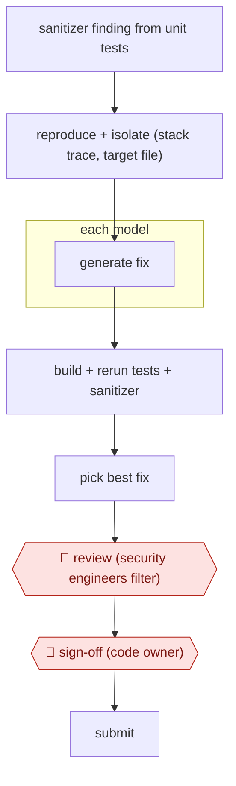

# Sanitizer-bug autopatch

`TEC › ITS › APPSEC` · checkpointed · evidence A · **draft: needs a reference example** ([how to add one](../../../../../CONTRIBUTING.md#1-add-an-example-run))

**Shape:** `sanitizer finding from unit tests → reproduce + isolate (stack trace, target file) → each model: generate fix → build + rerun tests + sanitizer → pick best fix → 🛑 review (security engineers filter) → 🛑 sign-off (code owner) → submit`
**How it differs:** AWF-0005 Alert enrich and adjudicate ends with a verdict on a security alert. This workflow ends with a code patch. AWF-0003 Delegated PR has no repro or sanitizer gate and no two-stage human filter.
**Variants:** `gemini-internal-pipeline` · `github-copilot-autofix` · `snyk-agent-fix`

<!-- shape diagram: generated by scripts/build_diagrams.py from `shape`; don't edit -->

<!-- end shape diagram -->

## Steps
1. Collect sanitizer bugs (memory-safety and similar) found while unit tests run, in C/C++, Java and Go. Keep all the information from the test run, especially the stack trace [[1]](#sources).
2. Reproduce and isolate each bug so the test can be rerun. Pick the file to change from the stack trace; the team also tried letting the LLM choose it [[1]](#sources).
3. Prompt LLMs (Gemini) for a fix. Models are tried in sequence, because different models fixed different bug types [[1]](#sources).
4. Test each candidate automatically: build, rerun the tests and rerun the sanitizer on the modified code. This catches fake fixes such as deleting the failing test [[1]](#sources).
5. Show the best fix for human review [[1]](#sources).
6. 🛑 **Review**: in a first human round, the team rejected 'approximately 10-20%' of generated commits as false positives or as changes that hurt code quality [[1]](#sources).
7. 🛑 **Sign-off**: the remaining commits go to code owners for final validation and submission [[1]](#sources).

**Output:** A reviewed fix commit for each vulnerability, landed by the code owner.
**Failure modes → guards:** The model 'fixes' the bug by removing the failing test, or by serializing code with a misleading comment → rerun the tests and sanitizer on the patched code, and keep a human filter before code owners see it. Reviewers may trust machine fixes too much → tell developers the fix is AI-generated and keep the double human filter [[1]](#sources).

**Recent practice (2026):**
- Validate step: an LLM-based critique tool highlights differences between the original and modified code to check for regressions. The agent self-corrects, and only patches that fix the root cause, are functionally correct, cause no regressions and follow style guidelines are surfaced for human review (CodeMender). [[2]](#sources)
- Review step: in the open-source variant, human researchers review every generated patch before it is submitted upstream to maintainers (CodeMender). [[2]](#sources)

## Public runs

Coverage as of 2026-11-13: **Strong**: a first-hand, detailed run that matches most of the shape. Updated in [Third collection pass](../../../../../research/2026-11-third-pass.md).

- [Google, AI-powered patching](https://storage.googleapis.com/gweb-research2023-media/pubtools/7563.pdf) (2024-01-05). Gemini pipeline patches sanitizer bugs found in unit tests; two human filters, then code owners accept. "Approximately 95% of the commits sent to code owners were accepted without discussion"; fixed "15% of sanitizer bugs". *First-hand: yes; confidence: med.*
- [Google DeepMind, Introducing CodeMender: an AI agent for code security](https://deepmind.google/blog/introducing-codemender-an-ai-agent-for-code-security/) (2025-10-06). Reactive patching agent with program-analysis tools and a critique agent; humans review every patch before upstreaming. "we have already upstreamed 72 security fixes to open source projects, including some as large as 4.5 million lines of code". *First-hand: yes; confidence: high.*

## Sources

1. Jan Keller, Jan Nowakowski (Google), AI-powered patching: the future of automated vulnerability fixes, Google Security Engineering Technical Report, 2024 (PDF created 2024-01-05). https://research.google/pubs/ai-powered-patching-the-future-of-automated-vulnerability-fixes/ ; PDF https://storage.googleapis.com/gweb-research2023-media/pubtools/7563.pdf
2. Raluca Ada Popa, Four Flynn (Google DeepMind), Introducing CodeMender: an AI agent for code security, 2025-10-06. https://deepmind.google/blog/introducing-codemender-an-ai-agent-for-code-security/
