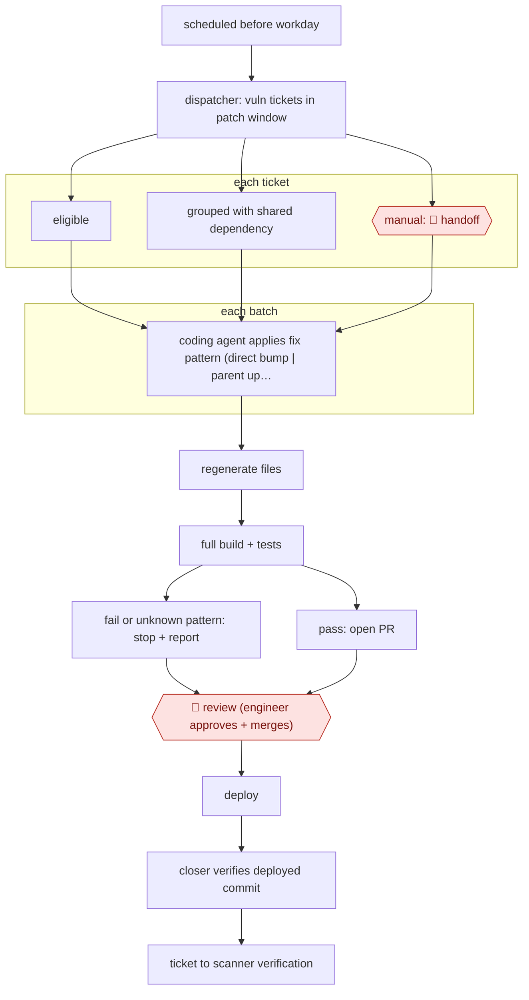

# Scheduled vuln-fix PRs

`TEC › ITS › APPSEC` · checkpointed · evidence A · **draft: needs a reference example** ([how to add one](../../../../../CONTRIBUTING.md#1-add-an-example-run))

**Shape:** `scheduled before workday → dispatcher: vuln tickets in patch window → each ticket: eligible | grouped with shared dependency | manual: 🛑 handoff → each batch: coding agent applies fix pattern (direct bump | parent upgrade | flag platform-managed | base image) → regenerate files → full build + tests → fail or unknown pattern: stop + report | pass: open PR → 🛑 review (engineer approves + merges) → deploy → closer verifies deployed commit → ticket to scanner verification`
**Variants:** `bitbucket-agentic-pipelines` · `rovo-dev` · `jira-automation` · `claude-code` · `codex`

<!-- shape diagram: generated by scripts/build_diagrams.py from `shape`; don't edit -->

<!-- end shape diagram -->

## Background

When a security scanner identifies a vulnerable software dependency, developers must find a safe update, change the right files and check that the application still builds and runs. Several tickets may refer to the same dependency, and a merged change may not yet have reached the deployed application. This workflow schedules the routine cases, groups related tickets and prepares tested changes. An agent can perform those repeatable steps and check deployment records. Engineers still decide whether to merge and release, while cases outside the known patterns remain with people.

**Terms:**
- **Vulnerability / scanner**: a security weakness and the tool reporting affected packages or images.
- **Patch window**: the period in which a reported weakness should be addressed.
- **Direct / transitive dependency**: a package the application uses explicitly, or one brought in by another package.
- **Parent upgrade / base image**: upgrading the package that brings in a dependency, or updating the operating-system image beneath an application container.
- **PR / diff / commit**: a proposed repository change, its changed lines, and its recorded revision.
- **CI/CD / idempotent**: automated build-and-delivery checks, and safe repetition without duplicate effects.

## Build it with an agent

**Form:** `service`. A schedule starts the work and deployment events arrive later; engineers receive PRs and exceptions.

**You need:** vulnerability tickets with required safe versions; approved repository checkouts and build environments; dependency decision trees stored beside the code; ticket and code-host MCP server (connector) tools; read-only deployment records and a persistent ticket-to-PR mapping. Keep source, credentials and security findings within approved systems. The coding run may open a PR but cannot merge or deploy.

| Step | Built as |
|---|---|
| scheduled before workday → dispatcher: vuln tickets in patch window | The existing scheduler invokes `claude -p` (headless). A Skill reads tickets and records eligibility and grouping decisions in the work store. |
| each ticket: eligible or grouped or manual: 🛑 handoff | The Skill applies the versioned decision tree and creates an explicit queue outcome for every ticket. |
| each batch: apply fix pattern → regenerate files → full build + tests | Separate headless runs use the repository's Skill, commands and isolated checkout; Permission rule or mode limits each run to the required systems. |
| fail or unknown pattern: stop + report or pass: open PR → 🛑 review | A Hook blocks PR creation unless the required checks have passed; failures return evidence to the manual queue. |
| deploy → closer verifies deployed commit → ticket to scanner verification | A later Skill reads merge and deployment state through MCP server (connector) tools before updating the ticket; durable identifiers make reruns auditable. |

**Checkpoints:** `handoff`: unknown patterns, incomplete deployment evidence and failed checks stay open with an explicit reason and logs. `review`: an engineer sees the dependency change, regenerated files and test results on the PR; repository permissions withhold merge and deployment from the agent. The closer cannot mark deployment complete without a matching deployed commit record.

**Since the sources:** The source dates from 2026-08 and was opened in 2026-11. Searches found [Atlassian's redesigned MCP integration announcement](https://www.atlassian.com/blog/bitbucket/connect-the-redesigned-atlassian-mcp-server-to-your-agentic-pipelines), dated 2026-10 and opened in 2026-11. It introduces the redesigned connector for Claude and Codex, while Rovo Dev CLI still uses the legacy connector and has a planned transition to Rovo CLI. Treat the `rovo-dev` variant as the source's current name pending that migration, not as already removed. The build above keeps the source's dispatcher, coding and closer responsibilities, expressed as headless Skills with persistent state; tool access must be checked against the chosen provider's connector version.

*A design based on this entry's steps and the tool documentation as of 2026-11, not a reported run.*

## Steps

*As reported by the sources.*

1. A scheduled automation rule starts the dispatcher before the working day [[1]](#sources).
2. The dispatcher searches for vulnerability tickets inside the patch window. It decides eligibility, groups tickets that share a dependency change, and starts parallel coding-agent runs per batch. 🛑 **Handoff**: items that need judgment are left for manual handling, and every ticket gets an explicit outcome [[1]](#sources).
3. The coding agent runs in the repo's own build environment with only the scopes it needs. It follows a repo-stored decision tree: bump a direct dependency, upgrade the parent of a transitive one, flag a platform-managed package, or take the base-image path. It regenerates generated files and runs the full build and test suite [[1]](#sources).
4. If checks fail or the fix falls outside the encoded patterns, the run stops and reports why. Otherwise it creates a branch and opens a PR. The prompt, skill and pipeline definition are versioned in the repo [[1]](#sources).
5. 🛑 **Review**: an engineer reviews the diff and decides whether to merge. Existing branch protections and required reviews still gate it [[1]](#sources).
6. After deployment, the closer checks that the matching PR was merged and the deployed build contains the commit, then moves the ticket to scanner verification. If the evidence is incomplete, the ticket stays open. Reruns are idempotent [[1]](#sources).

**Output:** Tested, review-ready vulnerability fix PRs each morning, and tickets closed only after the fix is confirmed deployed.
**Failure modes → guards:** Generic instructions → generic fixes, so the dependency patterns, file locations, build commands and exceptions are stored per codebase. Duplicate work on reruns → tickets, labels, branches and deployment state make reruns harmless. Model output becoming a release gate → deterministic checks and human review decide.

**How it differs:** AWF-0067 Sanitizer-bug autopatch starts from sanitizer crashes, compares fixes from several models, and goes through security-engineer filtering plus code-owner sign-off. Here the input is a queue of scanner tickets with known safe versions. A dispatcher batches them, routine dependency and image fixes go through one PR review, and a closer verifies the deploy. The input, deliverable and checkpoint arrangement all differ.

## Public runs

Coverage as of 2026-11-13: **Partial**: first-hand runs that cover part of the shape or put checkpoints elsewhere. Collected and re-checked in [Third collection pass](../../../../../research/2026-11-third-pass.md).

- [Atlassian, How we made vulnerability fixes review-ready with Agentic Pipelines](https://www.atlassian.com/blog/bitbucket/vulnerability-fixes-with-agentic-pipelines) (2026-08-30). Internal team's three-month results with dispatcher, coding agent and closer. "In 3 months, an Atlassian team reported more than 120 vulnerabilities resolved and more than 55 agent-created pull requests merged.". *First-hand: yes; confidence: med.*

## Sources

1. Arthy Vijayaraghavan (Atlassian), How we made vulnerability fixes review-ready with Agentic Pipelines, 2026-08-30. https://www.atlassian.com/blog/bitbucket/vulnerability-fixes-with-agentic-pipelines
