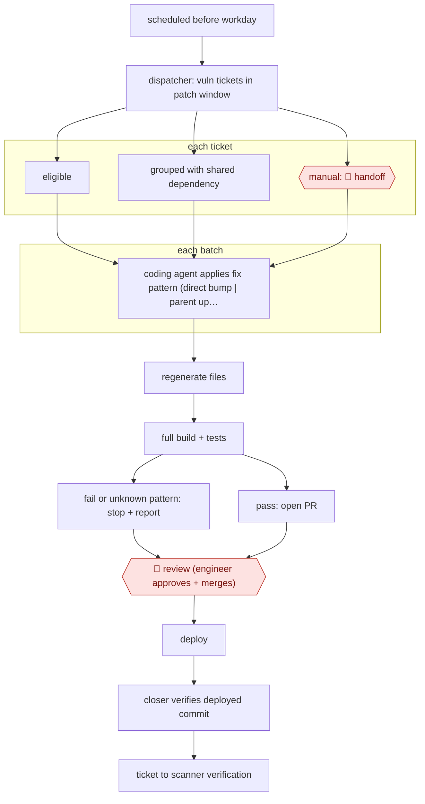

# Scheduled vuln-fix PRs

`TEC › ITS › APPSEC` · checkpointed · evidence A · **draft: needs a reference example** ([how to add one](../../../../../CONTRIBUTING.md#1-add-an-example-run))

**Shape:** `scheduled before workday → dispatcher: vuln tickets in patch window → each ticket: eligible | grouped with shared dependency | manual: 🛑 handoff → each batch: coding agent applies fix pattern (direct bump | parent upgrade | flag platform-managed | base image) → regenerate files → full build + tests → fail or unknown pattern: stop + report | pass: open PR → 🛑 review (engineer approves + merges) → deploy → closer verifies deployed commit → ticket to scanner verification`
**How it differs:** AWF-0067 Sanitizer-bug autopatch starts from sanitizer crashes, compares fixes from several models, and goes through security-engineer filtering plus code-owner sign-off. Here the input is a queue of scanner tickets with known safe versions. A dispatcher batches them, routine dependency and image fixes go through one PR review, and a closer verifies the deploy. The input, deliverable and checkpoint arrangement all differ.
**Variants:** `bitbucket-agentic-pipelines` · `rovo-dev` · `jira-automation` · `claude-code` · `codex`

<!-- shape diagram: generated by scripts/build_diagrams.py from `shape`; don't edit -->

<!-- end shape diagram -->

## Steps
1. A scheduled automation rule starts the dispatcher before the working day [[1]](#sources).
2. The dispatcher searches for vulnerability tickets inside the patch window. It decides eligibility, groups tickets that share a dependency change, and starts parallel coding-agent runs per batch. 🛑 **Handoff**: items that need judgment are left for manual handling, and every ticket gets an explicit outcome [[1]](#sources).
3. The coding agent runs in the repo's own build environment with only the scopes it needs. It follows a repo-stored decision tree: bump a direct dependency, upgrade the parent of a transitive one, flag a platform-managed package, or take the base-image path. It regenerates generated files and runs the full build and test suite [[1]](#sources).
4. If checks fail or the fix falls outside the encoded patterns, the run stops and reports why. Otherwise it creates a branch and opens a PR. The prompt, skill and pipeline definition are versioned in the repo [[1]](#sources).
5. 🛑 **Review**: an engineer reviews the diff and decides whether to merge. Existing branch protections and required reviews still gate it [[1]](#sources).
6. After deployment, the closer checks that the matching PR was merged and the deployed build contains the commit, then moves the ticket to scanner verification. If the evidence is incomplete, the ticket stays open. Reruns are idempotent [[1]](#sources).

**Output:** Tested, review-ready vulnerability fix PRs each morning, and tickets closed only after the fix is confirmed deployed.
**Failure modes → guards:** Generic instructions → generic fixes, so the dependency patterns, file locations, build commands and exceptions are stored per codebase. Duplicate work on reruns → tickets, labels, branches and deployment state make reruns harmless. Model output becoming a release gate → deterministic checks and human review decide.

## Public runs

Coverage as of 2026-11-13: **Partial**: first-hand runs that cover part of the shape or put checkpoints elsewhere. Collected and re-checked in [Third collection pass](../../../../../research/2026-11-third-pass.md).

- [Atlassian, How we made vulnerability fixes review-ready with Agentic Pipelines](https://www.atlassian.com/blog/bitbucket/vulnerability-fixes-with-agentic-pipelines) (2026-08-30). Internal team's three-month results with dispatcher, coding agent and closer. "In 3 months, an Atlassian team reported more than 120 vulnerabilities resolved and more than 55 agent-created pull requests merged.". *First-hand: yes; confidence: med.*

## Sources

1. Arthy Vijayaraghavan (Atlassian), How we made vulnerability fixes review-ready with Agentic Pipelines, 2026-08-30. https://www.atlassian.com/blog/bitbucket/vulnerability-fixes-with-agentic-pipelines
