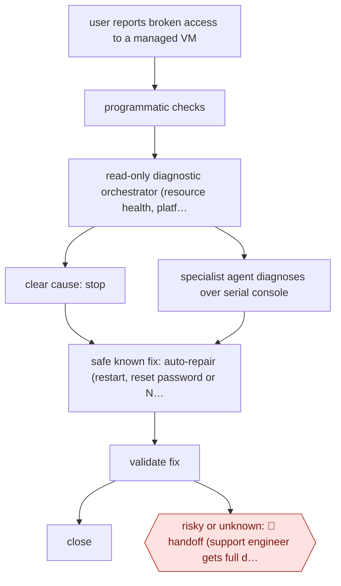

# Self-repair before handoff

`TEC › ITS › HELPDESK` · sampled · evidence A · **draft: needs a reference example** ([how to add one](../../../../../CONTRIBUTING.md#1-add-an-example-run))

**Shape:** `user reports broken access to a managed VM → programmatic checks → read-only diagnostic orchestrator (resource health, platform APIs) → clear cause: stop | specialist agent diagnoses over serial console → safe known fix: auto-repair (restart, reset password or NIC, console commands) → validate fix → close | risky or unknown: 🛑 handoff (support engineer gets full diagnostics) · before release: break test VMs + evals`
**Variants:** `microsoft-foundry` · `microsoft-agent-framework` · `azure-serial-console` · `azure-ai-evaluation`

<!-- shape diagram: generated by scripts/build_diagrams.py from `shape`; don't edit -->

<!-- end shape diagram -->

## Background

IT support engineers help employees regain access to computers used for development and testing. A failed connection can come from the machine, its network or the remote-access service, and identifying the cause requires several checks before trying a repair. This workflow lets an agent gather diagnostics and apply only known repairs, then test the result. People receive cases outside those known scenarios because changing the wrong setting can interrupt work or weaken access controls.

**Terms:**
- **VM**: virtual machine, a computer running as software on shared hardware.
- **RDP / serial console**: a remote desktop connection, and a separate text-based route for diagnosing a machine when normal access fails.
- **RAG / API**: retrieving relevant documentation before answering, and a program interface for reading or changing another system.
- **NIC / OS / evals**: network interface, operating system, and repeatable tests of agent behavior.

## Build it with an agent

**Form:** `service`. It starts from support requests and carries out diagnosis and permitted repairs before sending exceptions to people.

**You need:** approved machine-health and lab-management MCP server (connector) tools; a current user guide; read-only diagnostic tools; narrowly scoped repair scripts; test machines and expected outcomes. Keep employee information and credentials in approved systems; do not expose a general privileged shell.

| Step | Built as |
|---|---|
| user reports broken access → programmatic checks | The support frontend invokes a Skill through `claude -p` (headless); scripts perform the initial checks. |
| read-only diagnostic orchestrator → specialist diagnosis | A Skill chooses the next check; read-only Subagents gather resource-health and console evidence through scoped MCP server (connector) tools. |
| safe known fix → validate fix → close | A Hook checks the target and approved repair identifier before a bounded repair script runs. The Skill checks access again and records the result. |
| risky or unknown: 🛑 handoff | The service returns the diagnostic package to the user or support queue, without attempting an unlisted repair. |
| before release: break test VMs + evals | Scripts beside the Skill exercise supported failure cases on test machines before a changed procedure is released. |

**Checkpoints:** `handoff`: risky, unknown or unvalidated cases end with checks, observations and attempted repairs for the support engineer. The repair tools accept only approved operations on the selected machine; a Hook blocks operations outside that allowlist.

**Since the sources:** The source dates from 2026-08 and was opened in 2026-11. Searches found [Microsoft's Foundry update](https://devblogs.microsoft.com/foundry/whats-new-in-microsoft-foundry-july-august-2026/), published in 2026-09 and opened in 2026-11, reporting general availability of hosted agents. That is an optional hosting route, not access to Microsoft's internal Managed Cloud Labs tools. A general headless agent can coordinate the checks, but an operator still needs to supply authenticated console tooling, constrained repair actions and tests for every supported machine configuration.

*A design based on this entry's steps and the tool documentation as of 2026-11, not a reported run.*

## Steps

*As reported by the sources.*

1. The system routes how-to questions to a RAG info agent grounded in the user guide. The system routes connectivity problems to the Troubleshooting Agent [[1]](#sources).
2. The user selects the VM and reports the RDP problem. The agent shows a running summary of what it detects and does [[1]](#sources).
3. Programmatic checks run first. Then a read-only diagnostic orchestrator decides what to gather: Azure resource health, Managed Cloud Labs APIs, or routing to a specialised Windows RDP agent that drives the serial console. It stops early when an early signal shows a clear cause [[1]](#sources).
4. When the issue is one it can safely address, an auto-repair orchestrator restarts the VM, resets a password or network interface, or sends serial-console commands. It then validates the fix before closing the loop [[1]](#sources).
5. 🛑 **Handoff**: when the fix carries risk or falls outside known scenarios, the agent hands the full diagnostic context to the user, to pass to a human support engineer [[1]](#sources).
6. Before release and on changes, the team deliberately breaks test VMs in dozens of ways and runs evals to check that the repairs are safe and consistent [[1]](#sources).

**Output:** A repaired, validated VM with the ticket avoided or closed. Otherwise a diagnostic package for a support engineer.
**Failure modes → guards:** Fixes that differ across OS versions → extensive testing per supported Windows version and deliberately broken test VMs with evals. Unsafe repairs → only known, safe repair actions, with risky cases handed off. Stale knowledge for how-tos → the user guide is the single source of truth.

**How it differs:** AWF-0068 Slack IT request agent provisions access only after an app approver acts on each request. Here the agent diagnoses and repairs infrastructure end to end with no per-item approval, and people only take handoffs. The autonomy is sampled rather than checkpointed, and the deliverable is a repaired system rather than granted access.

## Public runs

Coverage as of 2026-11-13: **Strong**: a first-hand, detailed run that matches most of the shape. Collected and re-checked in [Third collection pass](../../../../../research/2026-11-third-pass.md).

- [Microsoft Inside Track, Resolving repetitive support tickets at Microsoft with AI automation](https://www.microsoft.com/insidetrack/blog/resolving-repetitive-support-tickets-at-microsoft-with-ai-automation/) (2026-08-13). First month of the Troubleshooting Agent on 150,000+ internal lab VMs. "Reduce the average time to mitigate a common connectivity ticket from 16 hours to 15 minutes.". *First-hand: yes; confidence: high.*

## Sources

1. Diana Mivelli (Microsoft Digital, Inside Track), Resolving repetitive support tickets at Microsoft with AI automation, 2026-08-13. https://www.microsoft.com/insidetrack/blog/resolving-repetitive-support-tickets-at-microsoft-with-ai-automation/
