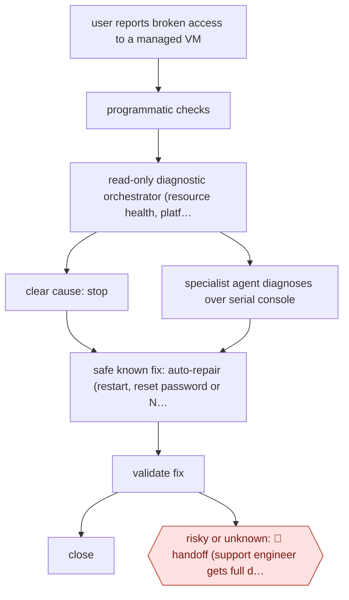

# Self-repair before handoff

`TEC › ITS › HELPDESK` · sampled · evidence A · **draft: needs a reference example** ([how to add one](../../../../../CONTRIBUTING.md#1-add-an-example-run))

**Shape:** `user reports broken access to a managed VM → programmatic checks → read-only diagnostic orchestrator (resource health, platform APIs) → clear cause: stop | specialist agent diagnoses over serial console → safe known fix: auto-repair (restart, reset password or NIC, console commands) → validate fix → close | risky or unknown: 🛑 handoff (support engineer gets full diagnostics) · before release: break test VMs + evals`
**How it differs:** AWF-0068 Slack IT request agent provisions access only after an app approver acts on each request. Here the agent diagnoses and repairs infrastructure end to end with no per-item approval, and people only take handoffs. The autonomy is sampled rather than checkpointed, and the deliverable is a repaired system rather than granted access.
**Variants:** `microsoft-foundry` · `microsoft-agent-framework` · `azure-serial-console` · `azure-ai-evaluation`

<!-- shape diagram: generated by scripts/build_diagrams.py from `shape`; don't edit -->

<!-- end shape diagram -->

## Steps
1. Route how-to questions to a RAG info agent grounded in the user guide. Route connectivity problems to the Troubleshooting Agent [[1]](#sources).
2. The user selects the VM and reports the RDP problem. The agent shows a running summary of what it detects and does [[1]](#sources).
3. Programmatic checks run first. Then a read-only diagnostic orchestrator decides what to gather: Azure resource health, Managed Cloud Labs APIs, or routing to a specialised Windows RDP agent that drives the serial console. It stops early when an early signal shows a clear cause [[1]](#sources).
4. When the issue is one it can safely address, an auto-repair orchestrator restarts the VM, resets a password or network interface, or sends serial-console commands. It then validates the fix before closing the loop [[1]](#sources).
5. 🛑 **Handoff**: when the fix carries risk or falls outside known scenarios, the agent hands the full diagnostic context to the user, to pass to a human support engineer [[1]](#sources).
6. Before release and on changes, deliberately break test VMs in dozens of ways and run evals to check that the repairs are safe and consistent [[1]](#sources).

**Output:** A repaired, validated VM with the ticket avoided or closed. Otherwise a diagnostic package for a support engineer.
**Failure modes → guards:** Fixes that differ across OS versions → extensive testing per supported Windows version and deliberately broken test VMs with evals. Unsafe repairs → only known, safe repair actions, with risky cases handed off. Stale knowledge for how-tos → the user guide is the single source of truth.

## Public runs

Coverage as of 2026-11-13: **Strong**: a first-hand, detailed run that matches most of the shape. Collected and re-checked in [Third collection pass](../../../../../research/2026-11-third-pass.md).

- [Microsoft Inside Track, Resolving repetitive support tickets at Microsoft with AI automation](https://www.microsoft.com/insidetrack/blog/resolving-repetitive-support-tickets-at-microsoft-with-ai-automation/) (2026-08-13). First month of the Troubleshooting Agent on 150,000+ internal lab VMs. "Reduce the average time to mitigate a common connectivity ticket from 16 hours to 15 minutes.". *First-hand: yes; confidence: high.*

## Sources

1. Diana Mivelli (Microsoft Digital, Inside Track), Resolving repetitive support tickets at Microsoft with AI automation, 2026-08-13. https://www.microsoft.com/insidetrack/blog/resolving-repetitive-support-tickets-at-microsoft-with-ai-automation/
