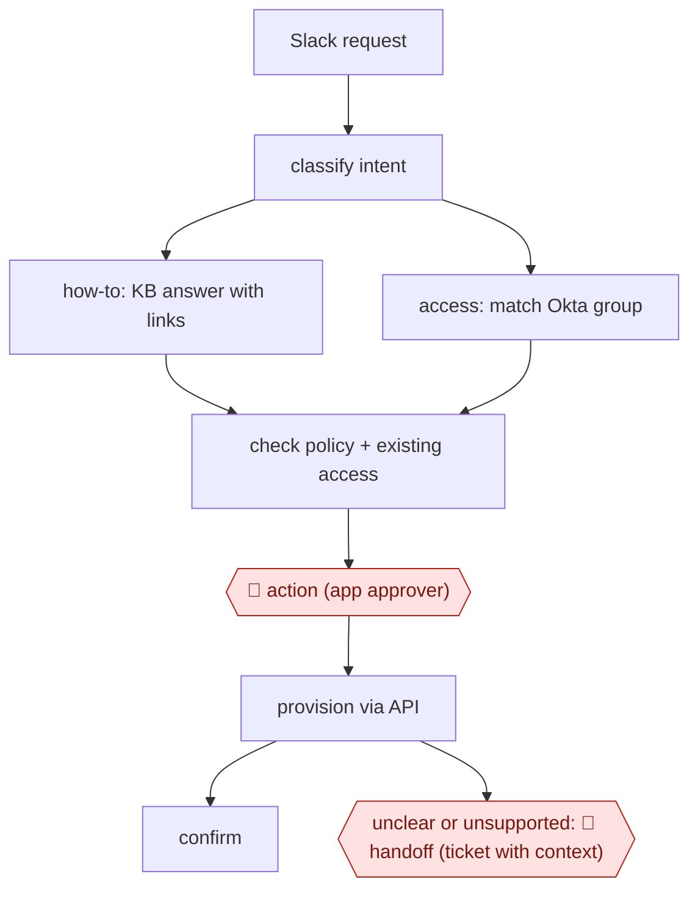

# Slack IT request agent

`TEC › ITS › HELPDESK` · checkpointed · evidence B · **draft: needs a reference example** ([how to add one](../../../../../CONTRIBUTING.md#1-add-an-example-run))

**Shape:** `Slack request → classify intent → how-to: KB answer with links | access: match Okta group → check policy + existing access → 🛑 action (app approver) → provision via API → confirm | unclear or unsupported: 🛑 handoff (ticket with context)`
**Variants:** `langgraph-claude-okta-slack-jsm` · `harmony` · `risotto` · `servicenow-ai-agents`

<!-- shape diagram: generated by scripts/build_diagrams.py from `shape`; don't edit -->

<!-- end shape diagram -->

## Background

Employees ask IT teams how to use company systems and request access to applications. Answering a question may need only a current guide, but granting access changes what somebody can see or do. This workflow routes messages, retrieves instructions and prepares access requests for the authorised approver. An agent can handle the surrounding lookups and confirmations while the approval policy stays outside its judgment. IT staff take requests that lack a supported procedure or enough information.

**Terms:**
- **IT / KB / IdP**: information technology, knowledge base, and the identity provider holding accounts and access groups.
- **API / MCP**: a program interface and the protocol connecting agent tools to other systems.
- **DM / provisioning**: a private message and granting the requested access.
- **Dead-letter queue**: storage for failed actions requiring retry or investigation.
- **Reranking / pgvector**: ordering candidate matches after retrieval, and a database extension for searching by similarity.
- **Joiner/mover/leaver**: employee arrival, role change and departure events.

## Build it with an agent

**Form:** `service`. Messages and employee-lifecycle events arrive without a person starting each agent session.

**You need:** a Slack event receiver; current knowledge-base access; identity-group metadata and fixed approver policy; durable request/approval storage; ticket creation tools. Use approved handling of employee information. Separate read-only lookup credentials from a provisioning tool that accepts only authenticated approvals.

| Step | Built as |
|---|---|
| Slack request → classify intent → how-to answer | A headless Skill classifies the event, asks for missing information and retrieves linked KB passages through MCP server (connector) tools. |
| access: match group → check policy + existing access | The Skill proposes a match; scripts beside it look up policy-defined approvers and verify current membership. |
| 🛑 action → provision via API → confirm | The service queues an approval request and ends. A separate approved event invokes the scoped provisioning script and records its result. |
| unclear or unsupported: 🛑 handoff | The Skill opens a contextual support ticket. Employee-lifecycle events use separately approved playbooks and the same audit store. |

**Checkpoints:** `action`: the application approver sees requester, exact group, policy and existing access. A PreToolUse Hook rejects provisioning without a matching authenticated approval; offboarding also enforces distinct requester and approver. `handoff`: missing playbooks, uncertain matches and failed provisioning go to IT with the original thread and attempted actions.

**Since the sources:** Evidence is dated 2026-08 or labelled undated in the entry. Both pages were opened in 2026-11; the Kernel page now identifies Chander Inguva and an update in 2026-03, so its existing anonymous/undated citation needs review. Searches also found [ServiceNow's 2026-08 release notes](https://www.servicenow.com/docs/r/store-release-notes/na-suite-rn-2026-08-07.html), opened in 2026-11, showing Otto rebranding in parts of its agent product family; this does not establish that the generic `servicenow-ai-agents` variant is withdrawn. The proposed service replaces custom conversational routing with a Skill, while approval storage, event delivery, retries and identity permissions remain ordinary service infrastructure.

*A design based on this entry's steps and the tool documentation as of 2026-11, not a reported run.*

## Steps

*As reported by the sources.*

1. Before building, the IT team ranks a year of past tickets by volume. The team automates first the categories with more than 1,000 requests a year (access requests and password resets came top) [[2]](#sources).
2. An employee posts in Slack. The agent sorts the message into an intent (access_request, how_to, incident, password_reset, other), each with its own confidence threshold. Low confidence means it asks a clarifying question [[1]](#sources).
3. For how-to requests, the agent retrieves Confluence passages (pgvector) and replies with a formatted answer that links its sources [[1]](#sources).
4. For access requests, the agent finds the right Okta group (aliases, fuzzy match, reranking), checks whether the user already has access, and looks up the approver stored on the app's Okta attribute [[1]](#sources). Who may approve each app is written as policy ahead of time, not decided by the model [[2]](#sources).
5. 🛑 **Action**: the designated approver approves or rejects with one tap in a Slack DM. Offboarding needs a second person, and requester and approver can never be the same [[1]](#sources)[[2]](#sources).
6. After approval, the system adds the user through the Okta Groups API. Failed provisioning goes to a dead-letter queue and raises a Slack alert [[1]](#sources).
7. 🛑 **Handoff**: anything without a playbook or KB match becomes a Jira Service Management ticket (or goes to a human in the same thread), and the requester is kept informed [[1]](#sources)[[2]](#sources).
8. Joiner/mover/leaver events from Okta event hooks trigger standard access, access reviews and revocation. Playbooks are tested in a test channel before publishing [[1]](#sources).

**Output:** The request is either closed in Slack (answer or provisioned access, logged) or escalated as a ticket with context for IT staff.
**Failure modes → guards:** The model decides who may approve → put approval rules in the workflow or policy, not the prompt [[2]](#sources). A worker dies and provisioning stops silently → health-check alerts [[1]](#sources). Guessed confidence thresholds → tune them on weeks of real traffic [[1]](#sources). Case-sensitive group names silently deny access → check config against the IdP [[1]](#sources).

**How it differs:** AWF-0021 Procedure agent (CSX RESOLVE) serves external customers. This workflow serves employees and changes identity and access state in the IdP behind a per-app approver. AWF-0005 handles security alerts, not employee requests.

## Public runs

Coverage as of 2026-11-06: **Weak**: only anonymous, vendor-linked or journalist-told accounts. Collected and re-checked in [New workflows for empty categories](../../../../../research/2026-11-new-workflows.md).

- [Harmony, Cyera customer story](https://harmony.io/customers/cyera) (2026-08-07). Access requests approved with one tap in Slack, Okta-scoped groups, two-person offboarding, human escalation in thread. "90–95% - of access requests fully automated". *First-hand: vendor; confidence: med.*
- [inguva.dev, How I Built Kernel](https://blog.inguva.dev/how-i-built-kernel-an-ai-powered-it-helpdesk-that-deflects-80-of-support-tickets) (undated). LangGraph + Claude Slack bot: intent routing, approver DM, Okta provisioning, Jira escalation; 8-week results. "78% deflection rate". *First-hand: anon; confidence: low.*

## Sources

1. inguva.dev blog (author unnamed), How I Built Kernel: An AI-Powered IT Helpdesk That Deflects 80% of Support Tickets, undated. https://blog.inguva.dev/how-i-built-kernel-an-ai-powered-it-helpdesk-that-deflects-80-of-support-tickets
2. Harmony (vendor customer story), How Cyera automates ~89% of employee requests with Harmony, 2026-08-07. https://harmony.io/customers/cyera
