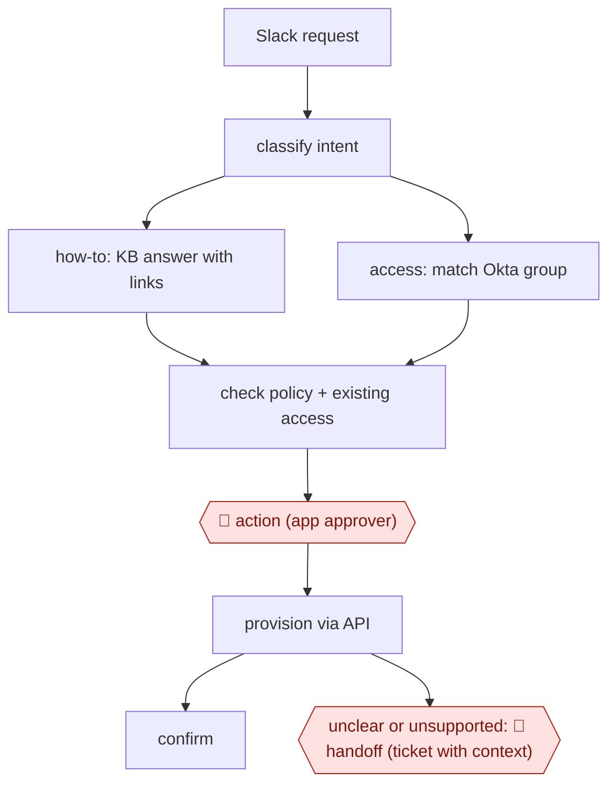

# Slack IT request agent

`TEC › ITS › HELPDESK` · checkpointed · evidence B · **draft: needs a reference example** ([how to add one](../../../../../CONTRIBUTING.md#1-add-an-example-run))

**Shape:** `Slack request → classify intent → how-to: KB answer with links | access: match Okta group → check policy + existing access → 🛑 action (app approver) → provision via API → confirm | unclear or unsupported: 🛑 handoff (ticket with context)`
**How it differs:** AWF-0021 Procedure agent (CSX RESOLVE) serves external customers. This workflow serves employees and changes identity and access state in the IdP behind a per-app approver. AWF-0005 handles security alerts, not employee requests.
**Variants:** `langgraph-claude-okta-slack-jsm` · `harmony` · `risotto` · `servicenow-ai-agents`

<!-- shape diagram: generated by scripts/build_diagrams.py from `shape`; don't edit -->

<!-- end shape diagram -->

## Steps
1. Before building, rank a year of past tickets by volume. Automate first the categories with more than 1,000 requests a year (access requests and password resets came top) [[2]](#sources).
2. An employee posts in Slack. The agent sorts the message into an intent (access_request, how_to, incident, password_reset, other), each with its own confidence threshold. Low confidence means it asks a clarifying question [[1]](#sources).
3. How-to: retrieve Confluence passages (pgvector) and reply with a formatted answer that links its sources [[1]](#sources).
4. Access: find the right Okta group (aliases, fuzzy match, reranking), check whether the user already has access, and look up the approver stored on the app's Okta attribute [[1]](#sources). Who may approve each app is written as policy ahead of time, not decided by the model [[2]](#sources).
5. 🛑 **Action**: the designated approver approves or rejects with one tap in a Slack DM. Offboarding needs a second person, and requester and approver can never be the same [[1]](#sources)[[2]](#sources).
6. After approval, add the user through the Okta Groups API. Failed provisioning goes to a dead-letter queue and raises a Slack alert [[1]](#sources).
7. 🛑 **Handoff**: anything without a playbook or KB match becomes a Jira Service Management ticket (or goes to a human in the same thread), and the requester is kept informed [[1]](#sources)[[2]](#sources).
8. Joiner/mover/leaver events from Okta event hooks trigger standard access, access reviews and revocation. Playbooks are tested in a test channel before publishing [[1]](#sources).

**Output:** The request is either closed in Slack (answer or provisioned access, logged) or escalated as a ticket with context for IT staff.
**Failure modes → guards:** The model decides who may approve → put approval rules in the workflow or policy, not the prompt [[2]](#sources). A worker dies and provisioning stops silently → health-check alerts [[1]](#sources). Guessed confidence thresholds → tune them on weeks of real traffic [[1]](#sources). Case-sensitive group names silently deny access → check config against the IdP [[1]](#sources).

## Public runs

Coverage as of 2026-11-06: **Weak**: only anonymous, vendor-linked or journalist-told accounts. Collected and re-checked in [New workflows for empty categories](../../../../../research/2026-11-new-workflows.md).

- [Harmony, Cyera customer story](https://harmony.io/customers/cyera) (2026-08-07). Access requests approved with one tap in Slack, Okta-scoped groups, two-person offboarding, human escalation in thread. "90–95% - of access requests fully automated". *First-hand: vendor; confidence: med.*
- [inguva.dev, How I Built Kernel](https://blog.inguva.dev/how-i-built-kernel-an-ai-powered-it-helpdesk-that-deflects-80-of-support-tickets) (undated). LangGraph + Claude Slack bot: intent routing, approver DM, Okta provisioning, Jira escalation; 8-week results. "78% deflection rate". *First-hand: anon; confidence: low.*

## Sources

1. inguva.dev blog (author unnamed), How I Built Kernel: An AI-Powered IT Helpdesk That Deflects 80% of Support Tickets, undated. https://blog.inguva.dev/how-i-built-kernel-an-ai-powered-it-helpdesk-that-deflects-80-of-support-tickets
2. Harmony (vendor customer story), How Cyera automates ~89% of employee requests with Harmony, 2026-08-07. https://harmony.io/customers/cyera
