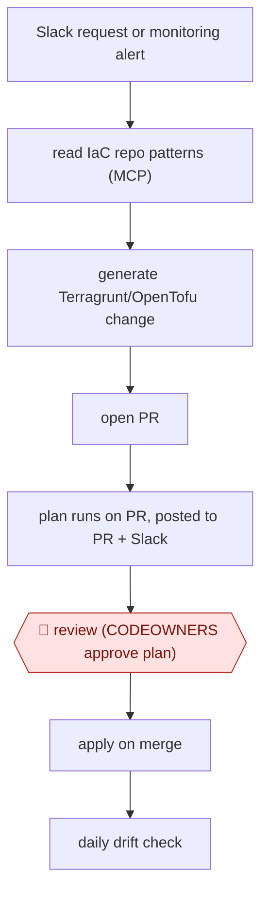

# Chat-to-IaC change

`TEC › ITS › INFRA` · checkpointed · evidence A · **draft: needs a reference example** ([how to add one](../../../../../CONTRIBUTING.md#1-add-an-example-run))

**Shape:** `Slack request or monitoring alert → read IaC repo patterns (MCP) → generate Terragrunt/OpenTofu change → open PR → plan runs on PR, posted to PR + Slack → 🛑 review (CODEOWNERS approve plan) → apply on merge → daily drift check`
**Variants:** `opentofu-terragrunt-mcp` · `terraform-atlantis` · `hcp-terraform`

<!-- shape diagram: generated by scripts/build_diagrams.py from `shape`; don't edit -->

<!-- end shape diagram -->

## Background

Infrastructure engineers configure the machines, networks and monitoring that applications rely on. A short request to add capacity can imply changes to running resources, so the team needs a record of exactly what will be created, modified or removed. This workflow lets an agent turn chat requests or monitoring alerts into proposed configuration changes. Reviewers inspect the planned effect before the delivery system applies it. The review remains human because a plausible code change can still destroy data or disrupt a service.

**Terms:**
- **IaC / HCL**: infrastructure as code, and the configuration language used to describe resources.
- **PR / diff / CI**: a proposed repository change, its changed lines, and automated checks run on changes.
- **Plan / apply / state**: previewing infrastructure changes, executing them, and the stored mapping between code and deployed resources.
- **Drift / CODEOWNERS**: differences between declared and running infrastructure, and the file identifying required code reviewers.
- **MCP / SSH**: an agent-tool connection protocol and a remote command connection.

## Build it with an agent

**Form:** `service`. Both chat and monitoring events can start unattended runs; people receive proposed changes for review.

**You need:** the infrastructure repository and resource examples; scoped code-host and chat MCP server (connector) tools; an existing plan/apply pipeline; protected branches and required reviewers. Plan credentials must be read-only; the drafting agent must have neither apply credentials nor merge permission. Redact secrets from plans before sharing them.

| Step | Built as |
|---|---|
| Slack request or monitoring alert → read repo patterns → generate change | The event receiver invokes `claude -p` (headless); a Skill reads repository examples and drafts matching configuration. |
| open PR → plan posted to PR + Slack | The Skill opens a PR through MCP server (connector) tools; the existing pipeline produces the plan and reports it. |
| 🛑 review → apply on merge | The agent stops at the PR. Required code-host review and protected merge rules gate the separate apply pipeline. |
| daily drift check | The existing scheduler runs the read-only plan command and posts differences; the Skill can prepare a follow-up review item. |

**Checkpoints:** `review`: required reviewers receive the diff, plan, original request and alert context. Code-host permissions prevent the agent from merging or bypassing required review; only the approved delivery pipeline can apply. Any material change to the reviewed revision requires a fresh plan and approval.

**Since the sources:** The source dates from 2026-06 and was opened in 2026-11. Searches for newer accounts and the named tools found no newer account as of 2026-11. A headless coding Skill can prepare the configuration without reproducing the source's bot internals. OpenTofu/Terragrunt, cloud providers and the plan/apply pipeline remain necessary; a general agent does not replace them. The source's useful distinction remains current: the agent proposes, the infrastructure plan exposes the effect, and required human review gates deployment.

*A design based on this entry's steps and the tool documentation as of 2026-11, not a reported run.*

## Steps

*As reported by the sources.*

1. A person starts the run with a plain-language request in Slack (e.g. 'add two instances for service A'), or a monitoring system sends an alert straight to the agent [[1]](#sources).
2. The agent reaches the OpenTofu repository through MCP, finds the existing code pattern for that kind of resource, and writes the Terragrunt change in the same style [[1]](#sources).
3. The agent opens a PR. On an alert, the PR records the reason, the alert and the plan output, so 'who added servers and why' has an answer [[1]](#sources).
4. CI runs `plan` automatically when the PR opens and comments the result on the PR. The result is also posted to Slack [[1]](#sources).
5. 🛑 **Review**: the required reviewers set in CODEOWNERS read the plan and the diff. Merging without review is technically blocked. The rule is the same whether a human or the agent wrote the change [[1]](#sources).
6. The delivery pipeline runs apply automatically on merge, so only approved changes reach infrastructure [[1]](#sources).
7. A daily drift check compares code with live infrastructure and alerts in Slack on console edits. Intentional exceptions go in `.driftignore` [[1]](#sources).

**Output:** A merged IaC PR with its plan output, applied to the cloud, with the request or alert attached as the change record.
**Failure modes → guards:** Reviewers approve a small-looking HCL diff that actually replaces or destroys resources → make the plan output the review artifact, posted on the PR. Console hotfixes drift from code → daily drift scan plus a rule that emergency edits are written back to code. Locked state → a force-unlock workflow in every project instead of SSH [[1]](#sources).

**How it differs:** AWF-0001 Plan-gated build and AWF-0003 Delegated PR produce application-code PRs gated on tests. Here the request comes from chat or an alert, the human checkpoint is the infrastructure plan (what will be created, changed or destroyed), and merging is itself the deploy.

## Public runs

Coverage as of 2026-11-06: **Partial**: first-hand runs that cover part of the shape or put checkpoints elsewhere. Collected and re-checked in [New workflows for empty categories](../../../../../research/2026-11-new-workflows.md).

- [LY Corporation, From IaC to AI: Adopting OpenTofu and ChatOps](https://techblog.lycorp.co.jp/en/techverse2026-86) (2026-06-22). Slack bot opens Terragrunt PRs, plan goes to Slack, human approves, apply runs on merge, across seven services. "about 1,500 resources" declared as code (no metric for the agent part itself). *First-hand: yes; confidence: med.*

## Sources

1. Chaeseung Lee, Eunhak Cho (LINE Plus SRE, LY Corporation), From infrastructure as code (IAC) to AI: Adopting OpenTofu and ChatOps, Tech-Verse 2026 (page lists 2026-06-22). https://techblog.lycorp.co.jp/en/techverse2026-86
