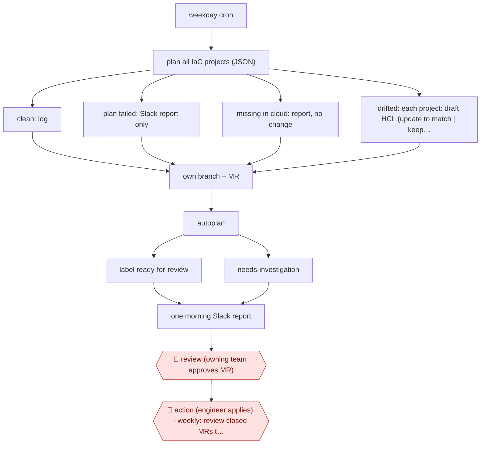

# Plan-verified drift fixes

`TEC › ITS › INFRA` · checkpointed · evidence A · **draft: needs a reference example** ([how to add one](../../../../../CONTRIBUTING.md#1-add-an-example-run))

**Shape:** `weekday cron → plan all IaC projects (JSON) → clean: log | plan failed: Slack report only | missing in cloud: report, no change | drifted: each project: draft HCL (update to match | keep + revert warning | import block) → own branch + MR → autoplan → label ready-for-review | needs-investigation → one morning Slack report → 🛑 review (owning team approves MR) → 🛑 action (engineer applies) · weekly: review closed MRs together`
**Variants:** `atlantis` · `terraform` · `gitlab` · `kubernetes-cronjob`

<!-- shape diagram: generated by scripts/build_diagrams.py from `shape`; don't edit -->

<!-- end shape diagram -->

## Background

Infrastructure code describes what a cloud environment should contain, but people and other systems can change the live environment outside that code. Engineers then have to decide whether to keep the live change, restore the code-defined value or bring an existing resource under management. This workflow drafts those decisions as separate repository changes and checks their planned effects. An agent can write the proposed configuration, while ordinary code controls the sequence and permissions. Engineers still review intent and perform the actual infrastructure change.

**Terms:**
- **Drift / IaC**: differences between running resources and infrastructure as code.
- **HCL / JSON**: the configuration language describing resources and a structured data format for plan output.
- **Plan / apply / import / state**: preview changes, execute them, register an existing resource, and record the mapping to live resources.
- **MR / autoplan**: merge request, and automatic planning of its proposed change.
- **CronJob / LLM / API**: a scheduled job, a large language model and a program interface.

## Build it with an agent

**Form:** `service`. A weekday schedule sweeps projects; humans receive per-project proposals and a consolidated report.

**You need:** existing read-only planning infrastructure; sanitised plans and complete module files; import-format references; per-project repository write scopes; a review queue and durable run records. Keep cloud secrets and unsanitised state out of model inputs. The model-facing process must have no apply or destroy path.

| Step | Built as |
|---|---|
| weekday cron → plan all projects → clean or failed or missing | The existing controller schedules and classifies plans in ordinary code; it invokes the Skill only for eligible drifted projects. |
| each drifted project: draft HCL | `claude -p` (headless) runs a Skill on the sanitised plan and module files. A Hook restricts writes to the assigned project and protects provider/backend configuration. |
| own branch + MR → autoplan → readiness label | The controller creates the MR and reads the infrastructure tool's plan result; the Skill prepares a short explanation and warnings. |
| morning report → 🛑 review → 🛑 action → weekly review | The controller links proposals in the review queue. Approval, apply and the review of closed MRs remain with the owning team. |

**Checkpoints:** `review`: engineers compare the configuration diff, regenerated plan, proposed remediation type and warnings. `action`: engineers apply through their own infrastructure tool; agent credentials cannot apply, destroy or approve MRs. A clean plan is evidence for review, not proof that the intended decision was correct.

**Since the sources:** The source dates from 2026-11 and was opened in 2026-11. Searches found [Atlantis's current FAQ](https://www.runatlantis.io/docs/faq), opened in 2026-11, documenting drift-detection APIs while leaving scheduling to an external system. Check the installed version before adopting those endpoints. The source deliberately replaced an open tool-calling loop with an ordinary code controller; the build retains that choice and uses a Skill only for configuration drafting. Current general agents do not justify returning control of commands, redaction or apply rights to the model.

*A design based on this entry's steps and the tool documentation as of 2026-11, not a reported run.*

## Steps

*As reported by the sources.*

1. A Kubernetes CronJob runs at 09:00 Pacific on weekdays with a one-hour deadline and one run at a time. A single request makes Atlantis plan all 187 projects in parallel and print `terraform show -json` [[1]](#sources).
2. The controller logs clean projects. Projects whose plan fails go to the Slack report and are never sent to the model. Resources that are missing from the cloud are reported without a proposed change, since the deletion may have been on purpose [[1]](#sources).
3. The controller gives each drifted project a prompt with the text plan, the drifted and changed resource lists, the sanitized JSON plan (each cut at 30,000 chars) and every .tf file in the module. The model returns only HCL plus a brief analysis and warnings. It updates the HCL when the cloud value looks deliberate, or keeps the code and warns that the next apply will revert. For objects in the cloud but not in state it writes an import block, guided by a table of import-ID formats. Replacements are flagged high risk [[1]](#sources).
4. The controller enforces safety controls in code, not the prompt: only init/plan/show/version can run, secret-like values are redacted, file writes stay inside the project, the plan role is read-only, and Atlantis applies only after an approved MR [[1]](#sources).
5. The controller gives each project its own branch and MR, showing the model ID and a prompt hash. Atlantis autoplan is the verifier, and the agent labels the MR ready-for-review or needs-investigation [[1]](#sources).
6. 🛑 **Review**: the owning team reviews the diff and the plan side by side, then approves, edits or closes [[1]](#sources).
7. 🛑 **Action**: an engineer applies via Atlantis. Approval and apply rights stay with people [[1]](#sources).
8. The controller sends one Slack report each morning linking the MRs. A count of drift MRs older than three days signals review lag. Closed MRs are reviewed together every week, and the prompt is versioned in the repo [[1]](#sources).

**Output:** Per-project drift-fix merge requests with a verifying plan, reviewed and applied by the owning team. Clean IaC state each morning.
**Failure modes → guards:** Wrong remediation type (27), misjudged intent (20) and wrong import ID format (18) → an import-format table cut ID errors from 13 to 5. Weak proposals that still pass a clean plan → 12 caught only by reviewers, so human review stays. Leaving out module .tf files degrades fixes → always include them. Redaction is the weakest control → review it whenever a new provider is added.

**How it differs:** AWF-0066 Chat-to-IaC change starts from a person's Slack request or an alert and produces one requested change, with drift only checked daily. Here a schedule triggers it, the input is detected drift across all projects, and the output is one MR per drifted project with a revert/update/import decision verified by re-planning. The trigger, deliverable and decision type differ.

## Public runs

Coverage as of 2026-11-13: **Strong**: a first-hand, detailed run that matches most of the shape. Collected and re-checked in [Third collection pass](../../../../../research/2026-11-third-pass.md).

- [Philo via DEVOPSdigest, Letting an LLM Draft Our Terraform Drift Fixes](https://devopsdigest.com/letting-llm-draft-our-terraform-drift-fixes-twelve-weeks-production) (2026-11-04). 12-week evaluation: 56 runs, 372 drift events, 351 MRs; engineer time per week dropped from 9.4h to 2.4h. "Of the 351 MRs, 73.5% were merged without semantic changes, 18.2% were merged after a reviewer edited them, and 8.3% were closed.". *First-hand: yes; confidence: high.*

## Sources

1. Nitish Mane (Philo), Letting an LLM Draft Our Terraform Drift Fixes: Twelve Weeks in Production, DEVOPSdigest, 2026-11-04. https://devopsdigest.com/letting-llm-draft-our-terraform-drift-fixes-twelve-weeks-production
