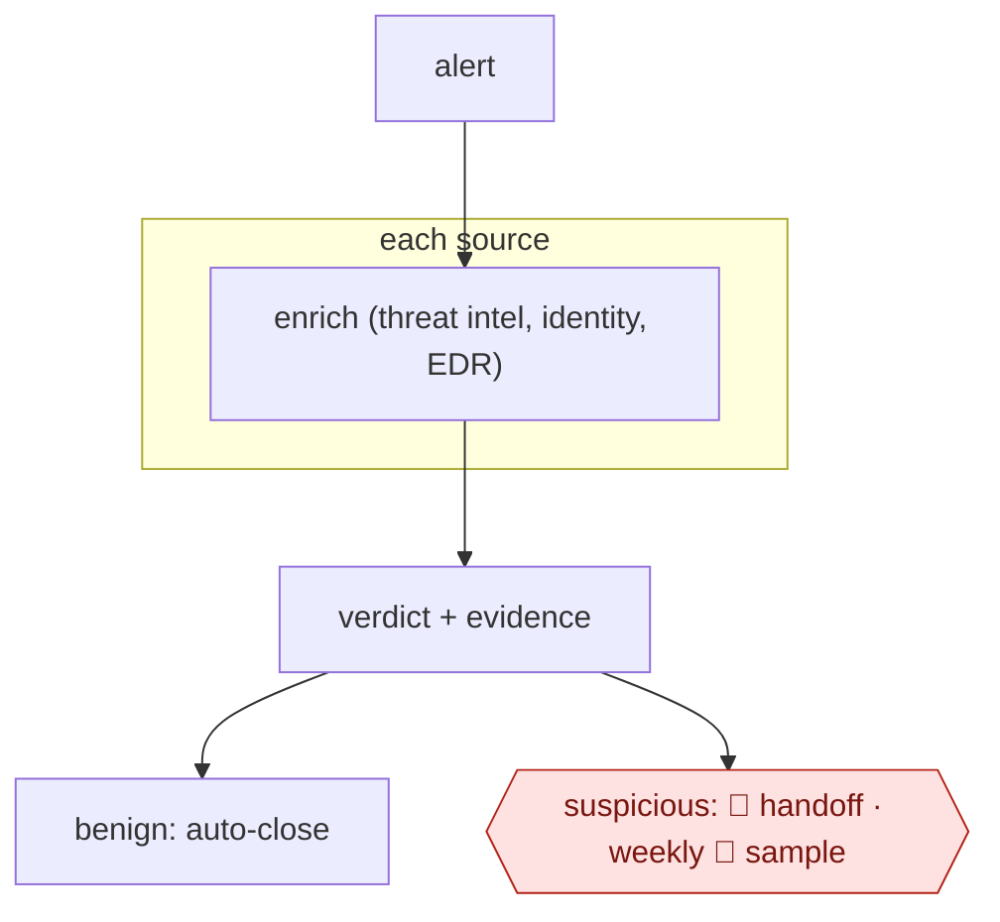

# Alert enrich and adjudicate

`TEC › ITS › SECOPS` · sampled · evidence B · **draft: needs a reference example** ([how to add one](../../../../../CONTRIBUTING.md#1-add-an-example-run))

**Shape:** `alert → each source: enrich (threat intel, identity, EDR) → verdict + evidence → benign: auto-close | suspicious: 🛑 handoff · weekly 🛑 sample`

<!-- shape diagram: generated by scripts/build_diagrams.py from `shape`; don't edit -->

<!-- end shape diagram -->

## Background

Security analysts investigate alerts raised by systems watching accounts, computers and network activity. An alert is a reason to look, rather than proof of an attack: the same action may be routine for one account and suspicious for another. Gathering that context means consulting several records before deciding what deserves attention. An agent can gather the records and prepare a reasoned verdict as alerts arrive. Analysts still investigate suspicious or uncertain cases and inspect a sample of closures, because an incorrect dismissal can hide an intrusion.

**Terms:**
- **Enrichment**: adding relevant facts to an alert, such as account history and whether an address is associated with attacks.
- **Threat intelligence**: information about malicious infrastructure, software and behavior.
- **Identity**: the user or service account associated with an action.
- **EDR**: endpoint detection and response, which records activity on computers and flags possible attacks.
- **Tier 2**: analysts who take over cases needing deeper investigation.
- **QA**: quality assurance, here checking whether alerts were closed correctly.

## Build it with an agent

**Form:** `service`. Alerts arrive without a person starting each investigation, and people see escalations and closure samples.

**You need:** an alert queue; approved read-only access to threat intelligence, account records and endpoint logs through MCP server (connector) tools; source-specific investigation playbooks; a case store and review queue. Keep security telemetry in the organisation's approved environment. Grant only the alert-disposition actions needed by the playbook, with no containment or account-change tools.

| Step | Built as |
|---|---|
| alert → each source: enrich | `claude -p` (headless) starts from the alert queue. A Skill normalizes the alert; Subagents use read-only MCP server (connector) tools to gather source-specific evidence. |
| verdict + evidence | The Skill writes a disposition, uncertainty and links to the retrieved records into the case store. |
| benign: auto-close | A Hook checks that the closure fits the approved policy and that required evidence is present before the disposition tool can close it. |
| suspicious: 🛑 handoff | The service posts the prepared case to the analyst queue and ends that item's run. |
| weekly 🛑 sample | A scheduled `claude -p` (headless) run copies the policy-defined closure sample to the review queue. |

**Checkpoints:** `handoff`: suspicious, uncertain or incomplete cases remain open in the analyst queue with the alert, lookups and rationale. The agent has no incident-response tools. `sample`: the service copies closures and their evidence into a weekly QA queue; analyst decisions feed back into the playbook and closure policy.

**Since the sources:** Public runs date from 2026-01 to 2026-07; there is no separate Sources list. All public-run pages were opened in 2026-11. Searches found [Elastic's current agent-builder guidance](https://www.elastic.co/docs/solutions/security/ai/agent-builder/skills-use-cases), opened in 2026-11, describing investigation with skills and tools. A headless agent with source-specific Skills and Subagents can carry the reasoning procedure; the alert queue, evidence store and closure controls remain infrastructure the operator must provide. The public runs support enrichment and dispositions, but do not establish the entry's weekly QA cadence as a reported practice; it is retained here as the catalog's guard.

*A design based on this entry's steps and the tool documentation as of 2026-11, not a reported run.*

## Steps

*As reported by the sources.*

1. The agent normalizes the alert.
2. The agent runs enrichment lookups in parallel.
3. The agent investigates the enriched alert using the analyst playbook.
4. The agent returns a verdict with confidence and evidence.
5. The system auto-closes benign alerts with the evidence attached.
6. 🛑 **Handoff**: send everything else to tier 2 as a prepared case.
7. 🛑 **Sample**: QA analysts inspect auto-closed alerts weekly.

**Metric:** analyst minutes per alert.

## Public runs

Coverage as of 2026-11-06: **Strong**: a first-hand, detailed run that matches most of the shape. From [Where are the real runs?](../../../../../research/2026-11-real-runs.md); every number was re-checked against its page.

- [Shapton, Hanify, Pezzino, Databricks](https://databricks.com/blog/scaling-security-alert-triage-specialized-agents-databricks) (2026-07-06). 17 per-source agents enrich → escalate / monitor / close; analysts decide escalations. "over 18,000 alerts with a 3.2% escalation rate"; "over 6,500 analyst hours in the first 30 days". *First-hand: yes; confidence: high.*
- [Aaron Jewitt, Elastic Security Labs](https://www.elastic.co/security-labs/alert-triage-agentic-soc-elastic-workflows) (2026-07-02). Deterministic checks → 20+ enrichment sources → triage and specialist agents → verdict. "30-minute manual alert triage into under 3 minutes". *First-hand: yes (own product); confidence: high.*
- [Mo & Stöckli, GitHub Security Lab](https://github.blog/security/ai-supported-vulnerability-triage-with-the-github-security-lab-taskflow-agent/) (2026-01-20). Facts → false-positive audit → validated report → labelled issue. "~30 real world vulnerabilities". *First-hand: yes; confidence: med.*

