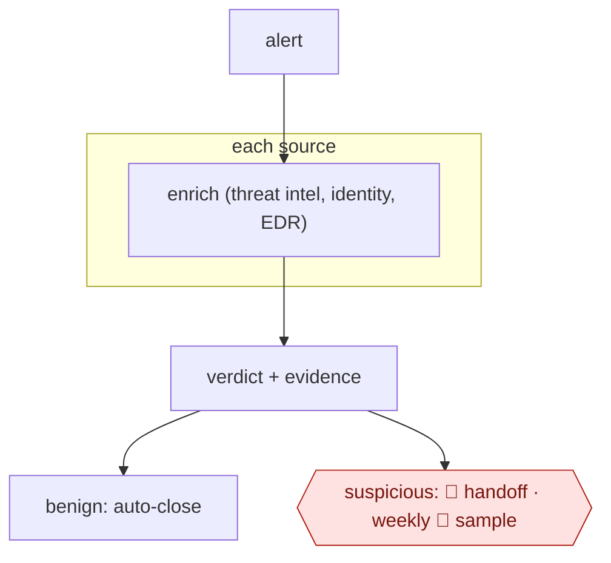

# Alert enrich and adjudicate

`TEC › ITS › SECOPS` · sampled · evidence B · **draft: needs a reference example** ([how to add one](../../../../../CONTRIBUTING.md#1-add-an-example-run))

**Shape:** `alert → each source: enrich (threat intel, identity, EDR) → verdict + evidence → benign: auto-close | suspicious: 🛑 handoff · weekly 🛑 sample`

<!-- shape diagram: generated by scripts/build_diagrams.py from `shape`; don't edit -->

<!-- end shape diagram -->

## Steps
1. Normalize the alert.
2. Run enrichment lookups in parallel.
3. Investigate as an analyst would.
4. Return a verdict with confidence and evidence.
5. Auto-close benign alerts with the evidence attached.
6. 🛑 **Handoff**: send everything else to tier 2 as a prepared case.
7. 🛑 **Sample**: QA auto-closed alerts weekly.

**Metric:** analyst minutes per alert.

## Public runs

Coverage as of 2026-11-06: **Strong**: a first-hand, detailed run that matches most of the shape. From [Where are the real runs?](../../../../../research/2026-11-real-runs.md); every number was re-checked against its page.

- [Shapton, Hanify, Pezzino, Databricks](https://databricks.com/blog/scaling-security-alert-triage-specialized-agents-databricks) (2026-07-06). 17 per-source agents enrich → escalate / monitor / close; analysts decide escalations. "over 18,000 alerts with a 3.2% escalation rate"; "over 6,500 analyst hours in the first 30 days". *First-hand: yes; confidence: high.*
- [Aaron Jewitt, Elastic Security Labs](https://www.elastic.co/security-labs/alert-triage-agentic-soc-elastic-workflows) (2026-07-02). Deterministic checks → 20+ enrichment sources → triage and specialist agents → verdict. "30-minute manual alert triage into under 3 minutes". *First-hand: yes (own product); confidence: high.*
- [Mo & Stöckli, GitHub Security Lab](https://github.blog/security/ai-supported-vulnerability-triage-with-the-github-security-lab-taskflow-agent/) (2026-01-20). Facts → false-positive audit → validated report → labelled issue. "~30 real world vulnerabilities". *First-hand: yes; confidence: med.*

