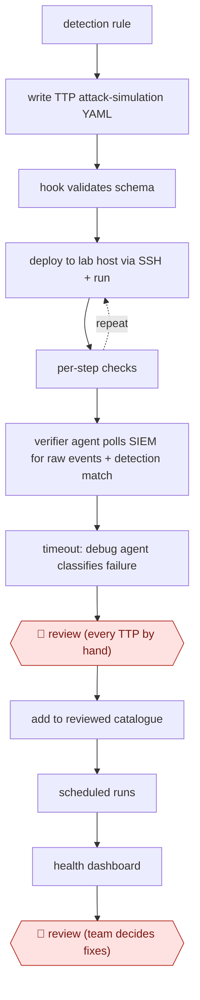

# Detonate-and-confirm detections

`TEC › ITS › SECOPS` · checkpointed · evidence A · **draft: needs a reference example** ([how to add one](../../../../../CONTRIBUTING.md#1-add-an-example-run))

**Shape:** `detection rule → write TTP attack-simulation YAML → hook validates schema → (deploy to lab host via SSH + run ⟲ per-step checks) → verifier agent polls SIEM for raw events + detection match → timeout: debug agent classifies failure → 🛑 review (every TTP by hand) → add to reviewed catalogue → scheduled runs → health dashboard → 🛑 review (team decides fixes)`
**Variants:** `claude-code` · `codex` · `ttpforge` · `splunk`

<!-- shape diagram: generated by scripts/build_diagrams.py from `shape`; don't edit -->

<!-- end shape diagram -->

## Background

Detection engineers need to know whether a security rule will notice the behavior it was written to catch. A rule can look correct while a computer fails to send the relevant event, the event arrives late, or a query checks the wrong field. This workflow writes a controlled simulation, runs it in an isolated lab and follows the resulting records through the detection system. An agent can draft, test and diagnose the simulation. People still review each simulation before routine replay and decide how to fix detection gaps, because an apparently successful test may not exercise the intended behavior.

**Terms:**
- **Detection rule**: a query or condition that turns recorded activity into an alert.
- **TTP**: tactic, technique and procedure; here a repeatable attack-behavior simulation.
- **YAML / schema**: a structured text file and the rules defining its valid fields.
- **SSH**: an authenticated remote command connection.
- **SIEM**: the system that collects security events and runs detection queries.
- **Telemetry / ingestion**: recorded activity and its arrival in the central system.
- **SPL**: Splunk's query language.
- **Golden image / forwarder**: a standard machine installation and the component sending its logs onward.
- **Devcontainer / egress rules**: an isolated development environment and limits on outgoing connections.

## Build it with an agent

**Form:** `service`. Authoring uses an interactive `project`, but the complete workflow also replays the reviewed catalogue unattended on a schedule.

**You need:** detection rules and field documentation; an explicitly authorised, isolated lab; the simulation runner, validator and cleanup scripts; read-only access to detection results; a reviewed catalogue and dashboard store. Limit remote-execution credentials to the lab and keep production credentials out of the agent's environment.

| Step | Built as |
|---|---|
| detection rule → write TTP attack-simulation YAML → hook validates schema | A Skill drafts the simulation and checks. A Hook runs the schema validator after edits; a PreToolUse Hook blocks lab execution unless validation passed. |
| deploy to lab host via SSH + run ⟲ per-step checks | The Skill invokes lab-only scripts and reads their check results; a Permission rule or mode denies production hosts and configuration changes outside scope. |
| verifier polls SIEM → timeout: debug classifies failure | A read-only Subagent uses MCP server (connector) queries; the Skill bounds polling and sends failures to a diagnose-only Subagent. |
| 🛑 review → add to reviewed catalogue | The Skill presents behavior, checks, cleanup and detection evidence. The agent cannot promote unreviewed files into the catalogue. |
| scheduled runs → health dashboard → 🛑 review | `claude -p` (headless), started by the existing scheduler, invokes approved simulations and records outcomes; people decide repairs. |

**Checkpoints:** `review`: the authoring run stops with the simulation and evidence package; a person promotes approved files using credentials withheld from the agent. Scheduled runs execute only this reviewed catalogue. The dashboard presents execution failures separately from missing telemetry and missing rule matches; the agent has no tools to change production detections or the logging pipeline.

**Since the sources:** The source dates from 2026-06 and was opened in 2026-11. Searches for newer accounts and the named tools found no newer account as of 2026-11. The source already uses Skills, Hooks and verifier agents, so these are retained rather than replaced by a different orchestration scheme. The scheduled replay remains separate from interactive authoring. A post-write Hook reports invalid YAML after the edit; the additional pre-execution guard in this design prevents invalid content from reaching the lab.

*A design based on this entry's steps and the tool documentation as of 2026-11, not a reported run.*

## Steps

*As reported by the sources.*

1. The detection engineer gives the agent a custom detection rule. A Claude Code plugin (skills, hooks, references) has it write a TTPForge attack-simulation YAML with checks and cleanup. [[1]](#sources)
2. A PostToolUse hook runs `ttpforge validate` on every write and blocks progress until the YAML is valid. [[1]](#sources)
3. The agent copies the TTP to an isolated lab host built from production golden images and runs it over SSH. When a per-step check fails, it rewrites and reruns. [[1]](#sources)
4. A background verifier agent polls Splunk every 2 minutes, with a 10-minute timeout. Success requires both the raw telemetry and a match from the detection's SPL. [[1]](#sources)
5. On timeout, a diagnose-only debug agent classifies the failure: silent host, missing event category, late ingestion, or a rule predicate that rejected the event. [[1]](#sources)
6. 🛑 **Review**: a human reviews every TTP by hand against a checklist before it enters the reviewed catalogue. [[1]](#sources)
7. A scheduled GitHub Actions run replays the catalogue and feeds a pipeline-health dashboard. 🛑 **Review**: humans decide what to change in detections or the pipeline. [[1]](#sources)

**Output:** A reviewed, rerunnable catalogue of attack simulations tied to detections, a scheduled health dashboard, and a list of detection and pipeline defects to fix.
**Failure modes → guards:** Agent goes out of scope during unattended runs (it edited a lab forwarder config) → devcontainer plus egress rules, interactive sessions for risky work. Weak checks let a TTP 'pass' without proving the technique → reject-shortcut rules in the skill plus human TTP review. Ingestion lag read as a miss → bounded polling plus the debug classifier.

**How it differs:** AWF-0005 Alert enrich and adjudicate: AWF-0005 rules on live alerts (auto-close or hand off) and audits weekly samples. This workflow tests the detections themselves by detonating attacks in a lab. Its deliverable is a validated simulation catalogue and defect list, and every artifact is human-reviewed before it runs on a schedule.

## Public runs

Coverage as of 2026-11-06: **Partial**: first-hand runs that cover part of the shape or put checkpoints elsewhere. Collected and re-checked in [Second collection pass](../../../../../research/2026-11-second-pass.md).

- [DNB CDC, End-to-end detection validation using coding agents](https://blog.cauchy.org/blog/detection-validation/) (2026-06-16). Netsh helper DLL persistence (T1546.007) confirmed end to end in the lab. "the detection matched on five events" after "about a three-minute ingestion lag" (the post says some numbers were redacted or changed). *First-hand: yes; confidence: med.*

## Sources

1. Kyrre Wahl Kongsgård (DNB Cyber Defense Center), End-to-end detection validation using coding agents, 2026-06-16. https://blog.cauchy.org/blog/detection-validation/
