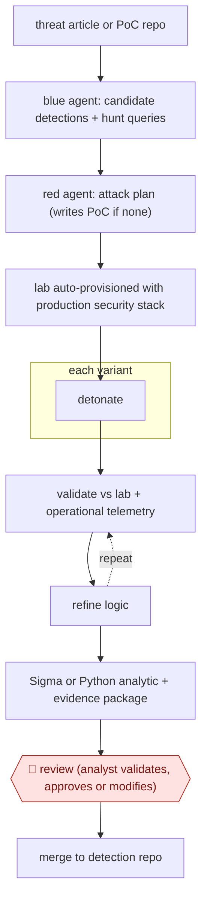

# Purple-team detection build

`TEC › ITS › SECOPS` · checkpointed · evidence A · **draft: needs a reference example** ([how to add one](../../../../../CONTRIBUTING.md#1-add-an-example-run))

**Shape:** `threat article or PoC repo → blue agent: candidate detections + hunt queries → red agent: attack plan (writes PoC if none) → lab auto-provisioned with production security stack → each variant: detonate → (validate vs lab + operational telemetry ⟲ refine logic) → Sigma or Python analytic + evidence package → 🛑 review (analyst validates, approves or modifies) → merge to detection repo`
**How it differs:** AWF-0128 Detonate-and-confirm detections starts from an existing rule and validates it with attack simulations and scheduled health runs. Here the input is threat intelligence and the deliverable is new detection logic built by a blue/red agent loop, with one analyst approval at the end. AWF-0005 triages alerts and creates no rules.
**Variants:** `claude-opus` · `claude-mythos` · `sigma` · `proxmox` · `ansible`

<!-- shape diagram: generated by scripts/build_diagrams.py from `shape`; don't edit -->

<!-- end shape diagram -->

## Steps
1. Ingest a threat source: an article, blog, incident report, analyst description or PoC repository [[1]](#sources).
2. Blue-team agent: propose one or more candidate detections, each with a plain-language description of the logic and a hunt query [[1]](#sources).
3. Red-team agent: write an attack plan covering the infrastructure, software and PoCs to detonate. If no public PoC exists, it tries to create one [[1]](#sources).
4. The lab is provisioned automatically from the plan (e.g. Proxmox range plus Ansible) and instrumented with the same security stack as production. Several environment variants may be created [[1]](#sources).
5. Execute the attack with multiple variants of the technique. Validate the detection logic against lab simulations and real operational data, repeating until the activity is reliably detected and false positives are minimized [[1]](#sources).
6. Convert the result to Sigma (simple cases) or Python analytics (complex cases) with filters, tuning logic and docs, packaged with the supporting evidence and validation results [[1]](#sources).
7. 🛑 **Review**: analysts validate, approve or modify the detections before they are merged into the repository [[1]](#sources).

**Output:** Production-ready detection rules with validation evidence, merged into the detection repo after analyst approval.
**Failure modes → guards:** Detections that only catch the exact PoC → more than 5 technique variants per rule, including in-process evasions, to find durable behavior indicators. False-positive floods → validation against real operational telemetry before review. The AI acting on its own → analysts keep operational decisions.

## Public runs

Coverage as of 2026-11-13: **Strong**: a first-hand, detailed run that matches most of the shape. Collected and re-checked in [Third collection pass](../../../../../research/2026-11-third-pass.md).

- [Canadian Centre for Cyber Security, used frontier AI to accelerate detection engineering](https://www.cyber.gc.ca/en/guidance/canadian-centre-cyber-security-used-frontier-ai-accelerate-detection-engineering) (n.d., 2026). Exploitarium PoC test case run through blue/red agent loop to analyst-reviewed rules. "In total, 8 new production detection rules were created from the above test case, with more than 5 variants of each technique tested". *First-hand: yes; confidence: high.*

## Sources

1. Communications Security Establishment Canada / Canadian Centre for Cyber Security, How the Canadian Centre for Cyber Security used frontier AI to accelerate detection engineering, n.d. (accessed 2026-11-13). https://www.cyber.gc.ca/en/guidance/canadian-centre-cyber-security-used-frontier-ai-accelerate-detection-engineering
