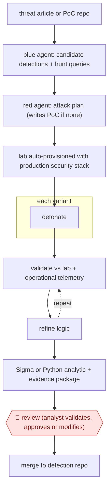

# Purple-team detection build

`TEC › ITS › SECOPS` · checkpointed · evidence A · **draft: needs a reference example** ([how to add one](../../../../../CONTRIBUTING.md#1-add-an-example-run))

**Shape:** `threat article or PoC repo → blue agent: candidate detections + hunt queries → red agent: attack plan (writes PoC if none) → lab auto-provisioned with production security stack → each variant: detonate → (validate vs lab + operational telemetry ⟲ refine logic) → Sigma or Python analytic + evidence package → 🛑 review (analyst validates, approves or modifies) → merge to detection repo`
**Variants:** `claude-opus` · `claude-mythos` · `sigma` · `proxmox` · `ansible`

<!-- shape diagram: generated by scripts/build_diagrams.py from `shape`; don't edit -->

<!-- end shape diagram -->

## Background

Detection engineers turn reports about attacks into rules that can identify similar activity in their own organisation. Copying an attack's visible details is not enough: a different file name or execution path may evade the rule, while ordinary work may trigger it. This workflow pairs a defender drafting a rule with an adversarial tester looking for gaps, then checks the results against lab and operational records. An agent can coordinate these roles and assemble the evidence. An analyst still decides whether the rule is suitable for production and owns the operational consequences.

**Terms:**
- **Blue / red / purple team**: defenders, authorised adversarial testers, and their collaborative testing loop.
- **PoC**: proof of concept, a demonstration of an attack or vulnerability.
- **Hunt query / telemetry**: a search for suspicious activity and the activity records searched.
- **Detonate**: execute an attack simulation inside an authorised lab.
- **False positive**: ordinary activity wrongly identified as suspicious.
- **Sigma / Python analytic**: a portable detection-rule format and detection logic written as a program.
- **Security stack**: the collection of monitoring and protection systems deployed on a machine.

## Build it with an agent

**Form:** `project`. Separate defender and adversarial contexts, standing lab knowledge and enforced execution boundaries require more than a procedure in one conversation.

**You need:** the threat report or repository; authorised lab provisioning and cleanup scripts; detection formats and field documentation; read-only operational telemetry through an approved MCP server (connector); a detection repository. Sensitive client telemetry must stay within the approved environment. Give the agent lab-only execution credentials and no production merge or deployment tool.

| Step | Built as |
|---|---|
| threat article or PoC repo → blue agent: candidate detections + hunt queries | A Skill loads the evidence; a defender Subagent drafts detection candidates and their expected signals. |
| red agent: attack plan → lab auto-provisioned → each variant: detonate | An adversarial Subagent proposes variants. A Permission rule or mode and a PreToolUse Hook require approval of the lab target and execution plan before provisioning or execution. |
| validate vs lab + operational telemetry ⟲ refine logic | Read-only MCP server (connector) queries return events and rule matches to the defender; the Skill retains each variant and result between iterations. |
| Sigma or Python analytic + evidence package | The Skill writes the rule, test records, exclusions and remaining gaps into reviewable files. |
| 🛑 review → merge to detection repo | The Skill ends with the rule and evidence; the analyst makes the final repository change. |

**Checkpoints:** `review`: the analyst receives the rule, tested variants, operational matches, exclusions and unresolved gaps. Repository permissions withhold merge and deployment. In addition, lab execution requires explicit plan approval through a Permission rule or mode; production hosts are excluded from the execution tool. This additional execution guard follows the source's own per-detonation approval example.

**Since the sources:** The source is undated, with a 2026-08 page-modification date, and was opened in 2026-11. Searches for newer accounts and the named tools found no newer account as of 2026-11. Its specialised Skills and separate defender/tester roles map directly to a project with Subagents; the lab and operational telemetry cannot be replaced by conversation alone. The source's orchestration table also reports user approval before each lab detonation, a guard omitted from this entry's shape and retained explicitly in this proposed build.

*A design based on this entry's steps and the tool documentation as of 2026-11, not a reported run.*

## Steps

*As reported by the sources.*

1. The agent ingests a threat source: an article, blog, incident report, analyst description or PoC repository [[1]](#sources).
2. The blue-team agent proposes one or more candidate detections, each with a plain-language description of the logic and a hunt query [[1]](#sources).
3. The red-team agent writes an attack plan covering the infrastructure, software and PoCs to detonate. If no public PoC exists, it tries to create one [[1]](#sources).
4. The lab is provisioned automatically from the plan (e.g. Proxmox range plus Ansible) and instrumented with the same security stack as production. Several environment variants may be created [[1]](#sources).
5. The red-team agent executes the attack with multiple variants of the technique. The blue-team agent validates the detection logic against lab simulations and real operational data, repeating until the activity is reliably detected and false positives are minimized [[1]](#sources).
6. The blue-team agent converts the result to Sigma (simple cases) or Python analytics (complex cases) with filters, tuning logic and docs, packaged with the supporting evidence and validation results [[1]](#sources).
7. 🛑 **Review**: analysts validate, approve or modify the detections before they are merged into the repository [[1]](#sources).

**Output:** Production-ready detection rules with validation evidence, merged into the detection repo after analyst approval.
**Failure modes → guards:** Detections that only catch the exact PoC → more than 5 technique variants per rule, including in-process evasions, to find durable behavior indicators. False-positive floods → validation against real operational telemetry before review. The AI acting on its own → analysts keep operational decisions.

**How it differs:** AWF-0128 Detonate-and-confirm detections starts from an existing rule and validates it with attack simulations and scheduled health runs. Here the input is threat intelligence and the deliverable is new detection logic built by a blue/red agent loop, with one analyst approval at the end. AWF-0005 triages alerts and creates no rules.

## Public runs

Coverage as of 2026-11-13: **Strong**: a first-hand, detailed run that matches most of the shape. Collected and re-checked in [Third collection pass](../../../../../research/2026-11-third-pass.md).

- [Canadian Centre for Cyber Security, used frontier AI to accelerate detection engineering](https://www.cyber.gc.ca/en/guidance/canadian-centre-cyber-security-used-frontier-ai-accelerate-detection-engineering) (n.d., 2026). Exploitarium PoC test case run through blue/red agent loop to analyst-reviewed rules. "In total, 8 new production detection rules were created from the above test case, with more than 5 variants of each technique tested". *First-hand: yes; confidence: high.*

## Sources

1. Communications Security Establishment Canada / Canadian Centre for Cyber Security, How the Canadian Centre for Cyber Security used frontier AI to accelerate detection engineering, n.d. (accessed 2026-11-13). https://www.cyber.gc.ca/en/guidance/canadian-centre-cyber-security-used-frontier-ai-accelerate-detection-engineering
