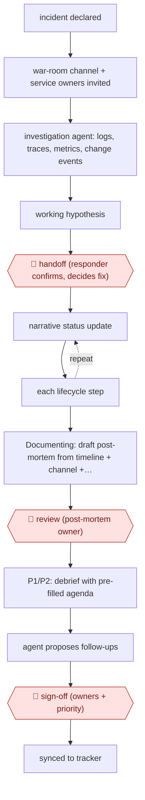

# Agent-run war room

`TEC › ITS › SRE` · checkpointed · evidence A · **draft: needs a reference example** ([how to add one](../../../../../CONTRIBUTING.md#1-add-an-example-run))

**Shape:** `incident declared → war-room channel + service owners invited → investigation agent: logs, traces, metrics, change events → working hypothesis → 🛑 handoff (responder confirms, decides fix) → (narrative status update ⟲ each lifecycle step) → Documenting: draft post-mortem from timeline + channel + telemetry → 🛑 review (post-mortem owner) → P1/P2: debrief with pre-filled agenda → agent proposes follow-ups → 🛑 sign-off (owners + priority) → synced to tracker`
**How it differs:** AWF-0004 Triage then remediate has the agent execute runbook steps behind an action gate and update runbooks. Here the agent never acts on production. Its deliverables are the war-room context, status updates, the post-mortem draft and tracked follow-ups, and the checkpoints are handoff, post-mortem-owner review and debrief. AWF-0127 is a NOC ticket-annotation flow.
**Variants:** `incident-io` · `datadog` · `slack` · `linear`

<!-- shape diagram: generated by scripts/build_diagrams.py from `shape`; don't edit -->

<!-- end shape diagram -->

## Steps
1. An incident is declared by a human or from an alert. The incident tool provisions a dedicated Slack war room and invites people based on the affected service [[1]](#sources).
2. An investigation agent starts at once. It queries production logs, APM traces, infrastructure and APM metrics, and change events filtered by component and PR, then correlates them into a working hypothesis before the first human joins [[1]](#sources).
3. 🛑 **Handoff**: the responder's job is to confirm the hypothesis and decide what to do. Humans make the judgment calls for P1 and P2 [[1]](#sources).
4. Through Triage → Investigating → Fixing → Monitoring → Closed, the agent posts narrative status updates (what is known, what changed, what is being done) so latecomers can catch up [[1]](#sources).
5. At Documenting, the agent drafts a structured post-mortem from the status timeline, war-room messages, the telemetry it queried, and the root-cause and resolution steps. 🛑 **Review**: the post-mortem owner, a role assigned during response, reviews it instead of writing it [[1]](#sources).
6. For every P1 and significant P2, a debrief is scheduled with the participants, and the agenda is pre-filled from the draft [[1]](#sources).
7. The agent proposes specific follow-ups (e.g. pre-deploy validation, a new monitor, SLO or critical-user-journey gaps). 🛑 **Sign-off**: each follow-up is given an owner and a priority, then it becomes first-class objects with an owner, a priority and a link back, synced to Linear and routed to the owning team [[1]](#sources).

**Output:** A reviewed post-mortem, a debrief, and owned follow-up tickets in the team's tracker. During the incident it also produces status updates and an early hypothesis.
**Failure modes → guards:** Follow-ups forgotten in a wiki → they are synced into the tracker teams already use. Stale pager lists → team-owned escalation paths in Terraform. Overreach → no autonomous fixes for P1/P2. Autonomous P3 triage is only planned.

## Public runs

Coverage as of 2026-11-13: **Partial**: first-hand runs that cover part of the shape or put checkpoints elsewhere. Collected and re-checked in [Third collection pass](../../../../../research/2026-11-third-pass.md).

- [Rohlik Group, How AI Runs Our War Rooms](https://blog.rohlik.group/blog/agentic-incident-management) (2026-04-23). Agent investigates on incident creation and drafts post-mortems that owners review. "The output is a draft post-mortem that's 80% complete before the PostMortem Owner even opens it.". *First-hand: yes; confidence: med.*

## Sources

1. Jan Bubik (Rohlik Group), How AI Runs Our War Rooms, 2026-04-23. https://blog.rohlik.group/blog/agentic-incident-management
