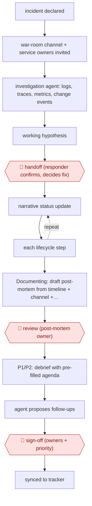

# Agent-run war room

`TEC › ITS › SRE` · checkpointed · evidence A · **draft: needs a reference example** ([how to add one](../../../../../CONTRIBUTING.md#1-add-an-example-run))

**Shape:** `incident declared → war-room channel + service owners invited → investigation agent: logs, traces, metrics, change events → working hypothesis → 🛑 handoff (responder confirms, decides fix) → (narrative status update ⟲ each lifecycle step) → Documenting: draft post-mortem from timeline + channel + telemetry → 🛑 review (post-mortem owner) → P1/P2: debrief with pre-filled agenda → agent proposes follow-ups → 🛑 sign-off (owners + priority) → synced to tracker`
**Variants:** `incident-io` · `datadog` · `slack` · `linear`

<!-- shape diagram: generated by scripts/build_diagrams.py from `shape`; don't edit -->

<!-- end shape diagram -->

## Background

When a company's online service breaks badly enough to hurt customers, it declares an incident, and the people who run the service (site reliability engineers, SREs, and the owners of the affected services) gather in a shared chat channel called a war room. Someone has to find what changed, decide on a fix, keep everyone informed, and afterwards write a post-mortem: a record of what happened, why, and what to change. By hand, the first twenty minutes go on the same lookups in logs, deployment history and dashboards, and the post-mortem and its follow-up tasks are often skipped or forgotten. Here an agent does the lookups, narrates status updates, drafts the post-mortem and proposes follow-ups. A person still has to confirm the cause and choose the fix, review the post-mortem, and give each follow-up an owner and a priority, because the agent cannot be held accountable for changes to a live service.

**Terms:**
- **Incident**: an unplanned breakdown or slowdown of a service. P1 is the most severe (full outage, very high customer impact), P2 is high, P3 is medium.
- **War room**: the dedicated chat channel opened for one incident.
- **Telemetry**: the data a running system emits: logs (event records), traces (the path of one request through services) and metrics (counts and gauges over time). APM (application performance monitoring) is the tool that collects traces and metrics.
- **Change events**: records of code deployments and configuration changes.
- **Post-mortem**: the written review of an incident. The **PostMortem Owner** is the role assigned during the response to review it.
- **Debrief**: a meeting after P1 and significant P2 incidents to go through the post-mortem.
- **Follow-up**: a task that comes out of the post-mortem to prevent a repeat.
- **SLO (service level objective)**: a target for how reliable a service should be. **CUJ (critical user journey)**: a path through the product that users depend on.
- **PR (pull request)**: a proposed code change, published for review.

## Build it with an agent

**Form:** `service`. An incident declaration starts the work with nobody at a keyboard, and responders meet the agent's output as channel messages, a draft and tickets, so it runs as a headless job.

**You need:** a way to start a run when an incident is declared: a webhook from the incident tool to a small receiver that starts `claude -p` or an Agent SDK program; read-only access to logs, traces, metrics and change events through the observability tool's MCP server or API; permission to post in the war-room channel and to create draft documents and tickets, and no tool that changes production; a store for the incident timeline, which is the war-room messages and status updates.

| Step | Built as |
|---|---|
| incident declared → war-room channel + service owners invited | The incident tool does this itself. Its declaration event starts the headless run. |
| investigation agent: logs, traces, metrics, change events → working hypothesis | A skill that lists the queries to run for the affected service (recent deployments, error rates, traces, database metrics). Built-in subagents can each take one source and return a summary. The run posts a hypothesis to the channel. |
| 🛑 handoff | See Checkpoints. |
| (narrative status update ⟲ each lifecycle step) | Each status change in the incident tool starts a short run that reads the timeline and posts what is known, what changed and what is being done. |
| Documenting: draft post-mortem from timeline + channel + telemetry | A skill with the post-mortem template; the run reads the timeline, channel messages and the earlier queries and writes a draft document. |
| 🛑 review | See Checkpoints. |
| P1/P2: debrief with pre-filled agenda | The skill writes an agenda from the draft; a person schedules the meeting. |
| agent proposes follow-ups | The same skill lists specific follow-ups, each tied to a cause in the draft. |
| 🛑 sign-off → synced to tracker | See Checkpoints. |

**Checkpoints:** `handoff`: after posting the hypothesis the run stops and says what it found and what it could not establish; the responder decides the fix. The agent has read-only credentials and no tool to deploy, roll back or restart anything, so P1 and P2 fixes stay with people. `review`: the post-mortem is saved as a draft that only the PostMortem Owner can publish. `sign-off`: the agent creates follow-ups only as proposals, with no assignee; the tracker connector can create a ticket only after the owner and priority are filled in by a person.

**Since the sources:** The one source and public run date from 2026-04. It was opened in 2026-11 and supports the steps cited to it. It describes a company's system built on an incident-management product, a monitoring product and a ticket tool, and does not say how its agent is implemented, so the build above is a design, not a reproduction. Searches in 2026-11 found vendor accounts of the same practice, all self-reported: incident.io describes an AI that drafts a post-mortem from the captured timeline once an incident resolves ([AI SRE explained](https://incident.io/blog/what-is-ai-sre-complete-guide-2026), 2026-02, updated 2026-08), and Datadog announced a new Bits Investigation agent in 2026-03 with triage and remediation capabilities ([Meet the new Bits Investigation](https://www.datadoghq.com/blog/bits-ai-sre-deeper-reasoning)). The vendors' remediation features are outside this entry, which keeps fixes with people. The tools in `variants` still exist under those names. This build leaves out the incident tool's built-in investigation and drafting features, which the vendors now sell, and uses a general agent over their data instead.

*A design based on this entry's steps and the tool documentation as of 2026-11, not a reported run.*

## Steps

*As reported by the sources.*
1. An incident is declared by a human or from an alert. The incident tool provisions a dedicated Slack war room and invites people based on the affected service [[1]](#sources).
2. An investigation agent starts at once. It queries production logs, APM traces, infrastructure and APM metrics, and change events filtered by component and PR, then correlates them into a working hypothesis before the first human joins [[1]](#sources).
3. 🛑 **Handoff**: the responder's job is to confirm the hypothesis and decide what to do. Humans make the judgment calls for P1 and P2 [[1]](#sources).
4. Through Triage → Investigating → Fixing → Monitoring → Closed, the agent posts narrative status updates (what is known, what changed, what is being done) so latecomers can catch up [[1]](#sources).
5. At Documenting, the agent drafts a structured post-mortem from the status timeline, war-room messages, the telemetry it queried, and the root-cause and resolution steps. 🛑 **Review**: the post-mortem owner, a role assigned during response, reviews it instead of writing it [[1]](#sources).
6. For every P1 and significant P2, a debrief is scheduled with the participants, and the agenda is pre-filled from the draft [[1]](#sources).
7. The agent proposes specific follow-ups (e.g. pre-deploy validation, a new monitor, SLO or critical-user-journey gaps). 🛑 **Sign-off**: each follow-up is given an owner and a priority, then it becomes first-class objects with an owner, a priority and a link back, synced to Linear and routed to the owning team [[1]](#sources).

**Output:** A reviewed post-mortem, a debrief, and owned follow-up tickets in the team's tracker. During the incident it also produces status updates and an early hypothesis.
**Failure modes → guards:** Follow-ups forgotten in a wiki → they are synced into the tracker teams already use. Stale pager lists → team-owned escalation paths in Terraform. Overreach → no autonomous fixes for P1/P2. Autonomous P3 triage is only planned.
**How it differs:** AWF-0004 Triage then remediate has the agent execute runbook steps behind an action gate and update runbooks. Here the agent never acts on production. Its deliverables are the war-room context, status updates, the post-mortem draft and tracked follow-ups, and the checkpoints are handoff, post-mortem-owner review and debrief. AWF-0127 is a NOC ticket-annotation flow.

## Public runs

Coverage as of 2026-11-13: **Partial**: first-hand runs that cover part of the shape or put checkpoints elsewhere. Collected and re-checked in [Third collection pass](../../../../../research/2026-11-third-pass.md).

- [Rohlik Group, How AI Runs Our War Rooms](https://blog.rohlik.group/blog/agentic-incident-management) (2026-04-23). Agent investigates on incident creation and drafts post-mortems that owners review. "The output is a draft post-mortem that's 80% complete before the PostMortem Owner even opens it.". *First-hand: yes; confidence: med.*

## Sources

1. Jan Bubik (Rohlik Group), How AI Runs Our War Rooms, 2026-04-23. https://blog.rohlik.group/blog/agentic-incident-management
