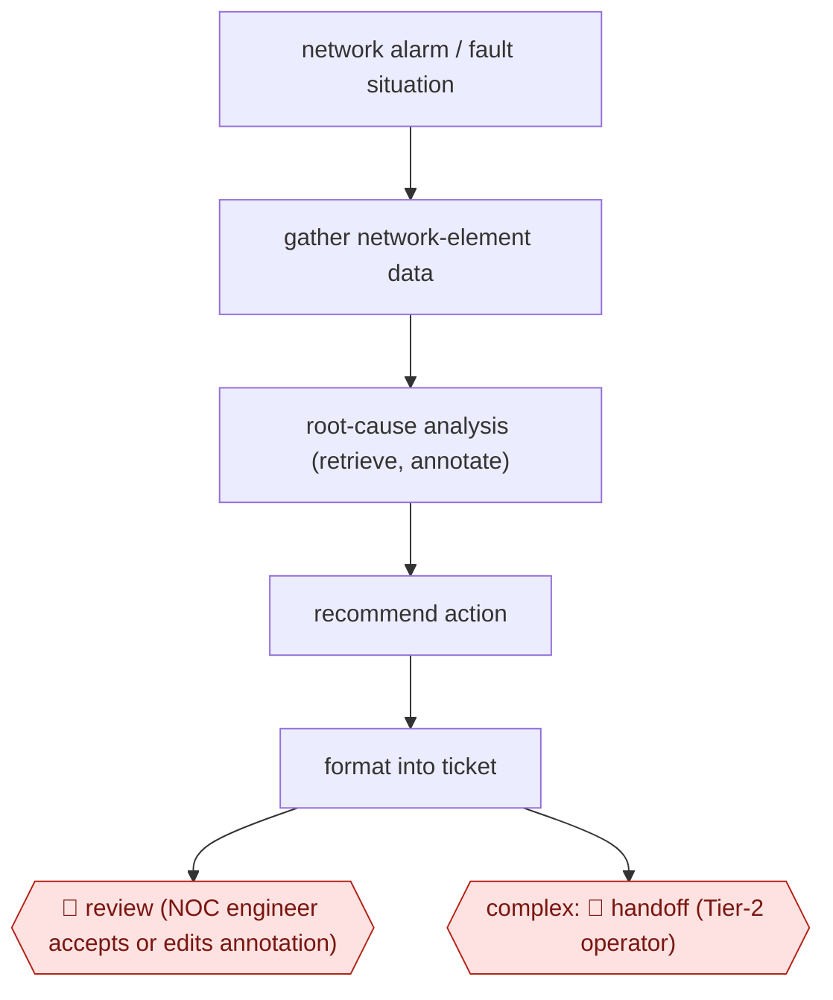

# Open-loop NOC root cause

`TEC › ITS › SRE` · checkpointed · evidence A · **draft: needs a reference example** ([how to add one](../../../../../CONTRIBUTING.md#1-add-an-example-run))

**Shape:** `network alarm / fault situation → gather network-element data → root-cause analysis (retrieve, annotate) → recommend action → format into ticket → 🛑 review (NOC engineer accepts or edits annotation) | complex: 🛑 handoff (Tier-2 operator)`
**Variants:** `docomo-agentic-ai` · `langgraph-mcp`

<!-- shape diagram: generated by scripts/build_diagrams.py from `shape`; don't edit -->

<!-- end shape diagram -->

## Background

A telecom operator runs its network from a network operations centre (NOC), where engineers watch alarms from thousands of network elements (routers, base stations, core-network nodes). When faults appear, an engineer works out the root cause, the underlying fault behind a cluster of alarms, and writes the cause and the fix into a trouble ticket. Doing this by hand means checking many systems and takes hours for a single fault, and most alarms are noise. Here an agent gathers the data, ranks likely root causes, recommends an action and writes it into the ticket as an annotation, without changing the network. The NOC engineer accepts or edits the annotation because a wrong action on a live network can cut customers off, and hard cases go to Tier-2, the more senior operators who handle what first-line staff cannot.

**Terms:**
- **NOC (network operations centre)**: the team and room that monitor a network and respond to faults.
- **Alarm**: an automatic warning from a network element that something is wrong. **Alarm noise** is the many alarms that need no action.
- **Network element**: a device or node in the network, such as a base station or a core-network function.
- **Root cause**: the underlying fault that explains a set of symptoms.
- **Trouble ticket**: the record of a fault, with its diagnosis and the action taken.
- **Tier-1 / Tier-2**: first-line operators and the more senior second line they escalate hard cases to.
- **Open-loop**: the agent recommends but does not act; a person decides.
- **MVP (minimum viable product)**: a first working version used to test the idea.

## Build it with an agent

**Form:** `service`. Alarms arrive around the clock and nobody starts each analysis, so a headless run is triggered by the fault event, and engineers see only the annotated ticket.

**You need:** a trigger from the alarm or ticket system into a small receiver that starts `claude -p` or an Agent SDK program for each fault situation; read-only MCP servers or APIs for the network-element data, the inventory and the history of past tickets; permission to write an annotation to the ticket and no tool that changes network configuration; an approved model setup, since the Atsky account ruled out public models for confidentiality of network data and ran inference inside the operator's own environment; a queue or ticket field where Tier-2 receives escalations.

| Step | Built as |
|---|---|
| network alarm / fault situation → gather network-element data | The fault event starts the run. A skill lists which element data and past tickets to read for each alarm type, through read-only connectors. |
| root-cause analysis (retrieve, annotate) | The skill's fixed first steps: retrieve the data, then annotate it with ranked root causes. Built-in subagents can analyse separate network domains in parallel and return summaries. |
| recommend action → format into ticket | The skill's last steps: one recommended action, then a fixed ticket annotation template. For a fixed order that is enforced, an Agent SDK program calls the four steps in sequence. |
| 🛑 review | See Checkpoints. |
| complex: 🛑 handoff | See Checkpoints. |

**Checkpoints:** `review`: the run writes the annotation to the ticket as a proposal marked "agent-recommended" and has no tool to close the ticket or touch the network; the NOC engineer accepts or edits it in the ticket system. `handoff`: when the evidence does not give a ranked cause, the run states what it could not decide and why and places the ticket in the Tier-2 queue with the data gathered so far.

**Since the sources:** Sources date from 2026 (the DOCOMO slides, from MWC 2026) to a case study last updated 2026-10 (Atsky, listed here as undated). Both were opened in 2026-11 and support the steps cited to them. Atsky built the flow as a deterministic LangGraph graph of four steps on its own hosted model, for reproducible, auditable output and data confidentiality; the build above reproduces that order with a skill, or with an Agent SDK program where the order must be enforced, and does not name a framework. DOCOMO's slides show a multi-agent system with no build detail. Searches in 2026-11 found newer vendor accounts of the same practice: [Amdocs](https://www.amdocs.com/insights/case-study/8-hours-7-seconds-root-cause-analysis-reimagined-agentic-ai) (2026-05-27) describes an agentic root-cause analysis workflow in production at a North American operator. A further account from Ericsson (2026-06) could not be opened, so it is not cited. Of the tools in `variants`, `docomo-agentic-ai` is DOCOMO's own system and no newer account of it was found. `langgraph-mcp` is the framework pairing Atsky used; LangChain's [changelog](https://docs.langchain.com/oss/python/releases/changelog.md) now says its `MultiServerMCPClient` (from `langchain-mcp-adapters`) is replaced by `MCPAdapter`, so that slug's name for the adapter is superseded.

*A design based on this entry's steps and the tool documentation as of 2026-11, not a reported run.*

## Steps

*As reported by the sources.*
1. An alarm arrives; the agent confirms it and gathers data from network elements [[1]](#sources).
2. Multi-agent root-cause analysis; Atsky uses a fixed four-step Retrieve → Annotate → Recommend → Format flow [[1]](#sources)[[2]](#sources).
3. Recommend actions and issue an analysis report [[1]](#sources)[[2]](#sources).
4. 🛑 **Handoff**: escalate to the Tier-2 operator (DOCOMO) [[1]](#sources). 🛑 **Review**: 'the agent recommends, the NOC decides' (Atsky) [[2]](#sources).

**Output:** Annotated trouble ticket with ranked root causes and a recommended action.
**Failure modes → guards:** Alarm noise → suppression. Non-reproducible answers → deterministic flow instead of an open agent loop.
**How it differs:** Same class as AWF-0004, but here the agent never executes a runbook step (no action checkpoint). The deliverable is a ticket annotation for a human operator.

## Public runs

Coverage as of 2026-11-06: **Partial**: first-hand runs that cover part of the shape or put checkpoints elsewhere. Collected and re-checked in [Second collection pass](../../../../../research/2026-11-second-pass.md).

- [NTT DOCOMO, AI-Centric Network](https://www.docomo.ne.jp/english/binary/pdf/info/media_center/event/mwc26/AI-Centric_Network.pdf?ver=1772615651) (2026, MWC). Commercial network operations over 1M+ devices. "Reduces recovery time by more than 50%". *First-hand: yes; confidence: med.*
- [Atsky, Tier-1 NOC](https://www.atsky.io/case-study/aiops-telco-network-operations) (n.d.). Nordic operator, via Nokia; MVP tested on 250 historical situations. "84% of annotations accepted as written by NOC engineers". *First-hand: vendor; confidence: med.*

## Sources

1. NTT DOCOMO, AI-Centric Network (MWC26). https://www.docomo.ne.jp/english/binary/pdf/info/media_center/event/mwc26/AI-Centric_Network.pdf?ver=1772615651
2. Atsky, Agentic AI in a Tier-1 NOC. https://www.atsky.io/case-study/aiops-telco-network-operations
