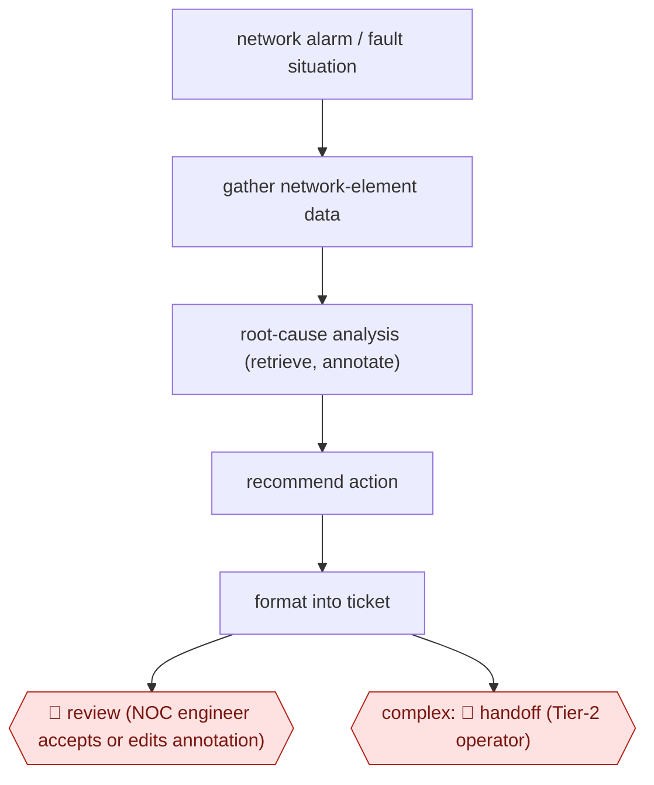

# Open-loop NOC root cause

`TEC › ITS › SRE` · checkpointed · evidence A · **draft: needs a reference example** ([how to add one](../../../../../CONTRIBUTING.md#1-add-an-example-run))

**Shape:** `network alarm / fault situation → gather network-element data → root-cause analysis (retrieve, annotate) → recommend action → format into ticket → 🛑 review (NOC engineer accepts or edits annotation) | complex: 🛑 handoff (Tier-2 operator)`
**How it differs:** Same class as AWF-0004, but here the agent never executes a runbook step (no action checkpoint). The deliverable is a ticket annotation for a human operator.
**Variants:** `docomo-agentic-ai` · `langgraph-mcp`

<!-- shape diagram: generated by scripts/build_diagrams.py from `shape`; don't edit -->

<!-- end shape diagram -->

## Steps
1. An alarm arrives; the agent confirms it and gathers data from network elements [[1]](#sources).
2. Multi-agent root-cause analysis; Atsky uses a fixed four-step Retrieve → Annotate → Recommend → Format flow [[1]](#sources)[[2]](#sources).
3. Recommend actions and issue an analysis report [[1]](#sources)[[2]](#sources).
4. 🛑 **Handoff**: escalate to the Tier-2 operator (DOCOMO) [[1]](#sources). 🛑 **Review**: 'the agent recommends, the NOC decides' (Atsky) [[2]](#sources).

**Output:** Annotated trouble ticket with ranked root causes and a recommended action.
**Failure modes → guards:** Alarm noise → suppression. Non-reproducible answers → deterministic flow instead of an open agent loop.

## Public runs

Coverage as of 2026-11-06: **Partial**: first-hand runs that cover part of the shape or put checkpoints elsewhere. Collected and re-checked in [Second collection pass](../../../../../research/2026-11-second-pass.md).

- [NTT DOCOMO, AI-Centric Network](https://www.docomo.ne.jp/english/binary/pdf/info/media_center/event/mwc26/AI-Centric_Network.pdf?ver=1772615651) (2026, MWC). Commercial network operations over 1M+ devices. "Reduces recovery time by more than 50%". *First-hand: yes; confidence: med.*
- [Atsky, Tier-1 NOC](https://www.atsky.io/case-study/aiops-telco-network-operations) (n.d.). Nordic operator, via Nokia; MVP tested on 250 historical situations. "84% of annotations accepted as written by NOC engineers". *First-hand: vendor; confidence: med.*

## Sources

1. NTT DOCOMO, AI-Centric Network (MWC26). https://www.docomo.ne.jp/english/binary/pdf/info/media_center/event/mwc26/AI-Centric_Network.pdf?ver=1772615651
2. Atsky, Agentic AI in a Tier-1 NOC. https://www.atsky.io/case-study/aiops-telco-network-operations
