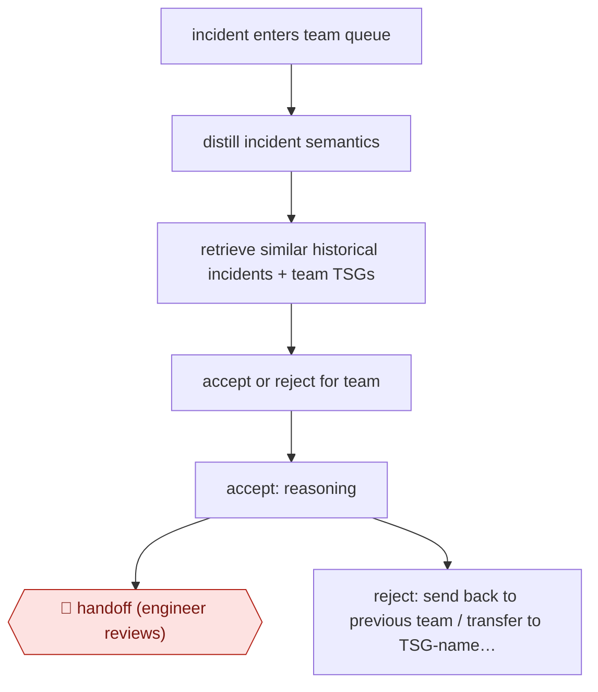

# Team-agent incident triage

`TEC › ITS › SRE` · checkpointed · evidence A · **draft: needs a reference example** ([how to add one](../../../../../CONTRIBUTING.md#1-add-an-example-run))

**Shape:** `incident enters team queue → distill incident semantics → retrieve similar historical incidents + team TSGs → accept or reject for team → accept: reasoning → 🛑 handoff (engineer reviews) | reject: send back to previous team / transfer to TSG-named team / keep in queue for engineer`
**How it differs:** Closest is AWF-0004 Triage then remediate: that workflow investigates signals and runs runbook actions behind 🛑 action. This one produces only an ownership decision (accept or reroute), takes no remediation action, and lets the agent reroute without approval for each item. It also differs from AWF-0127 (root-cause annotation in a NOC ticket) and AWF-0185 (war-room coordination and post-mortem): neither decides which team owns the incident.
**Variants:** `azure-openai` · `gpt-embeddings`

<!-- shape diagram: generated by scripts/build_diagrams.py from `shape`; don't edit -->

<!-- end shape diagram -->

## Steps
1. Each service team gets one agent that stands in for the team's engineers. It holds the team's historical incidents and troubleshooting guides (TSGs) as its domain knowledge [[1]](#sources).
2. When an incident enters the team's queue, the agent uses GPT embeddings and 'semantic distillation' to pull out the information in the incident that matters for triage [[1]](#sources).
3. The agent compares the incident with historical incidents and the team's TSGs, then makes a binary decision: accept the incident for its team or reject it, and gives its reasoning [[1]](#sources).
4. Accepted incidents: the agent attaches its reasoning. 🛑 **Handoff**: an engineer on the team (the designated responsible individual) reviews the incident and takes it on [[1]](#sources).
5. Rejected incidents: the agent sends the incident back to the previous team, transfers it to the team its TSG names, or leaves it in the queue for an engineer to resolve. A person does not approve each reroute [[1]](#sources).
6. Being built: a Global Triage layer, where a multi-agent orchestrator picks candidate teams and negotiates with each team's agent to find the right owner [[1]](#sources). Teams are onboarded one at a time, each bringing its own TSGs and incident history [[1]](#sources).

**Output:** An accept-or-reroute decision with reasoning on each incoming incident, so the incident reaches the owning team's on-call engineer sooner. That engineer then mitigates it.
**Failure modes → guards:** The agent wrongly rejects and bounces an incident, which adds redundant reassignments and lengthens time to mitigate → the agent can leave an incident in the queue for an engineer, and it gives reasoning for every decision. Stale or missing TSGs weaken decisions → agents are trained on each team's TSGs and historical incidents, and teams are onboarded one by one.

## Public runs

Coverage as of 2026-11-13: **Strong**: a first-hand, detailed run that matches most of the shape. Collected and re-checked in [Fourth collection pass](../../../../../research/2026-11-fourth-pass.md).

- [Microsoft Azure, Optimizing incident management with AIOps using the Triangle System](https://azure.microsoft.com/en-us/blog/optimizing-incident-management-with-aiops-using-the-triangle-system/) (2025-03-06). Per-team triage agents in Azure production since mid-2024; 6 teams live, 15+ onboarding. "agents achieving 90% accuracy and one team saw a reduction in their TTM of 38%". *First-hand: yes; confidence: high.*

## Sources

1. Mark Russinovich with the Azure Core Insights team, Optimizing incident management with AIOps using the Triangle System, Microsoft Azure Blog, 2025-03-06. https://azure.microsoft.com/en-us/blog/optimizing-incident-management-with-aiops-using-the-triangle-system/
