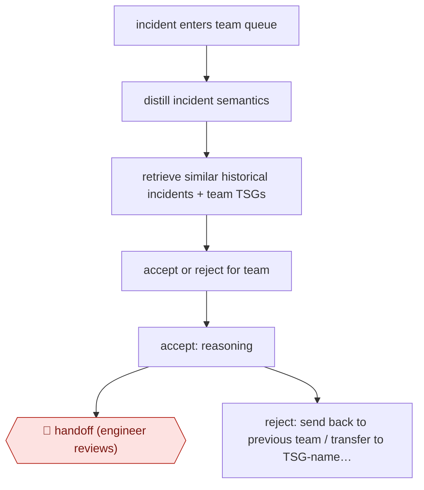

# Team-agent incident triage

`TEC › ITS › SRE` · checkpointed · evidence A · **draft: needs a reference example** ([how to add one](../../../../../CONTRIBUTING.md#1-add-an-example-run))

**Shape:** `incident enters team queue → distill incident semantics → retrieve similar historical incidents + team TSGs → accept or reject for team → accept: reasoning → 🛑 handoff (engineer reviews) | reject: send back to previous team / transfer to TSG-named team / keep in queue for engineer`
**Variants:** `azure-openai` · `gpt-embeddings`

<!-- shape diagram: generated by scripts/build_diagrams.py from `shape`; don't edit -->

<!-- end shape diagram -->

## Background

In a large cloud company, hundreds of services depend on one another, so an incident logged against one service may really come from another. Each service team has a queue of incoming incidents, and a designated engineer on duty (the responsible individual) must decide whether an incident belongs to the team, work out who should take it if not, and pass it on. By hand this is slow and error-prone, and each wrong hand-off adds a reassignment and lengthens the time to mitigate, the time until customers stop being hurt. Here one agent per team makes the first accept-or-reject call from past incidents and the team's troubleshooting guides, and gives its reasoning. A person on the team still reviews every accepted incident and takes it on, and mitigating the fault stays with that engineer.

**Terms:**
- **Incident**: an unplanned problem with a service that needs a response.
- **Queue**: the list of incidents waiting for a team.
- **Responsible individual (DRI)**: the engineer designated to investigate an incoming incident.
- **TSG (troubleshooting guide)**: a document engineers write on how to diagnose and fix a common pattern of problem.
- **TTM (time to mitigate)**: the time from an incident being logged until its customer impact is reduced.
- **Embedding**: a list of numbers that represents the meaning of a text, so that similar texts can be found. **Semantic distillation** is the source's name for pulling out the parts of an incident that matter for triage.
- **On-call engineer**: the engineer on duty to answer incidents for a team.

## Build it with an agent

**Form:** `service`. A new incident entering the queue starts the work with nobody at a keyboard, and the agent may send a rejected incident on without approval, so it runs as a headless job that acts on a queue.

**You need:** a trigger from the incident system when an incident enters a team's queue, starting `claude -p` or an Agent SDK program; the team's TSGs as files the run can read; read access to the team's incident history through an MCP server or search tool that returns similar past incidents; a connector that can add a note to an incident, assign it to the team's on-call engineer, send it to another team or leave it in the queue, and no tool that changes anything in production; a team list that says which teams a TSG names.

| Step | Built as |
|---|---|
| incident enters team queue | The incident system's event starts one headless run per incident. |
| distill incident semantics | The skill tells the agent to extract the symptoms, affected components and error text from the incident. |
| retrieve similar historical incidents + team TSGs | The agent searches the incident history for similar cases and reads the TSGs kept as reference files beside the skill. |
| accept or reject for team | The skill asks for a decision, accept or reject, with reasons that cite the incidents and TSG passages used. If the evidence does not settle it, the decision is to keep the incident in the queue. |
| accept: reasoning → 🛑 handoff | See Checkpoints. |
| reject: send back to previous team / transfer to TSG-named team / keep in queue for engineer | The connector's reroute action is limited to the previous team or a team named in a TSG. Anything else stays in the queue. |

**Checkpoints:** `handoff`: for an accepted incident the run writes its reasoning into the incident and assigns it to the on-call engineer, who reviews and takes it on; the agent has no tool to mitigate. A rejected incident is rerouted without a person approving each one, as in the source, so a missed stop here would send an incident to another team: the connector only allows the two reroute targets above, every reroute and its reasoning is logged, and a `PreToolUse` hook blocks any reroute to a team that no TSG or history entry names.

**Since the sources:** The one source and public run date from 2025-03 (the figures are as of 2025-01). The source was opened in 2026-11 and supports the steps cited to it. It describes per-team agents built from GPT embeddings, "semantic distillation" and training on incident history and TSGs, with the model details unstated; a current agent can read the TSGs through a skill and search past incidents through a connector, so the build uses those instead of a hand-built embedding pipeline. The Global Triage layer (step 6) was still being built in the source and is not in the build above. Searches in 2026-11 found no newer account of Microsoft's system. They found general accounts of the same practice: a vendor guide from Rootly (last updated 2026-10) argues that mapping incidents to the owning team through a service catalog reduces misroutes ([AI SRE lifecycle](https://rootly.com/ai-sre-guide/lifecycle)). The tools in `variants` (`azure-openai`, `gpt-embeddings`) were not confirmed renamed or withdrawn; no Microsoft retirement page for them was opened.

*A design based on this entry's steps and the tool documentation as of 2026-11, not a reported run.*

## Steps

*As reported by the sources.*
1. Each service team gets one agent that stands in for the team's engineers. It holds the team's historical incidents and troubleshooting guides (TSGs) as its domain knowledge [[1]](#sources).
2. When an incident enters the team's queue, the agent uses GPT embeddings and 'semantic distillation' to pull out the information in the incident that matters for triage [[1]](#sources).
3. The agent compares the incident with historical incidents and the team's TSGs, then makes a binary decision: accept the incident for its team or reject it, and gives its reasoning [[1]](#sources).
4. Accepted incidents: the agent attaches its reasoning. 🛑 **Handoff**: an engineer on the team (the designated responsible individual) reviews the incident and takes it on [[1]](#sources).
5. Rejected incidents: the agent sends the incident back to the previous team, transfers it to the team its TSG names, or leaves it in the queue for an engineer to resolve. A person does not approve each reroute [[1]](#sources).
6. Being built: a Global Triage layer, where a multi-agent orchestrator picks candidate teams and negotiates with each team's agent to find the right owner [[1]](#sources). Teams are onboarded one at a time, each bringing its own TSGs and incident history [[1]](#sources).

**Output:** An accept-or-reroute decision with reasoning on each incoming incident, so the incident reaches the owning team's on-call engineer sooner. That engineer then mitigates it.
**Failure modes → guards:** The agent wrongly rejects and bounces an incident, which adds redundant reassignments and lengthens time to mitigate → the agent can leave an incident in the queue for an engineer, and it gives reasoning for every decision. Stale or missing TSGs weaken decisions → agents are trained on each team's TSGs and historical incidents, and teams are onboarded one by one.
**How it differs:** Closest is AWF-0004 Triage then remediate: that workflow investigates signals and runs runbook actions behind 🛑 action. This one produces only an ownership decision (accept or reroute), takes no remediation action, and lets the agent reroute without approval for each item. It also differs from AWF-0127 (root-cause annotation in a NOC ticket) and AWF-0185 (war-room coordination and post-mortem): neither decides which team owns the incident.

## Public runs

Coverage as of 2026-11-13: **Strong**: a first-hand, detailed run that matches most of the shape. Collected and re-checked in [Fourth collection pass](../../../../../research/2026-11-fourth-pass.md).

- [Microsoft Azure, Optimizing incident management with AIOps using the Triangle System](https://azure.microsoft.com/en-us/blog/optimizing-incident-management-with-aiops-using-the-triangle-system/) (2025-03-06). Per-team triage agents in Azure production since mid-2024; 6 teams live, 15+ onboarding. "agents achieving 90% accuracy and one team saw a reduction in their TTM of 38%". *First-hand: yes; confidence: high.*

## Sources

1. Mark Russinovich with the Azure Core Insights team, Optimizing incident management with AIOps using the Triangle System, Microsoft Azure Blog, 2025-03-06. https://azure.microsoft.com/en-us/blog/optimizing-incident-management-with-aiops-using-the-triangle-system/
