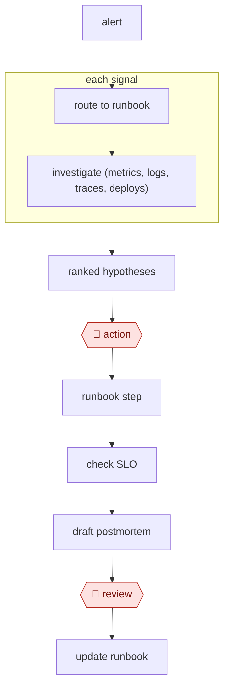

# Triage then remediate

`TEC › ITS › SRE` · checkpointed · evidence B · **draft: needs a reference example** ([how to add one](../../../../../CONTRIBUTING.md#1-add-an-example-run))

**Shape:** `alert → route to runbook → each signal: investigate (metrics, logs, traces, deploys) → ranked hypotheses → 🛑 action → runbook step → check SLO → draft postmortem → 🛑 review → update runbook`

<!-- shape diagram: generated by scripts/build_diagrams.py from `shape`; don't edit -->

<!-- end shape diagram -->

## Steps
1. An alert starts the agent, which routes by service tag to the matching runbook.
2. Read-only investigation runs in parallel: the error spike, deploys in the window, exemplar traces, and the suspect diff.
3. Post ranked hypotheses with evidence links to the incident channel.
4. 🛑 **Action**: the on-call engineer approves a specific runbook command (rollback, scale, restart).
5. Verify recovery against the SLO.
6. Draft the postmortem. 🛑 **Review**: the incident owner edits it, especially root cause and action items.
7. Update the runbook.

**Guard:** write tools are restricted to an allow-list of runbook commands, enforced in code.

## Public runs

Coverage as of 2026-11-06: **Partial**: first-hand runs that cover part of the shape or put checkpoints elsewhere. From [Where are the real runs?](../../../../../research/2026-11-real-runs.md); every number was re-checked against its page.

- [Hsu, Neu, Farrag, Kindi, Meta Engineering](https://engineering.fb.com/2024/06/24/data-infrastructure/leveraging-ai-for-efficient-incident-response/) (2024-06-24). Retriever + LLM ranker → top-5 suspect code changes for responders to check. "42% of these investigations had the root cause in the top five". *First-hand: yes; confidence: med.*
- [Goutham Veeramachaneni, *I built an AI SRE in 60 mins*](https://www.gouthamve.dev/i-built-an-ai-sre-in-60mins-you-should-too/) (2026-04-21). Replays recent pages against a knowledge base; opens runbook-update PRs that people review. "the false positive rate is less than 10% now" (no evals). *First-hand: yes; confidence: med.*
- [Chatwoot, *Introducing Faultline*](https://faultline.chatwoot.com/blog/introducing-faultline) (2026-02-18). A read-only agent investigates their own incidents across PagerDuty, New Relic, Sentry, AWS and GitHub. "typically makes 25-30 API calls". *First-hand: yes; confidence: med.*

