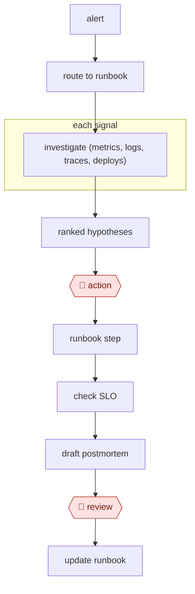

# Triage then remediate

`TEC › ITS › SRE` · checkpointed · evidence B · **draft: needs a reference example** ([how to add one](../../../../../CONTRIBUTING.md#1-add-an-example-run))

**Shape:** `alert → route to runbook → each signal: investigate (metrics, logs, traces, deploys) → ranked hypotheses → 🛑 action → runbook step → check SLO → draft postmortem → 🛑 review → update runbook`

<!-- shape diagram: generated by scripts/build_diagrams.py from `shape`; don't edit -->

<!-- end shape diagram -->

## Background

When a monitoring system detects that a service is failing, it sends an alert to the on-call engineer, the person on duty to respond at any hour. The engineer has to find which part of the system is at fault by reading metrics, logs, traces and recent deployments, follow the team's runbook (a written procedure for a known kind of failure), apply a fix such as a rollback, and afterwards write a postmortem, a review of what happened. By hand this is slow and tiring at night, and runbooks go out of date. Here an agent does the reading in parallel, ranks the likely causes with links to its evidence, and drafts the postmortem. The on-call engineer still approves each command that changes the running system, because a wrong rollback or restart can make an outage worse, and the incident owner reviews the postmortem.

**Terms:**
- **Alert**: an automatic message from monitoring that a measured value has gone wrong.
- **On-call engineer**: the engineer on duty to respond to alerts. The **incident owner** is the person responsible for one incident and its postmortem.
- **Runbook**: a written procedure for diagnosing and fixing a known kind of failure.
- **Metrics, logs, traces**: the numbers over time, the event records and the request paths a running service emits. A **deploy** is a release of new code.
- **Rollback**: returning a service to its previous version.
- **SLO (service level objective)**: a target for how reliable a service should be, used here to check that recovery worked.
- **Postmortem**: the written review of an incident: cause, timeline and what to change.

## Build it with an agent

**Form:** `service`. An alert starts the work with nobody at a keyboard, and the engineer is asked only for approval of a command and review of the postmortem.

**You need:** a webhook from the alerting system to a small receiver that starts `claude -p` or an Agent SDK program for each alert; the runbooks as files, tagged by service; read-only access to metrics, logs, traces, deploy history and the code repository through MCP servers; a short list of runbook commands the agent may propose (rollback, scale, restart), which only the on-call engineer's approval can run; a channel for the incident, and a place to open pull requests against the runbooks.

| Step | Built as |
|---|---|
| alert → route to runbook | The receiver passes the alert's service tag; a skill picks the runbook file with that tag. |
| each signal: investigate (metrics, logs, traces, deploys) | Built-in subagents, one per signal, run read-only queries in parallel and each returns a summary with links. |
| ranked hypotheses | The skill merges the summaries into ranked hypotheses with evidence links and posts them to the incident channel. |
| 🛑 action → runbook step | See Checkpoints. |
| check SLO | After an approved step, the agent reads the SLO metric and reports whether it has recovered. |
| draft postmortem | The skill writes a draft from the channel, the queries and the commands run. |
| 🛑 review | See Checkpoints. |
| update runbook | The agent opens a pull request that changes the runbook; a person merges it. |

**Checkpoints:** `action`: the agent holds read-only credentials and no tool that runs a command on production. A proposed runbook command goes to the on-call engineer through `canUseTool` or a `PreToolUse` hook that defers the call until a person answers, and a permission rule denies every command that is not on the allow-list, so the allow-list the source describes is enforced outside the prompt. `review`: the postmortem is saved as a draft and the agent has no publish tool; the incident owner edits and publishes it. The runbook pull request is not merged by the agent.

**Since the sources:** Sources date from 2024-06 to 2026-04. All three were opened in 2026-11 and support what is cited to them: Meta's retriever and ranker of suspect code changes, a one-person agent built on runbooks that opens pull requests for runbook updates, and a read-only investigation agent. No source reports the steps in this entry's Steps section as a whole, and none reports an engineer approving a runbook command: Chatwoot's agent is read-only and lists approved actions as future work, so the action gate and the SLO check come from the entry's design, not from a run. Meta's ranker was a fine-tuned model; the build uses a general agent over the same kinds of data. Searches in 2026-11 found a newer account of the approval gate: Anthropic's cookbook example (2026-04-10) of an on-call agent that reads logs and runbooks, opens a fix pull request and waits for approval before merging ([cookbook](https://platform.claude.com/cookbook/managed-agents-sre-incident-responder)), and an opinion piece from Rootly (2026-09-15) arguing for keeping a human in the loop on remediation ([Rootly](https://rootly.com/blog/could-2027-be-the-year-you-turn-off-human-in-the-loop)). The entry names no tools in `variants`.

*A design based on this entry's steps and the tool documentation as of 2026-11, not a reported run.*

## Steps

*As reported by the sources.*
1. An alert starts the agent, which routes by service tag to the matching runbook.
2. Read-only investigation runs in parallel: the error spike, deploys in the window, exemplar traces, and the suspect diff.
3. Post ranked hypotheses with evidence links to the incident channel.
4. 🛑 **Action**: the on-call engineer approves a specific runbook command (rollback, scale, restart).
5. Verify recovery against the SLO.
6. Draft the postmortem. 🛑 **Review**: the incident owner edits it, especially root cause and action items.
7. Update the runbook.

**Guard:** write tools are restricted to an allow-list of runbook commands, enforced in code.

## Public runs

Coverage as of 2026-11-06: **Partial**: first-hand runs that cover part of the shape or put checkpoints elsewhere. From [Where are the real runs?](../../../../../research/2026-11-real-runs.md); every number was re-checked against its page.

- [Hsu, Neu, Farrag, Kindi, Meta Engineering](https://engineering.fb.com/2024/06/24/data-infrastructure/leveraging-ai-for-efficient-incident-response/) (2024-06-24). Retriever + LLM ranker → top-5 suspect code changes for responders to check. "42% of these investigations had the root cause in the top five". *First-hand: yes; confidence: med.*
- [Goutham Veeramachaneni, *I built an AI SRE in 60 mins*](https://www.gouthamve.dev/i-built-an-ai-sre-in-60mins-you-should-too/) (2026-04-21). Replays recent pages against a knowledge base; opens runbook-update PRs that people review. "the false positive rate is less than 10% now" (no evals). *First-hand: yes; confidence: med.*
- [Chatwoot, *Introducing Faultline*](https://faultline.chatwoot.com/blog/introducing-faultline) (2026-02-18). A read-only agent investigates their own incidents across PagerDuty, New Relic, Sentry, AWS and GitHub. "typically makes 25-30 API calls". *First-hand: yes; confidence: med.*

