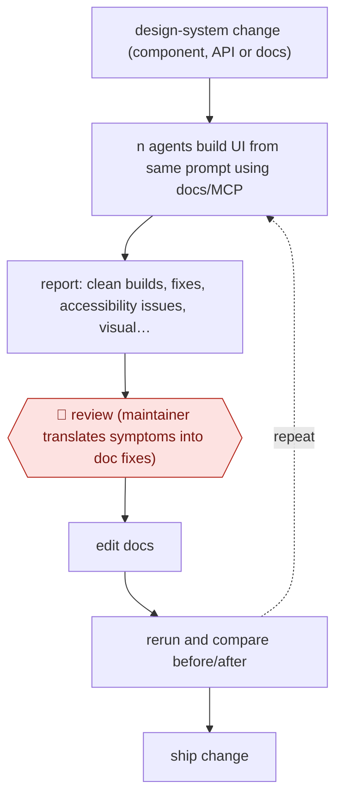

# Agent-eval docs loop

`TEC › PRD › DSYS` · checkpointed · evidence A · **draft: needs a reference example** ([how to add one](../../../../../CONTRIBUTING.md#1-add-an-example-run))

**Shape:** `design-system change (component, API or docs) → (n agents build UI from same prompt using docs/MCP → report: clean builds, fixes, accessibility issues, visual diffs, tokens, cost + collated agent feedback → 🛑 review (maintainer translates symptoms into doc fixes) → edit docs ⟲ rerun and compare before/after) → ship change`
**How it differs:** AWF-0008 Design to code and AWF-0122 Scored token migration ship product code. Here agents are a test population, the deliverable is improved design-system documentation measured by repeated agent builds, and the human checkpoint is translating eval feedback into doc fixes.
**Variants:** `sanity-design-system-eval-tool` · `sanity-ailf` · `mcp-server`

<!-- shape diagram: generated by scripts/build_diagrams.py from `shape`; don't edit -->

<!-- end shape diagram -->

## Steps
1. Define an eval: which design system, setup instructions, training material (markdown or MCP server), model, and a custom or agent-generated prompt [[1]](#sources).
2. Spin up n agents with the same prompt; each builds the UI. Measure tries to a clean build, accessibility issues, lines of code, performance, visual diffs per iteration, and token spend; collate the agents' feedback on what confused them [[1]](#sources).
3. Run it whenever a component ships, the API changes or docs are updated; 3–5 iterations usually give signal, 10 for more definitive results [[1]](#sources).
4. 🛑 **Review**: the maintainer reads the report; agent feedback is "more like a smoke detector than a dentist" (symptoms, not causes), so a person translates it into specific doc changes [[1]](#sources).
5. Fix the docs (Sanity moved from markdown to a JSON documentation schema), rerun, and measure before/after [[1]](#sources).
6. Cross-check with a second harness: Sanity's internal AILF suite tests agents with no docs, with docs provided, and finding docs themselves [[1]](#sources).

**Output:** Design-system docs (and components/API) with measured agent success rates per model, plus a before/after report for each change.
**Failure modes → guards:** Letting agents rewrite docs continuously from their own feedback spun out (the author tried it) → keep human translation of feedback [1]. Burning money on large runs → small iteration counts, token/cost tracking [1].

## Public runs

Coverage as of 2026-11-13: **Strong**: a first-hand, detailed run that matches most of the shape. Collected and re-checked in [Third collection pass](../../../../../research/2026-11-third-pass.md).

- [PJ Onori, Sanity, How well do agents use your design system?](https://www.sanity.io/engineering/design-system-evals) (2026-08-26). Four months of daily use on Sanity UI; n=30 runs per model, current vs new docs. Sonnet 4.6 successful builds "20%" (current) vs "90%" (new); "Across 76 test tasks, the library landed a 90/100 score". *First-hand: yes; confidence: high.*

## Sources

1. PJ Onori, Sanity, How well do agents use your design system?, 2026-08-26. https://www.sanity.io/engineering/design-system-evals
