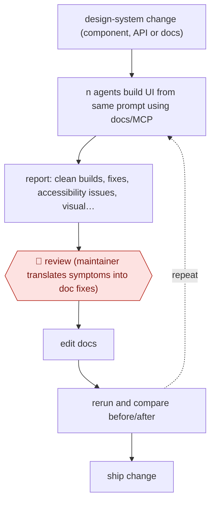

# Agent-eval docs loop

`TEC › PRD › DSYS` · checkpointed · evidence A · **draft: needs a reference example** ([how to add one](../../../../../CONTRIBUTING.md#1-add-an-example-run))

**Shape:** `design-system change (component, API or docs) → (n agents build UI from same prompt using docs/MCP → report: clean builds, fixes, accessibility issues, visual diffs, tokens, cost + collated agent feedback → 🛑 review (maintainer translates symptoms into doc fixes) → edit docs ⟲ rerun and compare before/after) → ship change`
**Variants:** `sanity-design-system-eval-tool` · `sanity-ailf` · `mcp-server`

<!-- shape diagram: generated by scripts/build_diagrams.py from `shape`; don't edit -->

<!-- end shape diagram -->

## Background

Design-system maintainers provide the components and instructions that keep a product's interfaces consistent. Coding agents can still misunderstand those instructions, invent component properties or produce something that builds but is hard to use. This workflow treats agents as test users of the documentation: give them the same task, measure what they build and compare versions. A maintainer uses the failures to decide which instructions need correction. Human interpretation remains necessary because an agent can describe a symptom without identifying its cause.

**Terms:**
- **Design system / UI**: shared interface rules and components, and the user interface they form.
- **Eval / harness**: a repeatable test and the software that runs it and collects results.
- **API / MCP**: a component's callable interface, and the protocol delivering external tools and documentation to agents.
- **Visual diff / token spend**: comparison of rendered images, and model input/output usage.
- **JSON schema / AILF**: a structured documentation format, and Sanity's internal AI Literacy Report evaluation suite.

## Build it with an agent

**Form:** `skill`. One maintainer runs a documentation experiment and stays in conversation; the existing evaluation harness can be invoked by scripts beside a Skill.

**You need:** the component library and versioned documentation; fixed task prompts and model settings; the evaluation harness, isolated build directories, accessibility checks and screenshot scripts; a run budget and baseline results. Use synthetic data and do not give evaluation workers production publishing credentials.

| Step | Built as |
|---|---|
| design-system change → n agents build from same prompt | A Skill freezes the task, model settings and document versions. Scripts beside it invoke the existing harness in separate workspaces for each trial. |
| report build, accessibility, visual and usage results | The Skill collates measured outputs and agent feedback, keeping failed runs and test conditions in the report. |
| 🛑 review → edit docs ⟲ rerun and compare | The maintainer selects a documentation change. The Skill reruns the same task and settings and compares the two saved result sets. |
| ship change | The Skill prepares the documentation diff and report; the maintainer releases through the usual repository process. |

**Checkpoints:** `review`: the Skill stops with failures, screenshots, agent feedback and evaluation conditions. The maintainer identifies the cause and chooses the edit. Evaluation agents cannot change the source documentation or publish it; the coordinating agent has no merge or release tool.

**Since the sources:** The source dates from 2026-08 and was opened in 2026-11. Searches for newer accounts and the named tools found no newer account as of 2026-11. Its existing evaluation harness remains useful; general-agent Skills only coordinate it and interpret its output. The source warns that code chunks and lint assistance can hide documentation defects, so documentation-only comparisons must disable those aids; test their additional effects separately. A passing build or an agent's self-report is not a measured documentation improvement; the retained before/after results are the evidence.

*A design based on this entry's steps and the tool documentation as of 2026-11, not a reported run.*

## Steps

*As reported by the sources.*

1. The maintainer defines an eval: which design system, setup instructions, training material (markdown or MCP server), model, and a custom or agent-generated prompt [[1]](#sources).
2. The evaluation harness spins up n agents with the same prompt; each builds the UI. The harness measures tries to a clean build, accessibility issues, lines of code, performance, visual diffs per iteration, and token spend, and collates the agents' feedback on what confused them [[1]](#sources).
3. The maintainer runs it whenever a component ships, the API changes or docs are updated; 3–5 iterations usually give signal, 10 for more definitive results [[1]](#sources).
4. 🛑 **Review**: the maintainer reads the report; agent feedback is "more like a smoke detector than a dentist" (symptoms, not causes), so a person translates it into specific doc changes [[1]](#sources).
5. The maintainer fixes the docs (Sanity moved from markdown to a JSON documentation schema), reruns, and measures before/after [[1]](#sources).
6. The team cross-checks with a second harness: Sanity's internal AILF suite tests agents with no docs, with docs provided, and finding docs themselves [[1]](#sources).

**Output:** Design-system docs (and components/API) with measured agent success rates per model, plus a before/after report for each change.
**Failure modes → guards:** Letting agents rewrite docs continuously from their own feedback spun out (the author tried it) → keep human translation of feedback [1]. Burning money on large runs → small iteration counts, token/cost tracking [1].

**How it differs:** AWF-0008 Design to code and AWF-0122 Scored token migration ship product code. Here agents are a test population, the deliverable is improved design-system documentation measured by repeated agent builds, and the human checkpoint is translating eval feedback into doc fixes.

## Public runs

Coverage as of 2026-11-13: **Strong**: a first-hand, detailed run that matches most of the shape. Collected and re-checked in [Third collection pass](../../../../../research/2026-11-third-pass.md).

- [PJ Onori, Sanity, How well do agents use your design system?](https://www.sanity.io/engineering/design-system-evals) (2026-08-26). Four months of daily use on Sanity UI; n=30 runs per model, current vs new docs. Sonnet 4.6 successful builds "20%" (current) vs "90%" (new); "Across 76 test tasks, the library landed a 90/100 score". *First-hand: yes; confidence: high.*

## Sources

1. PJ Onori, Sanity, How well do agents use your design system?, 2026-08-26. https://www.sanity.io/engineering/design-system-evals
