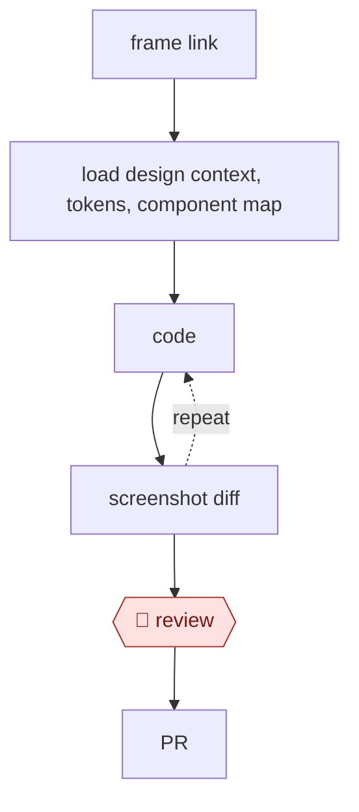

# Design to code

`TEC › PRD › DSYS` · checkpointed · evidence B · **draft: needs a reference example** ([how to add one](../../../../../CONTRIBUTING.md#1-add-an-example-run))

**Shape:** `frame link → load design context, tokens, component map → (code ⟲ screenshot diff) → 🛑 review → PR`

<!-- shape diagram: generated by scripts/build_diagrams.py from `shape`; don't edit -->

<!-- end shape diagram -->

## Steps
1. Pull the frame's design context, variables (color, spacing, typography), and Code Connect mappings through the Figma MCP server [[7]](#sources).
2. Reuse mapped code components instead of re-creating them.
3. Use tokens only, with no hardcoded values.
4. Render, take a screenshot, compare with the Figma screenshot, and loop.
5. 🛑 **Review**: designer review in a preview build.

**Output:** a PR. Token gaps are reported back to the design-system team.

## Public runs

Coverage as of 2026-11-06: **Partial**: first-hand runs that cover part of the shape or put checkpoints elsewhere. From [Where are the real runs?](../../../../../research/2026-11-real-runs.md); every number was re-checked against its page.

- [Jenny Xie, Figma blog, on Coinbase](https://www.figma.com/blog/how-coinbase-used-code-connect-to-shrink-token-costs/) (2026-09-02). Frame link → MCP + Code Connect → agent implements; a designer checks components. "cost by 22.5%"; "time to implementation by 22.3%"; three runs. *First-hand: vendor; confidence: med.*

## Sources

7. Figma, *MCP server guide*. https://github.com/figma/mcp-server-guide
