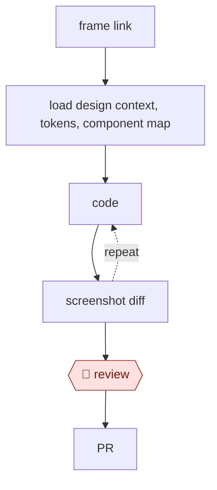

# Design to code

`TEC › PRD › DSYS` · checkpointed · evidence A · **draft: needs a reference example** ([how to add one](../../../../../CONTRIBUTING.md#1-add-an-example-run))

**Shape:** `frame link → load design context, tokens, component map → (code ⟲ screenshot diff) → 🛑 review → PR`
**Variants:** `storybook-mcp` · `claude-design`

<!-- shape diagram: generated by scripts/build_diagrams.py from `shape`; don't edit -->

<!-- end shape diagram -->

## Background

Designers describe an interface in a visual file, while developers implement its behavior using a product's existing components. A screenshot alone does not reveal which component, spacing rule or reusable style should be used, so similar-looking code can still diverge from the product system. This workflow gives the coding agent structured design context and compares the rendered result with the design. The designer reviews the preview because visual similarity does not establish correct interactions, accessible behavior or a suitable component choice.

**Terms:**
- **Frame / component map**: a design screen or selection, and its links to actual code components.
- **Design tokens**: named values for color, spacing and typography, reused instead of hardcoded values.
- **MCP / CLI**: the protocol connecting external tools to agents, and a command-line interface.
- **Screenshot diff / PR**: comparison of rendered images, and a proposed repository change.
- **DS / typecheck**: design system, and an automated check that code uses declared types correctly.

## Build it with an agent

**Form:** `project`. The design procedure needs repository-wide component rules and a repeatable validation gate as well as a Skill.

**You need:** the frame link; approved Figma and design-system MCP server (connector) tools; current component mappings and token definitions; the repository, preview command and screenshot comparison script. Use `CLAUDE.md` for conventions and a Skill for implementation. Protect unrelated files and give the agent no merge or production deployment permission.

| Step | Built as |
|---|---|
| frame link → load design context, tokens, component map | The Skill reads design context and mappings through MCP server (connector) tools and stops if authoritative component information is unavailable. |
| code ⟲ screenshot diff | The Skill reuses mapped components and renders a preview; scripts compare screenshots. A Hook runs the project's token/component checks and build checks. |
| 🛑 review → PR | The Skill presents the preview, screenshots, diff and unresolved token gaps. After design review it prepares the PR for the ordinary engineering process. |

**Checkpoints:** `review`: the designer inspects the running preview and screenshot differences, including states a still image cannot establish. The agent cannot merge or deploy; required code-host review gates production. A screenshot comparison cannot waive functional or accessibility checks.

**Since the sources:** Evidence dates from 2026-08 to 2026-09 plus undated documentation. In 2026-11 the Coinbase account, BILL account and Figma guide opened; Doctolib's Medium page refused access. Searches found [Figma's current tool documentation](https://developers.figma.com/docs/figma-mcp-server/tools-and-prompts/), opened in 2026-11, listing design-context, variable, screenshot and Code Connect tools. This provides structured context without requiring a custom scraper. It does not supply missing mappings or prove the inaccessible Doctolib results. Retain the source's hard stop when design-system information cannot be retrieved and report component or token gaps instead of guessing.

*A design based on this entry's steps and the tool documentation as of 2026-11, not a reported run.*

## Steps

*As reported by the sources.*

1. The agent pulls the frame's design context, variables (color, spacing, typography), and Code Connect mappings through the Figma MCP server [[7]](#sources).
2. The agent reuses mapped code components instead of re-creating them.
3. The agent uses tokens only, with no hardcoded values.
4. The agent renders, takes a screenshot, compares it with the Figma screenshot, and loops.
5. 🛑 **Review**: designer review in a preview build.

**Output:** a PR. Token gaps are reported back to the design-system team.

**Recent practice (2026):**
- Load design context: if the design-system MCP/CLI is unreachable, stop instead of guessing (BILL 2026-08-17). [[9]](#sources)
- Code ⟲ check: after generation, self-review against a versioned DS checklist and score compliance; triage deviations as missing AI context, missing DS capability, or legitimate custom UI (Doctolib 2026-09-15). [[8]](#sources)

## Public runs

Coverage as of 2026-11-13: **Strong**: a first-hand, detailed run that matches most of the shape. Updated in [Third collection pass](../../../../../research/2026-11-third-pass.md).

- [Jenny Xie, Figma blog, on Coinbase](https://www.figma.com/blog/how-coinbase-used-code-connect-to-shrink-token-costs/) (2026-09-02). Frame link → MCP + Code Connect → agent implements; a designer checks components. "cost by 22.5%"; "time to implementation by 22.3%"; three runs. *First-hand: vendor; confidence: med.*
- [Theophile Kalumbu, Doctolib, Keeping AI on Track: Lessons from Doctolib’s Oxygen Design System](https://medium.com/doctolib/keeping-ai-on-track-lessons-from-doctolibs-oxygen-design-system-9be5f9f041e8) (2026-09-15). Prototype-to-React skill against Oxygen DS with checklist self-review, hooks and typecheck/build gate; tested on a real feature team. "This moved compliance from 65% to 87%"; "reach 97% DS compliance". *First-hand: yes; confidence: high.*
- [David Cai, BILL, How We Made Our Design System Bilingual](https://www.bill.com/engineering/how-we-made-our-design-system-bilingual) (2026-08-17). Storybook-backed MCP/CLI + skills ground the agent; A/B tested against an ungrounded agent. "cut token usage by 31–63% per task and held generation time steady at five minutes per run". *First-hand: yes; confidence: high.*

## Sources

7. Figma, *MCP server guide*. https://github.com/figma/mcp-server-guide
8. Theophile Kalumbu, Doctolib, Keeping AI on Track: Lessons from Doctolib’s Oxygen Design System, 2026-09-15. https://medium.com/doctolib/keeping-ai-on-track-lessons-from-doctolibs-oxygen-design-system-9be5f9f041e8
9. David Cai, BILL, How We Made Our Design System Bilingual, 2026-08-17. https://www.bill.com/engineering/how-we-made-our-design-system-bilingual
