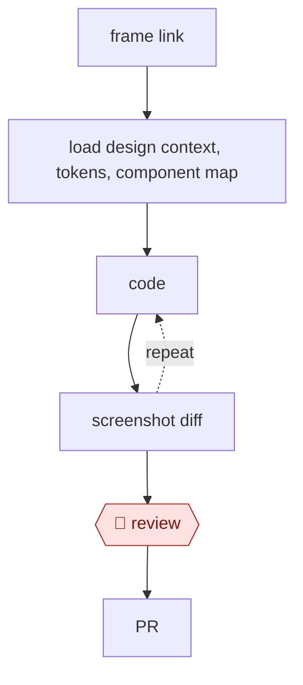

# Design to code

`TEC › PRD › DSYS` · checkpointed · evidence A · **draft: needs a reference example** ([how to add one](../../../../../CONTRIBUTING.md#1-add-an-example-run))

**Shape:** `frame link → load design context, tokens, component map → (code ⟲ screenshot diff) → 🛑 review → PR`
**Variants:** `storybook-mcp` · `claude-design`

<!-- shape diagram: generated by scripts/build_diagrams.py from `shape`; don't edit -->

<!-- end shape diagram -->

## Steps
1. Pull the frame's design context, variables (color, spacing, typography), and Code Connect mappings through the Figma MCP server [[7]](#sources).
2. Reuse mapped code components instead of re-creating them.
3. Use tokens only, with no hardcoded values.
4. Render, take a screenshot, compare with the Figma screenshot, and loop.
5. 🛑 **Review**: designer review in a preview build.

**Output:** a PR. Token gaps are reported back to the design-system team.

**Recent practice (2026):**
- Load design context: if the design-system MCP/CLI is unreachable, stop instead of guessing (BILL 2026-08-17). [[9]](#sources)
- Code ⟲ check: after generation, self-review against a versioned DS checklist and score compliance; triage deviations as missing AI context, missing DS capability, or legitimate custom UI (Doctolib 2026-09-15). [[8]](#sources)

## Public runs

Coverage as of 2026-11-13: **Strong**: a first-hand, detailed run that matches most of the shape. Updated in [Third collection pass](../../../../../research/2026-11-third-pass.md).

- [Jenny Xie, Figma blog, on Coinbase](https://www.figma.com/blog/how-coinbase-used-code-connect-to-shrink-token-costs/) (2026-09-02). Frame link → MCP + Code Connect → agent implements; a designer checks components. "cost by 22.5%"; "time to implementation by 22.3%"; three runs. *First-hand: vendor; confidence: med.*
- [Theophile Kalumbu, Doctolib, Keeping AI on Track: Lessons from Doctolib’s Oxygen Design System](https://medium.com/doctolib/keeping-ai-on-track-lessons-from-doctolibs-oxygen-design-system-9be5f9f041e8) (2026-09-15). Prototype-to-React skill against Oxygen DS with checklist self-review, hooks and typecheck/build gate; tested on a real feature team. "This moved compliance from 65% to 87%"; "reach 97% DS compliance". *First-hand: yes; confidence: high.*
- [David Cai, BILL, How We Made Our Design System Bilingual](https://www.bill.com/engineering/how-we-made-our-design-system-bilingual) (2026-08-17). Storybook-backed MCP/CLI + skills ground the agent; A/B tested against an ungrounded agent. "cut token usage by 31–63% per task and held generation time steady at five minutes per run". *First-hand: yes; confidence: high.*

## Sources

7. Figma, *MCP server guide*. https://github.com/figma/mcp-server-guide
8. Theophile Kalumbu, Doctolib, Keeping AI on Track: Lessons from Doctolib’s Oxygen Design System, 2026-09-15. https://medium.com/doctolib/keeping-ai-on-track-lessons-from-doctolibs-oxygen-design-system-9be5f9f041e8
9. David Cai, BILL, How We Made Our Design System Bilingual, 2026-08-17. https://www.bill.com/engineering/how-we-made-our-design-system-bilingual
