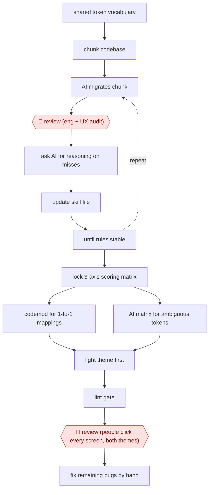

# Scored token migration

`TEC › PRD › DSYS` · checkpointed · evidence A · **draft: needs a reference example** ([how to add one](../../../../../CONTRIBUTING.md#1-add-an-example-run))

**Shape:** `shared token vocabulary → chunk codebase → (AI migrates chunk → 🛑 review (eng + UX audit) → ask AI for reasoning on misses → update skill file) ⟲ until rules stable → lock 3-axis scoring matrix → codemod for 1-to-1 mappings | AI matrix for ambiguous tokens → light theme first → lint gate → 🛑 review (people click every screen, both themes) → fix remaining bugs by hand`
**How it differs:** Closest is AWF-0008 (Design to code), which builds new UI from a Figma frame using a screenshot diff. This one rewrites thousands of existing token usages across the codebase. It adds a pilot-and-audit phase that builds the rules, routing between codemod and AI, and a full manual check before release.
**Variants:** `claude-code` · `regex-codemod` · `ambrook-agent-graph-migration` · `figma-mcp`

<!-- shape diagram: generated by scripts/build_diagrams.py from `shape`; don't edit -->

<!-- end shape diagram -->

## Steps
1. Agree a shared token vocabulary between engineering and UX. Split the codebase into small component slices [[1]](#sources).
2. Pilot loop: the AI migrates a slice. 🛑 **Review**: engineering and UX audit the result together. For every wrong replacement, ask the AI to explain its reasoning, then add the gap to a central rules and skills file. Repeat until the rules hold [[1]](#sources).
3. Lock a scoring matrix. Each candidate token is scored 0–3 on hex-value match, context fit and theme alignment [[1]](#sources).
4. Production run: a regex codemod handles the simple 1-to-1 mappings. Ambiguous or multi-intent tokens go through the AI scoring matrix. Migrate light theme first, so a wrong pick still renders the same colors in production [[1]](#sources).
5. Add a lint gate so the migration sticks. 🛑 **Review**: people click through every screen and state in both themes (no snapshot tooling). Fix the remaining wrong picks by hand [[1]](#sources).

**Output:** A codebase moved from utility tokens to semantic, theme-ready tokens, ready for dark mode.
**Failure modes → guards:** Whole-codebase prompts skipped files and mixed logic between files → chunking plus routing simple mappings to a codemod. Ambiguous intent → scoring matrix built from the audited pilots. Hidden wrong picks → light theme first, then a manual pass through both themes [[1]](#sources).

## Public runs

Coverage as of 2026-11-06: **Strong**: a first-hand, detailed run that matches most of the shape. Collected and re-checked in [Second collection pass](../../../../../research/2026-11-second-pass.md).

- [Island, Teaching AI to Migrate Code](https://www.island.io/blog/teaching-ai-to-migrate-code) (2026-10-27). Customer-facing web app migrated with pilot audits, scoring matrix, and manual two-theme check. "leaving us with just 150 bugs to fix manually. That is a 98.75% accuracy rate.". *First-hand: yes; confidence: high.*

## Sources

1. Boaz Hoch, Island, Teaching AI to Migrate 12,000+ Design Tokens to Dark Mode, 2026-10-27. https://www.island.io/blog/teaching-ai-to-migrate-code
