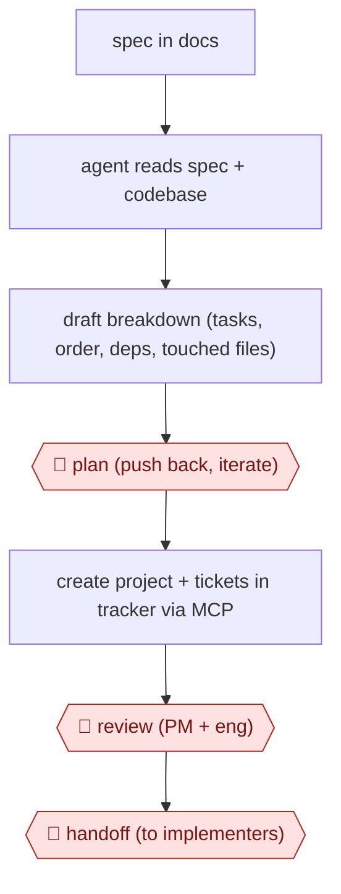

# Spec-to-ticket planning

`TEC › PRD › PM` · checkpointed · evidence A · **draft: needs a reference example** ([how to add one](../../../../../CONTRIBUTING.md#1-add-an-example-run))

**Shape:** `spec in docs → agent reads spec + codebase → draft breakdown (tasks, order, deps, touched files) → 🛑 plan (push back, iterate) → create project + tickets in tracker via MCP → 🛑 review (PM + eng) → 🛑 handoff (to implementers)`
**Variants:** `claude-code-linear-mcp` · `notion-mcp` · `gh-cli-issues`

<!-- shape diagram: generated by scripts/build_diagrams.py from `shape`; don't edit -->

<!-- end shape diagram -->

## Background

Product managers describe a problem and the outcome a team should deliver, while engineers need work items small enough to implement in a sensible order. Translating between those views requires knowing the existing code and finding dependencies that a product description may leave implicit. This workflow lets an agent draft the breakdown and create the agreed tickets. A person checks the plan before publication, and product and engineering review the tickets together. They remain responsible for priorities, scope and omissions.

**Terms:**
- **Spec / PRD**: a specification or product requirements document stating the problem, intended behavior and constraints.
- **PM / dependencies**: product manager, and work that must finish before another task can proceed.
- **Tracker / ticket**: the shared work-planning system and an individual work item.
- **MCP / CLI**: a protocol connecting agent tools to other systems, and a command-line interface.
- **Data modelling / edge cases**: defining how information is represented, and uncommon conditions the implementation must handle.

## Build it with an agent

**Form:** `skill`. One PM or engineer stays in the conversation while planning one project; no independent unattended controller is needed.

**You need:** the spec and read-only codebase access; a ticket template; approved document/tracker MCP server (connector) tools or the issue CLI. Scope writes to the intended project and keep confidential plans inside approved systems.

| Step | Built as |
|---|---|
| spec → read spec + codebase → draft breakdown | A Skill reads the spec and relevant source, then writes tasks with ordering, dependencies, touched files and open questions. |
| 🛑 plan → create project + tickets | The Skill presents the proposed ticket set and stops. After approval it uses the scoped MCP server (connector) tool to create only that set. |
| 🛑 review → 🛑 handoff | The Skill lists created ticket links and unresolved questions; product and engineering edit them before assigning implementation. |

**Checkpoints:** `plan`: the person reviews the proposed breakdown and target tracker before the Skill writes tickets. `review`: the agent presents the created set to PM and engineering and stops. `handoff`: implementers receive the agreed tickets and revisit their requirements; the planning Skill does not start implementation.

**Since the sources:** The entry lists evidence from 2026-04 and an undated account. In 2026-11 the Matos page returned only its title; the Every page opened only to the subscription boundary, so the quoted ticket count was not re-verified. Every now shows 2026-05 publication and a 2026-11 update. Searches found [Anthropic's current Skill-planning guide](https://claude.com/resources/guides/the-complete-guide-to-building-skills-for-claude/planning-and-design), opened in 2026-11, giving tracker-based sprint planning as a Skill/MCP use case. This supports the proposed packaging, not the blocked accounts' results. No special planner platform is necessary for the procedure; priorities and acceptance still require people.

*A design based on this entry's steps and the tool documentation as of 2026-11, not a reported run.*

## Steps

*As reported by the sources.*

1. The PM writes the spec as usual (problem, goals, metrics, user stories, constraints) in Notion [[1]](#sources). In the solo variant it is a roadmap README [[2]](#sources).
2. The PM or an engineer points Claude Code at the spec through the Notion MCP and asks for a project plan. The agent proposes tasks, order, dependencies and what each one touches in the codebase [[1]](#sources).
3. 🛑 **Plan**: the human reads the breakdown and pushes back ('why split X and Y? they touch the same file', 'you missed the migration step') over a few rounds until it is tight [[1]](#sources).
4. The agent pushes the plan into Linear through MCP: a project with every ticket carrying priority, description, and both product and technical context [[1]](#sources). The variant uses GitHub issues via the gh CLI [[2]](#sources).
5. 🛑 **Review**: the PM and engineering both review the created tickets. They move, kill or reprioritise tickets and flag missing pieces [[1]](#sources).
6. 🛑 **Handoff**: tickets go to engineers or coding agents. Before implementing a ticket, the owner re-reviews its requirements for data modelling and edge cases [[2]](#sources).

**Output:** A structured Linear (or GitHub) project with scoped, prioritised tickets, ready for sprint or agent pickup.
**Failure modes → guards:** Tickets scoped without codebase knowledge → the agent reads the repo during breakdown. A perfectly rational user assumed, with edge cases and microinteractions missed → human re-review before implementation [[2]](#sources). Agent is fast but not accountable → mandatory PM + eng review [[1]](#sources).

**How it differs:** AWF-0001 plan-gated build: its plan gate leads to a code PR. Here the deliverable stops at a reviewed ticket set in the tracker, and code work is handed off.

## Public runs

Coverage as of 2026-11-06: **Strong**: a first-hand, detailed run that matches most of the shape. Collected and re-checked in [New workflows for empty categories](../../../../../research/2026-11-new-workflows.md).

- [João Matos, The bottleneck has moved](https://joaomatos.me/notes/bottleneck-moved-fixed-it) (2026-04-10). Notion spec to reviewed Linear project via Claude Code and MCP. "The review usually takes 15–30 minutes"; "Total time from Notion doc to ready-to-work Linear project: under an hour.". *First-hand: yes; confidence: high.*
- [Marcus Moretti, Claude Code for Product Managers](https://every.to/source-code/claude-code-for-product-managers) (n.d.). Roadmap README to GitHub issues; PM re-reviews each ticket before implementing. "Claude produced about 100 detailed tickets". *First-hand: yes; confidence: high.*

## Sources

1. João Matos, The bottleneck has moved. Here's how we fixed it., 2026-04-10. https://joaomatos.me/notes/bottleneck-moved-fixed-it
2. Marcus Moretti (Every / Spiral), Claude Code for Product Managers, Every. https://every.to/source-code/claude-code-for-product-managers
