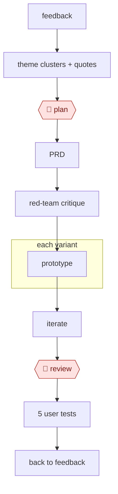

# Feedback to prototype

`TEC › PRD › PROTO` · checkpointed · evidence A · **draft: needs a reference example** ([how to add one](../../../../../CONTRIBUTING.md#1-add-an-example-run))

**Shape:** `feedback → theme clusters + quotes → 🛑 plan → PRD → red-team critique → each variant: prototype → iterate → 🛑 review → 5 user tests → back to feedback`

<!-- shape diagram: generated by scripts/build_diagrams.py from `shape`; don't edit -->

<!-- end shape diagram -->

## Steps
1. Cluster tickets, call transcripts, and NPS verbatims into themes, each with counts and source-linked quotes.
2. 🛑 **Plan**: the PM picks the problem to solve.
3. Draft the PRD: problem, users, non-goals, metrics, stories, edge cases. A critic red-teams it ("what would engineering push back on?").
4. Build 2–3 prototype variants (v0, Lovable, Bolt, Figma Make, Claude artifacts) from the PRD plus design tokens.
5. Iterate.
6. 🛑 **Review**: design review.
7. Run 5 user tests and feed the transcripts back to step 1.

**Output:** the PRD and prototype become the input to AWF-0001 or AWF-0008.

## Public runs

Coverage as of 2026-11-06: **None found**: no public first-hand run yet. A real example run would be the first. From [Where are the real runs?](../../../../../research/2026-11-real-runs.md); every number was re-checked against its page.

- [Teresa Torres, Product Talk](https://www.producttalk.org/ai-prototyping-lovable/) (2025-08-13). Interviews → scope → Lovable variants → internal user tests. "From idea to user validation, it just took us 11 days". *First-hand: no (second-hand); confidence: low.*

