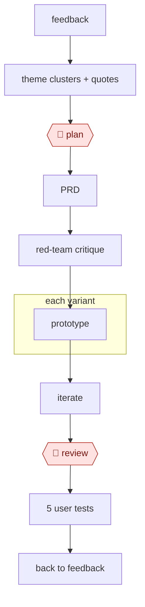

# Feedback to prototype

`TEC › PRD › PROTO` · checkpointed · evidence A · **draft: needs a reference example** ([how to add one](../../../../../CONTRIBUTING.md#1-add-an-example-run))

**Shape:** `feedback → theme clusters + quotes → 🛑 plan → PRD → red-team critique → each variant: prototype → iterate → 🛑 review → 5 user tests → back to feedback`

<!-- shape diagram: generated by scripts/build_diagrams.py from `shape`; don't edit -->

<!-- end shape diagram -->

## Background

Product teams collect customer complaints and suggestions, but those messages do not by themselves identify which problem is worth solving. A prototype makes a possible solution concrete enough for people to try before the team commits to building it. This workflow lets an agent group feedback, draft requirements and build alternative interactions. A product manager chooses the problem and designers review the prototype before user testing. Real users provide the evidence about whether the proposed solution addresses their needs.

**Terms:**
- **PRD / PM**: product requirements document, and the product manager deciding priorities.
- **NPS verbatims**: written comments collected alongside a net promoter score survey.
- **Theme cluster / source-linked quote**: related feedback grouped together, with wording linked back to its original record.
- **Red-team critique**: deliberately looking for weaknesses in a proposal.
- **Design tokens / prototype**: reusable visual settings, and a testable model of an interaction.

## Build it with an agent

**Form:** `skill`. One product lead guides a discovery cycle in conversation; a Skill can hold the sequence and use built-in parallel checks.

**You need:** approved feedback and transcripts with source identifiers; product constraints, design references and a sandbox for prototype files. Remove unnecessary customer identifiers before model access. Use synthetic prototype data and keep customer messaging, recruitment and production publishing tools out of the agent's reach.

| Step | Built as |
|---|---|
| feedback → theme clusters + quotes → 🛑 plan | A Skill groups feedback, links quotations and presents competing problem statements; the PM chooses the focus. |
| PRD → red-team critique | The Skill drafts requirements; a read-only Subagent checks assumptions and gaps against the supplied evidence. |
| each variant: prototype → iterate → 🛑 review | The Skill writes separate prototype files using the approved components or coding environment; the person compares interactions and asks for revisions. |
| 5 user tests → back to feedback | People run the tests and provide transcripts; the Skill adds observations back to the evidence set. |

**Checkpoints:** `plan`: the Skill stops with themes, evidence and uncertainties before drafting a solution. `review`: it presents prototypes and differences for design review. The agent cannot recruit or contact customers, publish the prototype or alter production; people control the testing and release steps.

**Since the sources:** The public account dates from 2025-08 and was opened in 2026-11. It reports interviews with teams using AI prototyping tools, not an agent running the complete sequence or a universal requirement for 5 tests. Searches found [Nate Parrott's first-hand prototyping account](https://claude.com/resources/articles/how-the-product-designer-who-built-claude-design-uses-it-to-explore-ideas-before-building-them), dated 2026-07 and opened in 2026-11, describing iterative visual exploration with code context. A general coding Skill can now make the prototype files directly; the build does not require the particular generator products listed in the historical steps. User feedback and the decision to invest remain outside automated generation.

*A design based on this entry's steps and the tool documentation as of 2026-11, not a reported run.*

## Steps

*As reported by the sources.*

1. The agent clusters tickets, call transcripts, and NPS verbatims into themes, each with counts and source-linked quotes.
2. 🛑 **Plan**: the PM picks the problem to solve.
3. The agent drafts the PRD: problem, users, non-goals, metrics, stories, edge cases. A critic red-teams it ("what would engineering push back on?").
4. The agent builds 2–3 prototype variants (v0, Lovable, Bolt, Figma Make, Claude artifacts) from the PRD plus design tokens.
5. The product team iterates with the agent.
6. 🛑 **Review**: the designers review the prototype.
7. The product team runs 5 user tests and feeds the transcripts back to step 1.

**Output:** the PRD and prototype become the input to AWF-0001 or AWF-0008.

## Public runs

Coverage as of 2026-11-06: **None found**: no public first-hand run yet. A real example run would be the first. From [Where are the real runs?](../../../../../research/2026-11-real-runs.md); every number was re-checked against its page.

- [Teresa Torres, Product Talk](https://www.producttalk.org/ai-prototyping-lovable/) (2025-08-13). Interviews → scope → Lovable variants → internal user tests. "From idea to user validation, it just took us 11 days". *First-hand: no (second-hand); confidence: low.*

