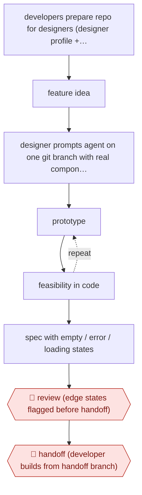

# In-codebase handoff prototype

`TEC › PRD › PROTO` · assist · evidence A · **draft: needs a reference example** ([how to add one](../../../../../CONTRIBUTING.md#1-add-an-example-run))

**Shape:** `developers prepare repo for designers (designer profile + 3 skill files) → feature idea → designer prompts agent on one git branch with real components → (prototype ⟲ feasibility in code) → spec with empty / error / loading states → 🛑 review (edge states flagged before handoff) → 🛑 handoff (developer builds from handoff branch)`
**How it differs:** Closest is AWF-0007 Feedback to prototype: that workflow clusters feedback into a PRD, builds several prototype variants and validates them with 5 user tests. Here the deliverable is a single in-repo branch handed to engineering, the gates are an edge-state review and a dev handoff, and there is no user-test loop. It also differs from the new Designer-authored UI PR, where the designer's own PR merges to production after engineering review. Here developers build the shipped code from the prototype branch.
**Variants:** `claude-code`

<!-- shape diagram: generated by scripts/build_diagrams.py from `shape`; don't edit -->

<!-- end shape diagram -->

## Steps
1. One-time setup: a tiger team of developers spends six weeks making the production repo a safe, productive place for designers to prototype. The setup is one designer profile and three skill files for Claude Code [[1]](#sources).
2. For each feature, the designer prototypes directly in the production codebase on a single git branch, using the real design-system components. This replaces separate Figma mock-ups and Lovable interaction prototypes [[1]](#sources).
3. Scope is bounded by what already exists in the code. Feasibility problems show up while the designer is prototyping, not later in development [[1]](#sources).
4. The designer adds empty, error and loading states to the spec. 🛑 **Review**: these edge states are flagged for review before handoff [[1]](#sources).
5. 🛑 **Handoff**: developers build the production feature from the handoff branch, and leadership reviews progress in the same place [[1]](#sources).

**Output:** A prototype on a git branch in the production repo, plus a spec covering edge states, which developers use as the starting point for the shipped feature.
**Failure modes → guards:** Speculative mock-ups that turn out infeasible, and missing edge states that developers then fill in themselves → prototype with real components inside codebase constraints, and flag edge states for review before handoff. Version confusion across tools → one artifact on one branch.

## Public runs

Coverage as of 2026-11-13: **Partial**: first-hand runs that cover part of the shape or put checkpoints elsewhere. Collected and re-checked in [Fourth collection pass](../../../../../research/2026-11-fourth-pass.md).

- [Knak, How Knak's Designers Prototype Directly in the Codebase](https://knak.com/blog/claude-code-streamlining-at-knak/) (2026-05-07). Knak designers prototype on one branch in the production repo after a six-week developer setup. "One front-end developer remarked that working from a handoff branch cut his time-to-production roughly in half.". *First-hand: yes; confidence: med.*

## Sources

1. Jack Steele (Director of Engineering, Knak), How Knak's Designers Prototype Directly in the Codebase, Knak blog, 2026-05-07. https://knak.com/blog/claude-code-streamlining-at-knak/
