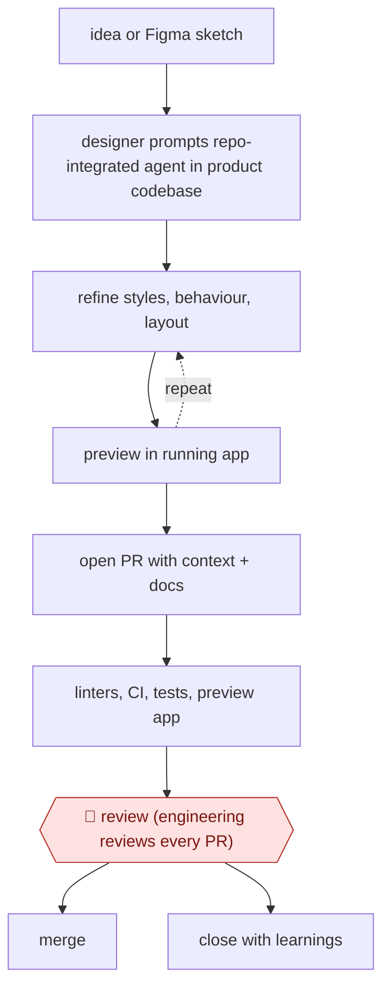

# Designer-authored UI PR

`TEC › PRD › UI` · assist · evidence A · **draft: needs a reference example** ([how to add one](../../../../../CONTRIBUTING.md#1-add-an-example-run))

**Shape:** `idea or Figma sketch → designer prompts repo-integrated agent in product codebase → (refine styles, behaviour, layout ⟲ preview in running app) → open PR with context + docs → linters, CI, tests, preview app → 🛑 review (engineering reviews every PR) → merge | close with learnings`
**Variants:** `cursor` · `claude-code`

<!-- shape diagram: generated by scripts/build_diagrams.py from `shape`; don't edit -->

<!-- end shape diagram -->

## Background

Product designers usually describe an interface and pass it to engineers, who translate the design into application code. Small interactions can lose detail during that handoff, while larger changes may depend on technical constraints the designer cannot see in a mock-up. This workflow lets a designer use an agent directly in the product repository and preview changes as they work. Engineering still reviews each proposed change because appearance alone does not establish maintainability, performance or accessibility. Some experiments are deliberately discarded rather than shipped.

**Terms:**
- **UI / frontend / backend**: user interface, the part running in the user's application, and supporting server-side behavior.
- **PR / branch / CI**: pull request, an isolated line of changes, and automated checks run on proposed changes.
- **Linter / preview app**: a checker for code rules, and a running build for inspection before release.
- **State / cross-cutting architecture**: information the application keeps between interactions, and structures affecting several parts of the system.

## Build it with an agent

**Form:** `project`. Prepared repository conventions, protected edit boundaries and required engineering review accompany the designer's Skill.

**You need:** the repository, approved interface components and preview/build commands; designer instructions in `CLAUDE.md`; a Skill for implementation and checks. Use a dedicated branch and sample data. Restrict backend and secret-file edits with a Hook or Permission rule or mode; withhold merge and production-deployment tools.

| Step | Built as |
|---|---|
| idea or sketch → designer prompts agent → refine ⟲ preview | The Skill reads component conventions and proposes a scope plan; a developer approves it before coding. The Skill then drafts the change and uses project scripts to run the preview. The designer drives the iterations. |
| open PR with context + docs → linters, CI, tests, preview | The Skill prepares the diff and explanation; a Hook runs required local checks and the code host runs the normal CI pipeline. |
| 🛑 review → merge or close | The agent ends at the reviewable PR; engineering decides whether to merge, request changes or close it with lessons for the next attempt. |

**Checkpoints:** `review`: a developer first approves the scope plan; later engineers inspect the running preview, diff, test results and scope against the product request. Repository permissions prevent the agent from merging or deploying; protected branches require engineering review. Changes beyond the agreed frontend scope return to an engineer before further implementation.

**Since the sources:** The source dates from 2025-08 and was opened in 2026-11. Searches found [Plotly's engineering follow-up](https://plotly.com/blog/what-i-learned-integrating-designers-wielding-llms-into-our-codebase/), dated 2025-10 and opened in 2026-11. It narrows the successful cases to constrained changes and describes developer approval of a plan before coding, alongside the later PR review. This design retains repository and review boundaries rather than interpreting faster coding as autonomous delivery; pre-coding developer plan approval follows that later account. The source's percentages remain historical results, not expectations for this build.

*A design based on this entry's steps and the tool documentation as of 2026-11, not a reported run.*

## Steps

*As reported by the sources.*

1. A product designer starts from an idea in Figma or a sketched interaction pattern. Instead of writing a spec, they open a code editor with a repo-integrated assistant (Cursor or Claude Code) and prompt it to build the experience in the real product codebase [[1]](#sources).
2. The designer refines styles, adjusts behaviour and tries layouts inside the codebase, previewing each change in the running application. Work happens on dedicated feature branches with preview environments [[1]](#sources).
3. For blue-sky work or big interaction spikes, the designer deliberately builds a throwaway prototype outside the repo first, to compare options and decide whether the idea merits a full implementation [[1]](#sources).
4. When satisfied, the designer opens a pull request that includes context and documentation. Guardrails (linters, CI, preview apps, automated test suites, required reviews) run on it [[1]](#sources).
5. 🛑 **Review**: engineering reviews every designer contribution for quality and consistency, under the same review process as any other code. Common rejection reasons are drifting from the design system, performance or accessibility gaps, and maintainability concerns [[1]](#sources).
6. The delivery system ships merged PRs. Closed PRs feed lessons into the next pass. Changes that only touch the frontend land best, and complex features are paired with engineering [[1]](#sources).

**Output:** A merged frontend pull request authored by a designer, in production code, with no Figma-to-engineering handoff.
**Failure modes → guards:** PRs drift from the design system, open performance or accessibility gaps, or reach into cross-cutting architecture and ad-hoc state → required engineering review plus linters, CI, preview apps and test suites. About 30% of PRs are closed without merging. Backend-touching changes land poorly → keep designer PRs to the frontend and pair with engineering on complex features.

**How it differs:** Closest is AWF-0062 Spec-bound screen options: there the deliverable is hi-fi design in a Figma working file, reviewed by a designer. Here the deliverable is shipped code, and the gate is an engineering PR review. AWF-0121 is an accessibility review/fix agent on engineers' PRs: a different deliverable, and it is routed to an accessibility team.

## Public runs

Coverage as of 2026-11-13: **Strong**: a first-hand, detailed run that matches most of the shape. Collected and re-checked in [Fourth collection pass](../../../../../research/2026-11-fourth-pass.md).

- [Plotly, How Plotly Designers Build Beyond Figma Mockups With AI](https://plotly.com/blog/plotly-designers-build-beyond-figma-mockups-ai/) (2025-08-25). Plotly designers ship code PRs through engineering review; merge rate and share of PRs. "designers have successfully merged approximately 70% of their PRs, with about 30% closed without merging"; "roughly 20% of total PRs in our main application now come from designers". *First-hand: yes; confidence: high.*

## Sources

1. Laura Gray and Dana Dzivinski (Plotly), How Plotly Designers Build Beyond Figma Mockups With AI, Plotly blog, 2025-08-25. https://plotly.com/blog/plotly-designers-build-beyond-figma-mockups-ai/
