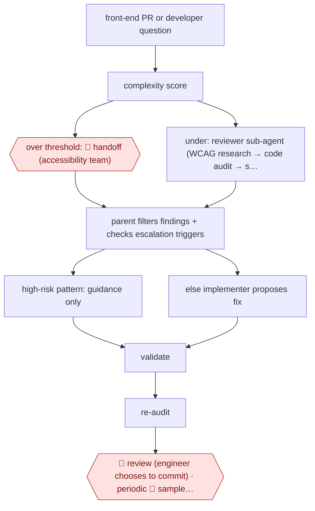

# Routed accessibility PR agent

`TEC › PRD › UI` · checkpointed · evidence A · **draft: needs a reference example** ([how to add one](../../../../../CONTRIBUTING.md#1-add-an-example-run))

**Shape:** `front-end PR or developer question → complexity score → over threshold: 🛑 handoff (accessibility team) | under: reviewer sub-agent (WCAG research → code audit → structured findings) → parent filters findings + checks escalation triggers → high-risk pattern: guidance only | else implementer proposes fix → validate → re-audit → 🛑 review (engineer chooses to commit) · periodic 🛑 sample (accessibility team audits output)`
**Variants:** `github-copilot-cli` · `axe-core` · `accessflow-code-agent`

<!-- shape diagram: generated by scripts/build_diagrams.py from `shape`; don't edit -->

<!-- end shape diagram -->

## Background

Accessibility specialists help teams make interfaces usable by people with different ways of seeing, hearing, moving and interacting. Code can reveal some barriers, but a component that passes automated checks may still fail in real use. This workflow has an agent review proposed frontend changes, propose bounded fixes and route difficult patterns to specialists. Engineers decide whether to accept each fix, while the accessibility team inspects samples of agent output. That human role remains essential because many accessibility judgments depend on context and interaction.

**Terms:**
- **WCAG / A and AA**: Web Content Accessibility Guidelines, with levels grouping their success criteria.
- **PR / CLI**: a proposed repository change, and a command-line interface for on-demand requests.
- **Reviewer / implementer / schema**: separate inspection and editing roles, and a fixed format for their reports.
- **Toast / tree view / data grid**: a brief status message, a hierarchical list and an interactive table.
- **Re-audit**: checking a proposed fix again after changes.

## Build it with an agent

**Form:** `service`. Frontend PR events start runs automatically and specialist audits happen periodically; people receive suggestions, escalations and samples.

**You need:** PR events and scoped repository access; organisation-specific audited examples; current accessibility references, the complexity script and risk-pattern policy; isolated preview and test scripts; a durable review/audit queue. Use synthetic or approved test data. Use a Permission rule or mode to deny commits, merges and production deployment.

| Step | Built as |
|---|---|
| PR or question → complexity score → 🛑 handoff | A headless Skill invokes the complexity script; a Hook blocks editing when thresholds or known high-risk patterns require guidance only. |
| reviewer researches → audits → structured findings | A read-only Subagent uses the fixed reviewer schema and returns criterion references, code locations and escalation triggers. |
| parent filters → guidance or implementer → validate → re-audit | The Skill routes filtered findings to a separate editing Subagent only for permitted cases, then runs tests and a fresh inspection; workers do not communicate directly. |
| 🛑 review · periodic 🛑 sample | The service writes suggested diffs and guidance to the PR review queue, retaining a policy-defined sample for the accessibility team. |

**Checkpoints:** `handoff`: complex or high-risk cases receive evidence and questions for the accessibility team, with no generated patch. `review`: an engineer sees the proposed diff, criterion references and validation limits and commits only the fixes they accept. `sample`: the accessibility team periodically audits stored outputs and feedback. Permission rules and the edit-blocking Hook enforce guidance-only cases; the service cannot merge.

**Since the sources:** The source dates from 2026-05 and was opened in 2026-11. Searches found [accessFlow's Code Agent announcement](https://support.accessibe.com/hc/en-us/articles/39152427368466-2026-09-17-accessFlow-Code-Agent-brings-AI-powered-accessibility-checks-to-GitHub), dated 2026-09 and opened in 2026-11, describing PR checks and suggested improvements. That is a maintained product alternative, not evidence that expert routing or manual checks are obsolete. A general headless agent can use Skills, Subagents and Hooks for this routing while existing checkers remain external tools. Preserve the source's fixed-order reviewer/implementer separation; neither tool success nor another model's approval establishes complete accessibility.

*A design based on this entry's steps and the tool documentation as of 2026-11, not a reported run.*

## Steps

*As reported by the sources.*

1. The code host triggers the agent on PRs that change front-end code; developers can also invoke it from the CLI or editor [[1]](#sources).
2. A shell script scores the code's complexity. Above the threshold, the agent makes no code changes. 🛑 **Handoff**: it tells the person to consult the accessibility team [[1]](#sources).
3. A read-only reviewer sub-agent researches the WCAG criteria, audits the code, flags escalation triggers (for example several high-severity failures), and returns findings in a template schema [[1]](#sources).
4. The parent agent validates and filters the findings. For high-risk patterns (drag and drop, toasts, rich text editors, tree views, data grids) it switches the implementer to guidance only. Otherwise the implementer proposes and validates code changes, and the parent runs re-audit loops [[1]](#sources).
5. 🛑 **Review**: a human decides whether to commit each suggested fix. 🛑 **Sample**: the accessibility team periodically reviews agent output for accuracy, and PR reviewer sentiment is tracked [[1]](#sources).

**Output:** WCAG findings and suggested fixes on front-end PRs, or a guidance doc and handoff for complex patterns.
**Failure modes → guards:** About 36% of level A and AA criteria can't be found automatically → the agent escalates and gives guidance instead of claiming coverage. Confident fixes on hard widgets → a deny-list of high-risk patterns and a complexity threshold. Less experienced users accept the output without question → periodic audits by the accessibility team [[1]](#sources).

**How it differs:** Closest is AWF-0062 (Spec-bound screen options), a designer-gated flow that makes new screens. This one audits and fixes existing front-end code on every PR. It routes by complexity and risk to fix, guidance or handoff, and adds sampled expert audits.

## Public runs

Coverage as of 2026-11-06: **Strong**: a first-hand, detailed run that matches most of the shape. Collected and re-checked in [Second collection pass](../../../../../research/2026-11-second-pass.md).

- [GitHub, Building a general-purpose accessibility agent](https://github.blog/ai-and-ml/github-copilot/building-a-general-purpose-accessibility-agent-and-what-we-learned-in-the-process/) (2026-05-15). Runs automatically on GitHub's own front-end PRs, with routing and escalation gates. "reviewed 3,535 pull requests, with a 68% resolution rate". *First-hand: yes; confidence: high.*

## Sources

1. Eric Bailey, GitHub Blog, Building a general-purpose accessibility agent—and what we learned in the process, 2026-05-15. https://github.blog/ai-and-ml/github-copilot/building-a-general-purpose-accessibility-agent-and-what-we-learned-in-the-process/
