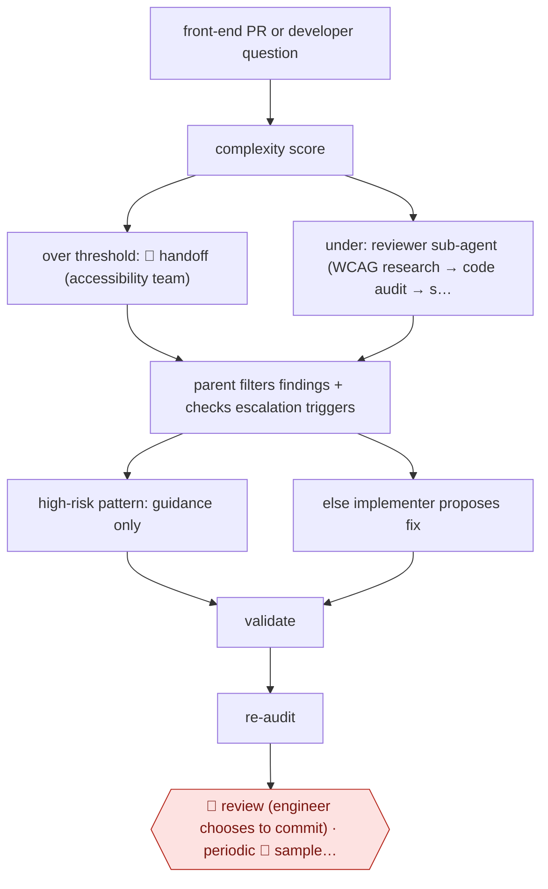

# Routed accessibility PR agent

`TEC › PRD › UI` · checkpointed · evidence A · **draft: needs a reference example** ([how to add one](../../../../../CONTRIBUTING.md#1-add-an-example-run))

**Shape:** `front-end PR or developer question → complexity score → over threshold: 🛑 handoff (accessibility team) | under: reviewer sub-agent (WCAG research → code audit → structured findings) → parent filters findings + checks escalation triggers → high-risk pattern: guidance only | else implementer proposes fix → validate → re-audit → 🛑 review (engineer chooses to commit) · periodic 🛑 sample (accessibility team audits output)`
**How it differs:** Closest is AWF-0062 (Spec-bound screen options), a designer-gated flow that makes new screens. This one audits and fixes existing front-end code on every PR. It routes by complexity and risk to fix, guidance or handoff, and adds sampled expert audits.
**Variants:** `github-copilot-cli` · `axe-core` · `accessflow-code-agent`

<!-- shape diagram: generated by scripts/build_diagrams.py from `shape`; don't edit -->

<!-- end shape diagram -->

## Steps
1. Trigger automatically on PRs that change front-end code, or on demand from the CLI or editor [[1]](#sources).
2. A shell script scores the code's complexity. Above the threshold, the agent makes no code changes. 🛑 **Handoff**: it tells the person to consult the accessibility team [[1]](#sources).
3. A read-only reviewer sub-agent researches the WCAG criteria, audits the code, flags escalation triggers (for example several high-severity failures), and returns findings in a template schema [[1]](#sources).
4. The parent agent validates and filters the findings. For high-risk patterns (drag and drop, toasts, rich text editors, tree views, data grids) it switches the implementer to guidance only. Otherwise the implementer proposes and validates code changes, and the parent runs re-audit loops [[1]](#sources).
5. 🛑 **Review**: a human decides whether to commit each suggested fix. 🛑 **Sample**: the accessibility team periodically reviews agent output for accuracy, and PR reviewer sentiment is tracked [[1]](#sources).

**Output:** WCAG findings and suggested fixes on front-end PRs, or a guidance doc and handoff for complex patterns.
**Failure modes → guards:** About 36% of level A and AA criteria can't be found automatically → the agent escalates and gives guidance instead of claiming coverage. Confident fixes on hard widgets → a deny-list of high-risk patterns and a complexity threshold. Less experienced users accept the output without question → periodic audits by the accessibility team [[1]](#sources).

## Public runs

Coverage as of 2026-11-06: **Strong**: a first-hand, detailed run that matches most of the shape. Collected and re-checked in [Second collection pass](../../../../../research/2026-11-second-pass.md).

- [GitHub, Building a general-purpose accessibility agent](https://github.blog/ai-and-ml/github-copilot/building-a-general-purpose-accessibility-agent-and-what-we-learned-in-the-process/) (2026-05-15). Runs automatically on GitHub's own front-end PRs, with routing and escalation gates. "reviewed 3,535 pull requests, with a 68% resolution rate". *First-hand: yes; confidence: high.*

## Sources

1. Eric Bailey, GitHub Blog, Building a general-purpose accessibility agent—and what we learned in the process, 2026-05-15. https://github.blog/ai-and-ml/github-copilot/building-a-general-purpose-accessibility-agent-and-what-we-learned-in-the-process/
