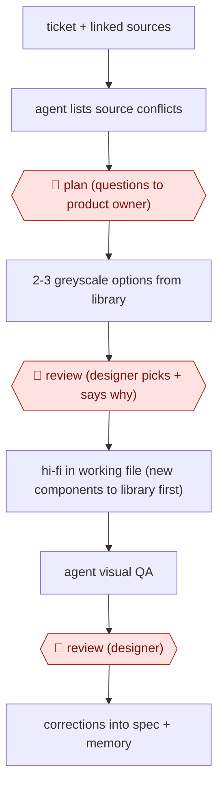

# Spec-bound screen options

`TEC › PRD › UI` · checkpointed · evidence A · **draft: needs a reference example** ([how to add one](../../../../../CONTRIBUTING.md#1-add-an-example-run))

**Shape:** `ticket + linked sources → agent lists source conflicts → 🛑 plan (questions to product owner) → 2-3 greyscale options from library → 🛑 review (designer picks + says why) → hi-fi in working file (new components to library first) → agent visual QA → 🛑 review (designer) → corrections into spec + memory`
**Variants:** `figma-api` · `figma-mcp` · `claude-code`

<!-- shape diagram: generated by scripts/build_diagrams.py from `shape`; don't edit -->

<!-- end shape diagram -->

## Background

Product designers turn requirements into screens that fit the product's shared visual language. Tickets, conversations and existing code can disagree, and a polished screen can accidentally introduce behavior nobody requested. This workflow has an agent gather those sources, expose conflicts and propose several restrained layout options before producing the chosen design. The designer selects the direction and inspects the finished screens. Human judgment remains necessary because structural checks cannot establish whether a screen communicates clearly or implements the intended requirement.

**Terms:**
- **Greyscale wireframe / hi-fi**: a layout without finished visual styling, and a detailed high-fidelity screen.
- **Library / published instance**: the shared component definitions and linked copies placed on screens.
- **Semantic token / primitive**: a named style expressing a purpose, and its underlying value.
- **Spec / memory / QA**: versioned design rules, recorded corrections and quality-assurance checks.
- **API / MCP**: a program interface and the protocol connecting its tools to an agent.

## Build it with an agent

**Form:** `project`. Persistent design rules and correction notes, together with a library-only write boundary, must apply to every task.

**You need:** the ticket and linked sources; the component library and working file; `DESIGN.md` and reviewed correction notes; approved Figma MCP server (connector) tools with the required read/write access. A Skill loads rules at the start; `CLAUDE.md` specifies source precedence. Protect client material and production data; work in approved design files and label sample content.

| Step | Built as |
|---|---|
| ticket + sources → list conflicts → 🛑 plan | The Skill reads the sources and design rules, then lists contradictions and unresolved questions without changing the product owner's ticket. |
| 2-3 greyscale options → 🛑 review | The Skill creates options using library instances through MCP server (connector) tools; the designer selects or combines them and records the reason. |
| hi-fi in working file; new components to library first | A Hook checks the target file and component provenance before writes. New library components wait for human publication before use in the working file. |
| visual QA → 🛑 review → corrections into spec + memory | The Skill exports screenshots and compares affected instances with their source components; approved corrections are proposed as versioned rule and note edits. |

**Checkpoints:** `plan`: the Skill stops with source conflicts and questions before drawing. `review`: the designer chooses the option, then inspects the detailed screens after QA. MCP permissions withhold library publication and production release from the agent; a Hook blocks unapproved local component creation in the working file. The person reviews changes to design rules and correction notes.

**Since the sources:** The source dates from 2026-10 and was opened in 2026-11. Searches found [Figma's current tool documentation](https://developers.figma.com/docs/figma-mcp-server/tools-and-prompts/), opened in 2026-11, documenting native read and write tools. An MCP server (connector) can therefore provide the design-file access instead of assuming a custom API wrapper, subject to the account's available tools and limits. The source's library-first discipline, source-conflict review and human visual inspection remain relevant. Neither its correction notes nor `CLAUDE.md` are enforcement by themselves; write restrictions need connector permissions or Hooks.

*A design based on this entry's steps and the tool documentation as of 2026-11, not a reported run.*

## Steps

*As reported by the sources.*

1. The designer keeps two Figma files (a library and a working file built only from published instances), one versioned DESIGN.md spec, and an agent memory of past corrections. The agent loads all of them before any task [[1]](#sources).
2. The agent reads the Jira ticket with linked stories, Confluence pages, code specs and call transcripts. It designs only what those sources describe [[1]](#sources).
3. 🛑 **Plan**: before drawing anything, the agent lists where the story, board and code disagree and which source wins. Open questions go back to the product owner [[1]](#sources).
4. The agent produces 2-3 greyscale wireframe options built from library instances, side by side on a review board [[1]](#sources).
5. 🛑 **Review**: the designer picks or combines options and states why [[1]](#sources).
6. The agent builds the chosen option hi-fi with real content. Any new component goes into the library first and is published before the screen uses it [[1]](#sources).
7. The agent performs visual QA after bulk changes: it compares each instance to its main component, takes before/after screenshots, checks clipping and overlap, and runs the checklist [[1]](#sources).
8. 🛑 **Review**: the designer inspects the screens. Each correction is written into the spec and the memory so it doesn't recur [[1]](#sources).

**Output:** Reviewed hi-fi Figma screens built from the published design system, plus an updated spec and memory. They go on to dev handoff.
**Failure modes → guards:** Agent invents components that exist nowhere in the product → 'only library instances' rule plus spec. The same mistakes recur weekly → corrections persisted to memory (~70 notes) with the spec taking precedence. Structurally valid but visually wrong screens → designer looks even when the QA script reports zero errors [[1]](#sources).

**How it differs:** AWF-0008 design to code turns approved designs into code. AWF-0007 feedback to prototype builds prototypes from feedback. This produces reviewed design-tool screens from tickets, with an options-pick gate.

## Public runs

Coverage as of 2026-11-06: **Strong**: a first-hand, detailed run that matches most of the shape. Collected and re-checked in [New workflows for empty categories](../../../../../research/2026-11-new-workflows.md).

- [Nuno Viegas, AI-native designer: a design system in five weeks](https://nmviegas.pt/blog/ai-native-designer-design-system-in-five-weeks) (2026-10-30). Wealth-management design system and screens built with agent writing to Figma via API. "There are about 70 of them now."; "the agent re-pointed five semantic tokens". *First-hand: yes; confidence: high.*

## Sources

1. Nuno Viegas, AI-native designer: a design system in five weeks, 2026-10-30. https://nmviegas.pt/blog/ai-native-designer-design-system-in-five-weeks
