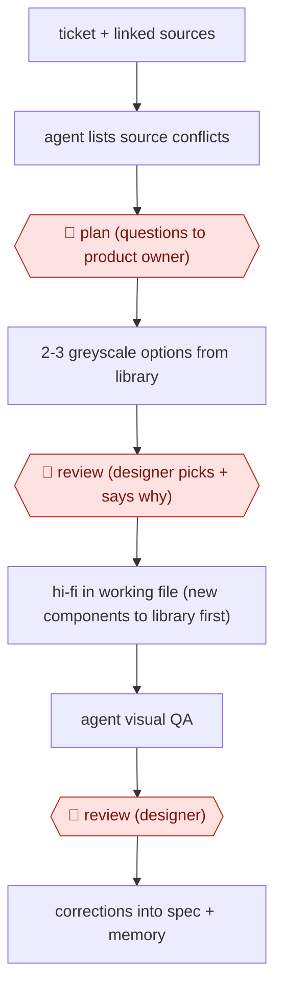

# Spec-bound screen options

`TEC › PRD › UI` · checkpointed · evidence A · **draft: needs a reference example** ([how to add one](../../../../../CONTRIBUTING.md#1-add-an-example-run))

**Shape:** `ticket + linked sources → agent lists source conflicts → 🛑 plan (questions to product owner) → 2-3 greyscale options from library → 🛑 review (designer picks + says why) → hi-fi in working file (new components to library first) → agent visual QA → 🛑 review (designer) → corrections into spec + memory`
**How it differs:** AWF-0008 design to code turns approved designs into code. AWF-0007 feedback to prototype builds prototypes from feedback. This produces reviewed design-tool screens from tickets, with an options-pick gate.
**Variants:** `figma-api` · `figma-mcp` · `claude-code`

<!-- shape diagram: generated by scripts/build_diagrams.py from `shape`; don't edit -->

<!-- end shape diagram -->

## Steps
1. Keep two Figma files (a library and a working file built only from published instances), one versioned DESIGN.md spec, and an agent memory of past corrections. The agent loads all of them before any task [[1]](#sources).
2. The agent reads the Jira ticket with linked stories, Confluence pages, code specs and call transcripts. It designs only what those sources describe [[1]](#sources).
3. 🛑 **Plan**: before drawing anything, the agent lists where the story, board and code disagree and which source wins. Open questions go back to the product owner [[1]](#sources).
4. Produce 2-3 greyscale wireframe options built from library instances, side by side on a review board [[1]](#sources).
5. 🛑 **Review**: the designer picks or combines options and states why [[1]](#sources).
6. Build the chosen option hi-fi with real content. Any new component goes into the library first and is published before the screen uses it [[1]](#sources).
7. Agent visual QA after bulk changes: compare each instance to its main component, take before/after screenshots, check clipping and overlap, run the checklist [[1]](#sources).
8. 🛑 **Review**: the designer inspects the screens. Each correction is written into the spec and the memory so it doesn't recur [[1]](#sources).

**Output:** Reviewed hi-fi Figma screens built from the published design system, plus an updated spec and memory. They go on to dev handoff.
**Failure modes → guards:** Agent invents components that exist nowhere in the product → 'only library instances' rule plus spec. The same mistakes recur weekly → corrections persisted to memory (~70 notes) with the spec taking precedence. Structurally valid but visually wrong screens → designer looks even when the QA script reports zero errors [[1]](#sources).

## Public runs

Coverage as of 2026-11-06: **Strong**: a first-hand, detailed run that matches most of the shape. Collected and re-checked in [New workflows for empty categories](../../../../../research/2026-11-new-workflows.md).

- [Nuno Viegas, AI-native designer: a design system in five weeks](https://nmviegas.pt/blog/ai-native-designer-design-system-in-five-weeks) (2026-10-30). Wealth-management design system and screens built with agent writing to Figma via API. "There are about 70 of them now."; "the agent re-pointed five semantic tokens". *First-hand: yes; confidence: high.*

## Sources

1. Nuno Viegas, AI-native designer: a design system in five weeks, 2026-10-30. https://nmviegas.pt/blog/ai-native-designer-design-system-in-five-weeks
