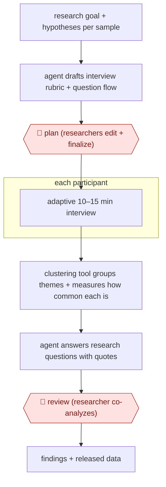

# Agent-run interviews

`TEC › PRD › UXR` · checkpointed · evidence A · **draft: needs a reference example** ([how to add one](../../../../../CONTRIBUTING.md#1-add-an-example-run))

**Shape:** `research goal + hypotheses per sample → agent drafts interview rubric + question flow → 🛑 plan (researchers edit + finalize) → each participant: adaptive 10–15 min interview → clustering tool groups themes + measures how common each is → agent answers research questions with quotes → 🛑 review (researcher co-analyzes) → findings + released data`
**How it differs:** Closest is AWF-0061 (Quote-verified synthesis), where a person reviews each step of synthesizing transcripts that already exist. In this one the agent conducts the interviews itself. The human checkpoints sit at the interview plan and in the final analysis, and the deliverable is a new primary dataset.
**Variants:** `anthropic-interviewer` · `conveo` · `great-question-ai-moderator`

<!-- shape diagram: generated by scripts/build_diagrams.py from `shape`; don't edit -->

<!-- end shape diagram -->

## Steps
1. Write a system prompt with the method, hypotheses for each sample, and interview-planning practices set by the user research team [[1]](#sources).
2. From the research goal, the agent drafts an interview rubric with questions and a planned flow. This keeps questions consistent across hundreds of interviews while allowing tangents. 🛑 **Plan**: human researchers edit and finalize the plan [[1]](#sources).
3. The agent runs real-time, adaptive interviews with each participant following the plan. In the reported test they lasted about 10–15 minutes [[1]](#sources).
4. A separate tool clusters emergent themes across transcripts and measures how common each one is. The agent answers each research question with example quotes [[1]](#sources).
5. 🛑 **Review**: a human researcher analyzes the transcripts together with the agent before findings are published [[1]](#sources).

**Output:** A study of hundreds to thousands of interviews with themes, how common each is, and quotes. In the source, the consented interview data was released publicly.
**Failure modes → guards:** Shallow probing → detailed research plans set by researchers. Theme clusters taken as truth → human co-analysis of transcripts. Sample bias (crowdworker recruitment) → state it as a limit of the study [[1]](#sources).

## Public runs

Coverage as of 2026-11-06: **Strong**: a first-hand, detailed run that matches most of the shape. Collected and re-checked in [Second collection pass](../../../../../research/2026-11-second-pass.md).

- [Anthropic, Introducing Anthropic Interviewer](https://www.anthropic.com/research/anthropic-interviewer) (2025-12-04). Researcher-finalized plan, agent-run adaptive interviews across three professional samples, human-led analysis. "1,250 interviews with professionals—the general workforce (N=1,000), scientists (N=125), and creatives (N=125)". *First-hand: yes; confidence: high.*

## Sources

1. Anthropic, Introducing Anthropic Interviewer, 2025-12-04. https://www.anthropic.com/research/anthropic-interviewer
