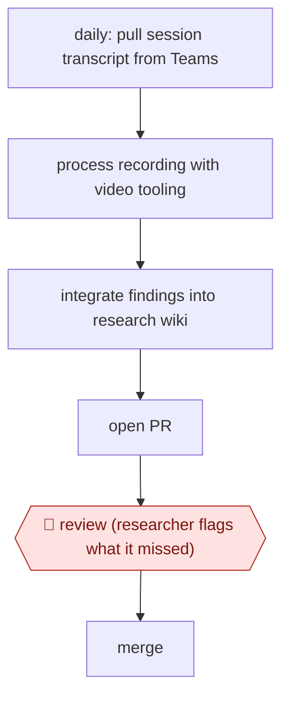

# PR-reviewed research wiki

`TEC › PRD › UXR` · checkpointed · evidence B · **draft: needs a reference example** ([how to add one](../../../../../CONTRIBUTING.md#1-add-an-example-run))

**Shape:** `daily: pull session transcript from Teams → process recording with video tooling → integrate findings into research wiki → open PR → 🛑 review (researcher flags what it missed) → merge`
**Variants:** `microsoft-teams` · `git-pull-requests`

<!-- shape diagram: generated by scripts/build_diagrams.py from `shape`; don't edit -->

<!-- end shape diagram -->

## Background

Research teams need to preserve findings across sessions so that later decisions can use more than the latest report. A shared wiki can accumulate evidence, but automatic summaries may miss a participant's context or overwrite an earlier interpretation. This workflow updates the wiki from each new session and presents the change as a reviewable difference. An agent gathers and organises the material on a schedule. The researcher checks omissions and interpretation before merging because the wiki will become evidence for other people's decisions.

**Terms:**
- **Wiki / LLM wiki**: a linked collection of research notes maintained for both people and language-model tools.
- **PR / merge / diff**: a proposed versioned update, accepting it, and the changed text.
- **Participant segment**: a group with a relevant shared context, such as new versus experienced users.
- **Transcript / recording tooling**: written speech and the tools extracting evidence from session recordings.

## Build it with an agent

**Form:** `service`. A daily schedule starts updates while researchers receive individual proposals for review.

**You need:** approved access to session transcripts and the existing recording-processing tools; study briefs and participant segments; a versioned wiki; code-host MCP server (connector) tools limited to branches and PR creation; a processed-session ledger. Keep recordings and personal data in approved storage, and withhold merge and public publishing permissions.

| Step | Built as |
|---|---|
| daily: transcript → process recording | A scheduled `claude -p` (headless) run invokes a Skill; scoped MCP server (connector) tools retrieve authorised sessions and the existing video tool's outputs. |
| integrate findings into wiki → open PR | The Skill reads the study context, links each addition to session evidence and writes a branch. It records processed session IDs to prevent duplicate updates. |
| 🛑 review → merge | The service opens a PR with the diff, source links and uncertain interpretations. The researcher corrects it and performs the merge. |

**Checkpoints:** `review`: the researcher receives the wiki diff, session references and flagged contradictions, with participant segments kept distinct. The agent cannot merge or publish; existing branch protection requires researcher approval. Failed or incomplete recording extraction remains an explicit gap instead of a fabricated observation.

**Since the sources:** The source dates from 2026-09 and was opened in 2026-11. Searches for newer accounts and the named tools found no newer account as of 2026-11. A headless Skill can coordinate the daily chain without reproducing a crew of named agents. The source does not identify its video tooling or document a reusable implementation; this build assumes an existing approved processor and does not claim that a text agent replaces video or transcription processing. Persistent source links and researcher PR review remain necessary.

*A design based on this entry's steps and the tool documentation as of 2026-11, not a reported run.*

## Steps

*As reported by the sources.*

1. The researcher keeps the study's findings in a version-controlled "LLM wiki" rather than one report; the researcher keeps "constantly tweaking and adjusting" it [[1]](#sources).
2. A chain of agents runs on a daily loop: grab the session transcript from Teams, process the recording through the team's video tooling, integrate the results into the wiki [[1]](#sources).
3. The chain opens a pull request with the changes [[1]](#sources).
4. 🛑 **Review**: the researcher reviews the PR ("oh, it missed this, it missed that") before merging [[1]](#sources).
5. The same team also assembles context (brief, project notes, participant segments) before analysis so segments are not flattened [[1]](#sources).

**Output:** A continuously updated research wiki, each change merged by the researcher; replaces a one-off report.
**Failure modes → guards:** Agent misses findings → PR review before merge [1]. Analysis flattens differences between participant segments → include brief and segment context [1].

**How it differs:** AWF-0061 Quote-verified synthesis produces a one-off report with theme verification and researcher sign-off; AWF-0120 runs the interviews. Here a daily agent chain updates a standing research wiki and the checkpoint is a PR review per update: a different deliverable and cadence.

## Public runs

Coverage as of 2026-11-13: **Weak**: only anonymous, vendor-linked or journalist-told accounts. Collected and re-checked in [Third collection pass](../../../../../research/2026-11-third-pass.md).

- [Microsoft Design, Rebuilding research from the ground up](https://microsoft.design/articles/rebuilding-research-from-the-ground-up/) (2026-09-10). Principal UX researcher on Core AI runs a daily agent chain into a wiki, reviewed by PR. "Report writing that once took a week and a half now takes one to three days". *First-hand: interview; confidence: med.*

## Sources

1. Microsoft Design, Rebuilding research from the ground up (Think First, Season 2; Ben Hanrahan, Chris Gunderson et al.), 2026-09-10. https://microsoft.design/articles/rebuilding-research-from-the-ground-up/
