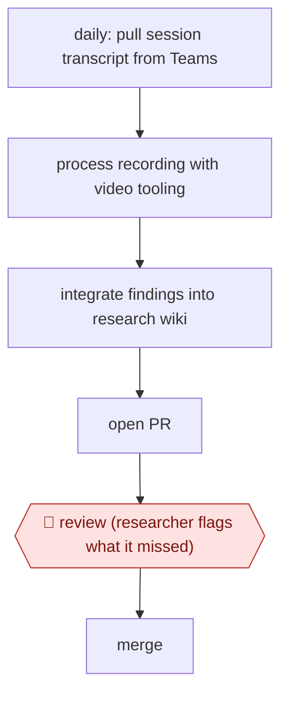

# PR-reviewed research wiki

`TEC › PRD › UXR` · checkpointed · evidence B · **draft: needs a reference example** ([how to add one](../../../../../CONTRIBUTING.md#1-add-an-example-run))

**Shape:** `daily: pull session transcript from Teams → process recording with video tooling → integrate findings into research wiki → open PR → 🛑 review (researcher flags what it missed) → merge`
**How it differs:** AWF-0061 Quote-verified synthesis produces a one-off report with theme verification and researcher sign-off; AWF-0120 runs the interviews. Here a daily agent chain updates a standing research wiki and the checkpoint is a PR review per update: a different deliverable and cadence.
**Variants:** `microsoft-teams` · `git-pull-requests`

<!-- shape diagram: generated by scripts/build_diagrams.py from `shape`; don't edit -->

<!-- end shape diagram -->

## Steps
1. Keep the study's findings in a version-controlled "LLM wiki" rather than one report; the researcher keeps "constantly tweaking and adjusting" it [[1]](#sources).
2. A chain of agents runs on a daily loop: grab the session transcript from Teams, process the recording through the team's video tooling, integrate the results into the wiki [[1]](#sources).
3. The chain opens a pull request with the changes [[1]](#sources).
4. 🛑 **Review**: the researcher reviews the PR ("oh, it missed this, it missed that") before merging [[1]](#sources).
5. Related practice from the same team: assemble context (brief, project notes, participant segments) before analysis so segments are not flattened [[1]](#sources).

**Output:** A continuously updated research wiki, each change merged by the researcher; replaces a one-off report.
**Failure modes → guards:** Agent misses findings → PR review before merge [1]. Analysis flattens differences between participant segments → include brief and segment context [1].

## Public runs

Coverage as of 2026-11-13: **Weak**: only anonymous, vendor-linked or journalist-told accounts. Collected and re-checked in [Third collection pass](../../../../../research/2026-11-third-pass.md).

- [Microsoft Design, Rebuilding research from the ground up](https://microsoft.design/articles/rebuilding-research-from-the-ground-up/) (2026-09-10). Principal UX researcher on Core AI runs a daily agent chain into a wiki, reviewed by PR. "Report writing that once took a week and a half now takes one to three days". *First-hand: interview; confidence: med.*

## Sources

1. Microsoft Design, Rebuilding research from the ground up (Think First, Season 2; Ben Hanrahan, Chris Gunderson et al.), 2026-09-10. https://microsoft.design/articles/rebuilding-research-from-the-ground-up/
