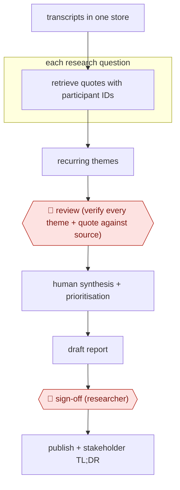

# Quote-verified synthesis

`TEC › PRD › UXR` · assist · evidence A · **draft: needs a reference example** ([how to add one](../../../../../CONTRIBUTING.md#1-add-an-example-run))

**Shape:** `transcripts in one store → each research question: retrieve quotes with participant IDs → recurring themes → 🛑 review (verify every theme + quote against source) → human synthesis + prioritisation → draft report → 🛑 sign-off (researcher) → publish + stakeholder TL;DR`
**Variants:** [`claude-code` kit](variants/claude-code.md) · `claude-code-skill` · `notebooklm` · `dovetail` · `otter-ai`

<!-- shape diagram: generated by scripts/build_diagrams.py from `shape`; don't edit -->

<!-- end shape diagram -->

## Background

User researchers turn interview recordings into an account of what people need and why. Finding relevant passages is repetitive, but interpreting them requires the surrounding conversation and knowledge of the product. A statement that sounds positive can actually describe a frustrating workaround. This workflow lets an agent retrieve quotations and draft a report from verified material. The researcher checks every quote, groups and prioritises the insights, and approves publication so that the report does not turn plausible summaries into unsupported evidence.

**Terms:**
- **Participant ID / timestamp**: an identifier used instead of a person's name, and the location of a passage in a recording.
- **Theme / affinity mapping**: a recurring observation, and grouping related evidence to form insights.
- **Synthesis / sentiment**: interpreting what the evidence means, and the feeling inferred from what was said.
- **TL;DR**: a short summary for stakeholders.
- **Temperature**: a model setting influencing variation, not a guarantee of factual accuracy.

## Build it with an agent

**Form:** `skill`. One researcher works through one study in conversation; [the existing kit](variants/claude-code.md) supplies a procedure and quote-checking script.

**You need:** pseudonymised transcripts with speaker IDs and timestamps; the original recordings for researcher checks; research questions and report templates. Keep personal data in approved storage and give the agent no public web, mail, Confluence-write or Slack-posting tools during synthesis.

| Step | Built as |
|---|---|
| transcripts → each question: retrieve quotes → themes | A Skill searches the evidence store and records participant IDs and source locations. The kit's script checks quote text against transcript exports; built-in Subagents may check separate questions. |
| 🛑 review → human synthesis + prioritisation | The Skill stops with quotes and proposed themes. The researcher verifies the evidence and supplies the grouping and priorities. |
| draft report → 🛑 sign-off → publish + TL;DR | The Skill drafts only from verified insights and prepares the report and summary as files. The researcher approves and publishes through their own systems. |

**Checkpoints:** `review`: the researcher checks every quotation and theme against the transcript or audio, including surrounding context; a substring match cannot establish meaning. `sign-off`: the Skill stops with the report and stakeholder summary; publishing tools are absent, so the researcher performs the final release.

**Since the sources:** Evidence dates from 2025-06 to 2026-06, with a 2026-04 update. In 2026-11 Photoroom opened, while Donska and ShopBack's Medium pages refused access. Bounded searches found no newer fully readable first-hand account of this exact workflow as of 2026-11; a later study's page returned a cookie challenge and was not used. A general Skill can replace a bespoke quote-query interface over transcript exports; the researcher still interprets and prioritises. The linked kit's publishing step is optional and requires explicit approval; this narrower build leaves publishing outside the agent.

*A design based on this entry's steps and the tool documentation as of 2026-11, not a reported run.*

## Steps

*As reported by the sources.*

1. The researcher puts all recordings and transcripts in a single evidence store, such as Dovetail or a notebook per study [[2]](#sources)[[3]](#sources).
2. For each research question, the researcher asks the agent for matching quotes with participant IDs and timestamps or source links. The researcher asks one question at a time and keeps asking until results are exhausted [[2]](#sources)[[3]](#sources).
3. The researcher asks for themes mentioned by 3+ participants, with direct quotes, and tells it not to interpret sentiment [[1]](#sources).
4. 🛑 **Review**: the researcher checks every theme and quote against the original audio or transcript. In one run this caught 'checks dashboard daily' being a workaround for broken alerts, not engagement [[1]](#sources).
5. Humans cluster and prioritise insights (affinity mapping in Miro). AI is used only as a devil's advocate to check for gaps or bias [[2]](#sources).
6. The agent drafts the report from verified insights [[3]](#sources).
7. 🛑 **Sign-off**: the researcher approves the report. It is then published to Confluence, with a TL;DR posted to Slack channels [[3]](#sources).

**Output:** A verified insights report with traceable quotes, published to Confluence or slides, feeding design and product decisions.
**Failure modes → guards:** Invented quotes (seen with ChatGPT even at temperature 0.1) → grounded retrieval plus 100% quote checks [[3]](#sources). Sentiment misread from literal words → no-sentiment prompting plus human re-listening [[1]](#sources).

**How it differs:** AWF-0007 feedback to prototype: that one turns feedback into a prototype. This stops at a verified insights report, with no build.

## Public runs

Coverage as of 2026-11-06: **Strong**: a first-hand, detailed run that matches most of the shape. Collected and re-checked in [New workflows for empty categories](../../../../../research/2026-11-new-workflows.md).

- [Tanya Donska, Using AI for UX Research](https://dnsk.work/blog/using-ai-for-ux-research-workflow) (2025-10-08). Deutsche Telekom study: 8 interviews; AI themes checked against audio. "45-minute interview uploaded. 5 minutes later, transcript ready. 90% accurate.". *First-hand: yes; confidence: high.*
- [Lana Hung, How we transformed qualitative synthesis](https://medium.com/@LanaHung/how-we-transformed-qualitative-synthesize-with-ai-chatgpt-notebooklm-claude-code-0b4df664a15f) (2026-06-14). ShopBack UXR team moved to a Claude Code synthesis skill publishing to Confluence/Slack. "The entire process typically took 3 — 5 days." → "we were able to complete most reports within a single day". *First-hand: yes; confidence: high.*

## Sources

1. Tanya Donska, Using AI for UX Research: The Workflow I Actually Use, 2025-10-08 (updated 2026-04-14). https://dnsk.work/blog/using-ai-for-ux-research-workflow
2. Cori Widen (Photoroom), Working smarter with AI-led qualitative analysis at Photoroom, 2025-06-10. https://www.photoroom.com/inside-photoroom/ai-qualitative-analysis
3. Lana Hung (ShopBack), How we transformed qualitative synthesize with AI: ChatGPT, NotebookLM, Claude Code, Medium, 2026-06-14. https://medium.com/@LanaHung/how-we-transformed-qualitative-synthesize-with-ai-chatgpt-notebooklm-claude-code-0b4df664a15f
