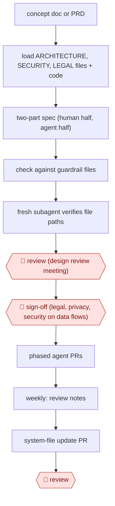

# Guardrailed design spec

`TEC › SWE › ARCH` · checkpointed · evidence A · **draft: needs a reference example** ([how to add one](../../../../../CONTRIBUTING.md#1-add-an-example-run))

**Shape:** `concept doc or PRD → load ARCHITECTURE, SECURITY, LEGAL files + code → two-part spec (human half, agent half) → check against guardrail files → fresh subagent verifies file paths → 🛑 review (design review meeting) → 🛑 sign-off (legal, privacy, security on data flows) → phased agent PRs → weekly: review notes → system-file update PR → 🛑 review`
**Variants:** `claude-code-spec-tool` · `github-spec-kit` · `kiro` · `adr-skill-with-linter`

<!-- shape diagram: generated by scripts/build_diagrams.py from `shape`; don't edit -->

<!-- end shape diagram -->

## Background

Before a team builds a large change to a software system, an engineer usually writes a design document: the problem it solves, how the parts will fit together, what data it touches and what it deliberately leaves out. Colleagues review it in a meeting, and the people responsible for legal, privacy and security approve anything that moves customer data. Written by hand, these documents take days, and drafts often ignore the company's own rules (which database to use, where data may be stored), so reviewers spend their time catching the same mistakes. Here the agent drafts the document from a short brief, checks it against the company's written rules and confirms that its references to the code are real. Engineers still decide in the review whether the premise and the design are right, and the legal, privacy and security owners still approve the data flows, because the company answers for how customer data is handled.

**Terms:**
- **Design spec (design document)**: the written plan for a change, reviewed before anyone builds it.
- **PRD (product requirements document)**: a product manager's description of what a feature must do and for whom.
- **Concept doc**: a rough brief of a few lines: the problem, the constraints and pointers into the code.
- **Guardrail files (system files)**: files kept in the repository that state the company's rules: `ARCHITECTURE.md` (how systems are built), `SECURITY.md` (how they are protected), `LEGAL.md` (how data is handled), plus `PLAN.md`, the spec template.
- **Data flow**: where customer data goes, who can read it and where it is stored.
- **Code owners**: the people or teams recorded as responsible for each part of the code, who must review changes to it.
- **PR (pull request)**: a proposed change to the shared code, published for review before it is merged.
- **Phased PRs**: the implementation split into a sequence of smaller pull requests, one per phase of the plan.
- **Background agent**: a coding agent that runs without a person watching, in its own container, and returns a pull request.
- **Mermaid**: a text format for diagrams that renders inside Markdown.
- **Design slop**: the source's name for AI-drafted designs that ignore in-house conventions or pick non-standard tools.

## Build it with an agent

**Form:** `project`. The guardrail files are standing project knowledge that every run must read, and the second check needs a reviewer that has not seen the draft; both need a project, not a single skill. The weekly update starts on its own, so it runs as a cloud scheduled task beside the project.

**You need:** the repository with the guardrail files and the `PLAN.md` template; a `CLAUDE.md` that points to them; code-owner data the agent can read (a `CODEOWNERS` file or a small script); for the weekly update, read access through MCP connectors to the review meeting transcripts and the relevant Slack channels. Meeting recordings and internal threads stay within the setup your organisation has approved for internal material. Do not give the agent permission to merge.

| Step | Built as |
|---|---|
| concept doc or PRD → load ARCHITECTURE, SECURITY, LEGAL files + code | A spec skill. Its first instruction reads the brief, the guardrail files and the template; built-in read-only subagents map the affected code and its owners. |
| two-part spec (human half, agent half) | The skill writes `specs/<name>.md` from the template: problem, diagrams, key decisions, what is not being done, stakeholders, privacy and security first; then the phases, with file paths, signatures and checks. |
| check against guardrail files | The skill compares each decision with the guardrail files and lists every conflict with the rule it breaks. |
| fresh subagent verifies file paths | A custom read-only subagent that receives only the spec and the guardrail files, confirms every referenced path exists and pushes back on conflicts. |
| 🛑 review (design review meeting) → 🛑 sign-off (legal, privacy, security on data flows) | See Checkpoints. |
| phased agent PRs | Each phase is built separately, for example as in [AWF-0001 Plan-gated build](../../FEAT/plan-gated-build/). |
| weekly: review notes → system-file update PR → 🛑 review | A cloud scheduled task runs once a week with the transcript and Slack connectors, drafts changes to the guardrail files and opens a pull request. A permission rule denies merging. |

**Checkpoints:** `review`: the spec skill ends by presenting the spec, problem statement first, and stops; engineers review it in their design review meeting, outside the agent. The weekly task's pull request is the second `review`: a person merges or closes it, and the task has no permission to merge. `sign-off`: the legal, privacy and security owners approve the data flows themselves, in the meeting or on the spec's pull request. The agent has no tool that records an approval and no permission to merge, so no spec goes forward on the agent's word.

**Since the sources:** Source 1 and the one public run both date from 2026-03. The source built its spec tool as a command-line program on the Claude Code SDK, with a meeting bot that records every design review and background agents that run the phases in containers. The build above runs the same steps as a Claude Code project; the recording bot and the container pipeline are not part of it, and the weekly update assumes transcripts already exist. The source says the team released its template and system-file patterns as an open-source Claude Code plugin (`spec-tool@abnormal-ai`); this catalog has not checked that plugin's contents.

*A design based on this entry's steps and the tool documentation as of 2026-11, not a reported run.*

## Steps

*As reported by the sources.*

1. A person writes a short concept doc or PRD: the problem, constraints and code pointers. It does not need to be polished [[1]](#sources).
2. The spec tool loads the repository's system files (ARCHITECTURE.md, SECURITY.md, LEGAL.md, the PLAN.md template, CLAUDE.md) and researches the codebase and its code owners [[1]](#sources).
3. The agent generates a two-part spec. The top half is for people: problem statement, Mermaid diagrams, key decisions, 'What We're NOT Doing', stakeholders, privacy and security. The bottom half is for agents: a phased guide with file paths, signatures and verification checklists [[1]](#sources).
4. The agent checks the plan against the guardrail files and cites any violations. A separate subagent re-reviews it and verifies that every referenced file path exists [[1]](#sources).
5. 🛑 **Review**: engineers review the spec in a design review meeting, problem statement first, so a wrong premise is rejected before anyone reads the details. The meeting is recorded [[1]](#sources).
6. 🛑 **Sign-off**: Legal, Privacy and Security approve the data flows [[1]](#sources).
7. Background agents implement the guide as phased PRs, which people review [[1]](#sources).
8. Each week, an agent reads the recorded reviews, Slack threads and samples of PR comments, and opens a PR updating the system files. A person reviews and approves it, so the next spec includes the latest decisions [[1]](#sources).

**Output:** A reviewed, signed-off design spec in the repo/Confluence that doubles as the agents' implementation contract; system files updated weekly from review feedback.
**Failure modes → guards:** 'Design slop' (ignores in-house conventions, picks non-standard tools) → encode rules in system files checked on every run. Specs too long to review → two-audience structure with the problem first. Knowledge lost in meetings → weekly system-file update PRs [[1]](#sources).
**How it differs:** AWF-0001 Plan-gated build approves a per-task implementation plan inside a coding session. Here the deliverable is the design document itself, approved in a design review meeting with legal/privacy/security sign-off, plus a weekly loop that updates the architecture rules.

## Public runs

Coverage as of 2026-11-06: **Partial**: first-hand runs that cover part of the shape or put checkpoints elsewhere. Collected and re-checked in [New workflows for empty categories](../../../../../research/2026-11-new-workflows.md).

- [Abnormal AI, Our Design Docs Write Themselves](https://builders.abnormal.ai/p/our-design-docs-write-themselves) (2026-03-02). Spec tool turns a PRD into a guardrail-checked technical plan; all design reviews company-wide now use it. "an 80-page technical plan" shipped as a dogfooding demo "within a week". *First-hand: yes; confidence: med.*

## Sources

1. Shrivu Shankar (Abnormal AI), Our Design Docs Write Themselves, Abnormal Builders, 2026-03-02. https://builders.abnormal.ai/p/our-design-docs-write-themselves
