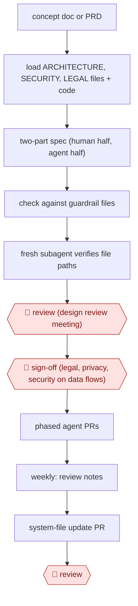

# Guardrailed design spec

`TEC › SWE › ARCH` · checkpointed · evidence A · **draft: needs a reference example** ([how to add one](../../../../../CONTRIBUTING.md#1-add-an-example-run))

**Shape:** `concept doc or PRD → load ARCHITECTURE, SECURITY, LEGAL files + code → two-part spec (human half, agent half) → check against guardrail files → fresh subagent verifies file paths → 🛑 review (design review meeting) → 🛑 sign-off (legal, privacy, security on data flows) → phased agent PRs → weekly: review notes → system-file update PR → 🛑 review`
**How it differs:** AWF-0001 Plan-gated build approves a per-task implementation plan inside a coding session. Here the deliverable is the design document itself, approved in a design review meeting with legal/privacy/security sign-off, plus a weekly loop that updates the architecture rules.
**Variants:** `claude-code-spec-tool` · `github-spec-kit` · `kiro` · `adr-skill-with-linter`

<!-- shape diagram: generated by scripts/build_diagrams.py from `shape`; don't edit -->

<!-- end shape diagram -->

## Steps
1. A human writes a short concept doc or PRD: the problem, constraints and code pointers. It does not need to be polished [[1]](#sources).
2. The spec tool loads repo system files (ARCHITECTURE.md, SECURITY.md, LEGAL.md, the PLAN.md template, CLAUDE.md) and researches the codebase and code owners [[1]](#sources).
3. Generate a two-part spec. The top half is for humans: problem statement, Mermaid diagrams, key decisions, 'What We're NOT Doing', stakeholders, privacy and security. The bottom half is for agents: a phased guide with file paths, signatures and verification checklists [[1]](#sources).
4. Check the plan against the guardrail files and cite any violations. A separate subagent re-reviews it and verifies that every referenced file path exists [[1]](#sources).
5. 🛑 **Review**: engineers review the spec in a design review meeting, problem statement first, so a wrong premise is rejected before anyone reads the details. The meeting is recorded [[1]](#sources).
6. 🛑 **Sign-off**: Legal, Privacy and Security approve the data flows [[1]](#sources).
7. Background agents implement the guide as phased PRs, which humans review [[1]](#sources).
8. Weekly, an agent reads the recorded reviews, Slack threads and samples of PR comments, and opens a PR updating the system files. A human reviews and approves it, so the next spec includes the latest decisions [[1]](#sources).

**Output:** A reviewed, signed-off design spec in the repo/Confluence that doubles as the agents' implementation contract; system files updated weekly from review feedback.
**Failure modes → guards:** 'Design slop' (ignores in-house conventions, picks non-standard tools) → encode rules in system files checked on every run. Specs too long to review → two-audience structure with the problem first. Knowledge lost in meetings → weekly system-file update PRs [[1]](#sources).

## Public runs

Coverage as of 2026-11-06: **Partial**: first-hand runs that cover part of the shape or put checkpoints elsewhere. Collected and re-checked in [New workflows for empty categories](../../../../../research/2026-11-new-workflows.md).

- [Abnormal AI, Our Design Docs Write Themselves](https://builders.abnormal.ai/p/our-design-docs-write-themselves) (2026-03-02). Spec tool turns a PRD into a guardrail-checked technical plan; all design reviews company-wide now use it. "an 80-page technical plan" shipped as a dogfooding demo "within a week". *First-hand: yes; confidence: med.*

## Sources

1. Shrivu Shankar (Abnormal AI), Our Design Docs Write Themselves, Abnormal Builders, 2026-03-02. https://builders.abnormal.ai/p/our-design-docs-write-themselves
