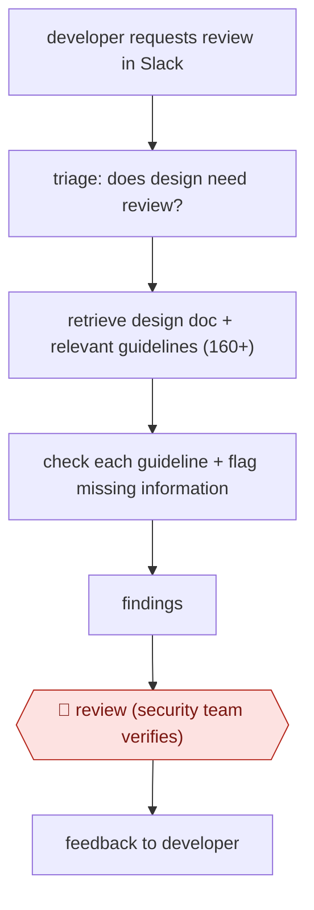

# Guideline-checked design review

`TEC › SWE › ARCH` · checkpointed · evidence A · **draft: needs a reference example** ([how to add one](../../../../../CONTRIBUTING.md#1-add-an-example-run))

**Shape:** `developer requests review in Slack → triage: does design need review? → retrieve design doc + relevant guidelines (160+) → check each guideline + flag missing information → findings → 🛑 review (security team verifies) → feedback to developer`
**How it differs:** AWF-0072 Guardrailed design spec has the agent write the spec. Here a human writes the design doc and the agent reviews it against a large guideline catalogue, with a security-team verification checkpoint. The deliverable is review findings rather than a spec.
**Variants:** `slack`

<!-- shape diagram: generated by scripts/build_diagrams.py from `shape`; don't edit -->

<!-- end shape diagram -->

## Steps
1. A developer starts a Security Design Review request in the existing Slack-based flow [[1]](#sources).
2. Triage: the agent applies separate internal guidelines to decide whether the design needs a review at all [[1]](#sources).
3. The agent retrieves the design document and the relevant internal security guidelines (160+ items plus standards such as RFCs) and runs them through a context-engineering layer [[1]](#sources).
4. It checks the design against each guideline and flags missing information or obvious violations. It is tuned to be over-cautious, accepting some noise to get zero misses [[1]](#sources).
5. 🛑 **Review**: the analysis goes to the Product Security team for verification before feedback reaches the developer [[1]](#sources).
6. Benchmark the agent against human expert reviews of real design documents, and plan continuous benchmarking as guidelines and models change [[1]](#sources).

**Output:** A guideline-by-guideline security findings list on a design doc, verified by security before the developer sees it.
**Failure modes → guards:** Poorly structured design docs lower accuracy → both humans and agent do better on well-written docs. Guidelines evolve → plan continuous benchmarking. Generic agents miss org-specific rules → a custom tool encodes the internal guideline set.

## Public runs

Coverage as of 2026-11-13: **Partial**: first-hand runs that cover part of the shape or put checkpoints elsewhere. Collected and re-checked in [Third collection pass](../../../../../research/2026-11-third-pass.md).

- [Sansan, How We Built an AI Agent to Automate Design Reviews](https://buildersbox.corp-sansan.com/entry/2026/02/26/100000_en) (2026-02-26). Hayami benchmarked against human expert reviews on real design docs; estimated time saved. "Accuracy | 95.8% | 72.1%" and "reduction in total review time by up to 18.76 business hours". *First-hand: yes; confidence: med.*

## Sources

1. yoshiyama33 (Sansan Product Security), Scaling Security at Sansan: How We Built an AI Agent to Automate Design Reviews, 2026-02-26. https://buildersbox.corp-sansan.com/entry/2026/02/26/100000_en
