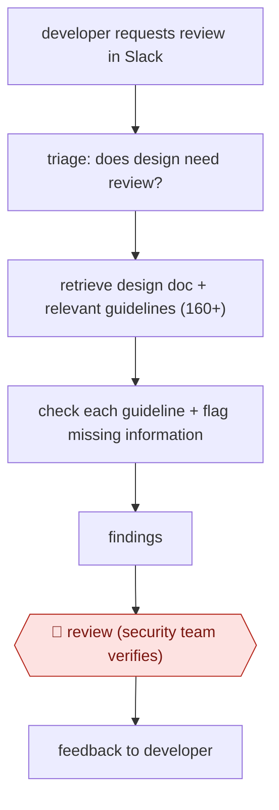

# Guideline-checked design review

`TEC › SWE › ARCH` · checkpointed · evidence A · **draft: needs a reference example** ([how to add one](../../../../../CONTRIBUTING.md#1-add-an-example-run))

**Shape:** `developer requests review in Slack → triage: does design need review? → retrieve design doc + relevant guidelines (160+) → check each guideline + flag missing information → findings → 🛑 review (security team verifies) → feedback to developer`
**Variants:** `slack`

<!-- shape diagram: generated by scripts/build_diagrams.py from `shape`; don't edit -->

<!-- end shape diagram -->

## Background

Before developers build a new feature, many companies ask the security team to read the feature's design document and point out risks while they are still cheap to fix. This is a security design review. The team checks the design against the company's written security guidelines, often well over a hundred of them, and also uses judgement to spot flaws no checklist covers. With a small team, reading every guideline against every document is slow, so reviewers fall back on memory and items get missed, while the queue of requests grows as developers ship faster. The agent decides whether a design needs review at all, checks it guideline by guideline and lists what is missing or wrong. A security engineer still verifies every finding before the developer sees it, because the security team is accountable for what the company ships, and a false all-clear is the costly mistake.

**Terms:**
- **Security design review (SDR)**: a security team's review of a design document before implementation starts.
- **Design document**: the developer's written plan for a feature: what it does, how it works and what data it handles.
- **Guidelines**: the company's numbered security rules, such as how to authenticate users or store secrets, plus outside standards.
- **RFC**: a published internet standard (Request for Comments), cited for protocols such as authentication.
- **Triage**: deciding whether a request needs the full review at all.
- **False negative / false positive**: a real problem the review misses / a reported problem that is not real.
- **Context-engineering layer**: the code that chooses which guidelines and parts of the document go into each model call.
- **Benchmark**: a fixed set of past design documents with expert findings, used to measure the agent's accuracy.

## Build it with an agent

**Form:** `skill`. A security engineer takes one review request at a time and verifies the findings in the same conversation, so one skill holding the guideline catalogue and the procedure is enough.

**You need:** the guideline catalogue and the triage rules as reference files beside the skill; read access to the design document (a file, or an MCP connector to the document store); a Slack connector only if the skill is to post the verified feedback. Design documents can describe unreleased products and internal systems, so use a setup your organisation has approved for confidential material.

| Step | Built as |
|---|---|
| developer requests review in Slack → triage: does design need review? | The skill's first instruction: read the request and apply the triage rules from `triage.md`. If no review is needed, it says why and stops. |
| retrieve design doc + relevant guidelines (160+) | The skill opens the document and selects the guidelines that apply from the catalogue files beside it. |
| check each guideline + flag missing information | Built-in subagents each take one group of guidelines and return a table: guideline, verdict, quote from the document, missing information. The skill tells them to report anything doubtful. |
| findings | The skill merges the tables into one findings list. |
| 🛑 review (security team verifies) → feedback to developer | See Checkpoints. |

**Checkpoints:** `review`: the skill stops after presenting the findings list and does not post anything; the security engineer confirms, edits or drops each finding. Only then does the skill draft the message to the developer, and it posts it only on the engineer's instruction, or the engineer sends it from their own account.

**Since the sources:** Source 1 and its public run date from 2026-02. The source built Hayami as its own service, started from the existing Slack request flow and with results going to the security team; it does not say which agent framework or model it uses. The build above drops the Slack trigger and the separate service: a security engineer runs the skill on each request. The source's planned continuous benchmarking (step 6) is not part of this build; it needs a set of past documents with expert findings, kept beside the skill and rerun when the guidelines or the model change. A team that wants every request analysed before an engineer picks it up would run the same skill as a `service`, with the findings sent to the security team's queue.

*A design based on this entry's steps and the tool documentation as of 2026-11, not a reported run.*

## Steps

*As reported by the sources.*

1. A developer starts a Security Design Review request in the existing Slack-based flow [[1]](#sources).
2. The agent triages the request: it applies separate internal guidelines to decide whether the design needs a review at all [[1]](#sources).
3. The agent retrieves the design document and the relevant internal security guidelines (160+ items plus standards such as RFCs) and runs them through a context-engineering layer [[1]](#sources).
4. The agent checks the design against each guideline and flags missing information or obvious violations. It is tuned to be over-cautious, accepting some noise (false positives) to get zero misses [[1]](#sources).
5. 🛑 **Review**: the analysis goes to the Product Security team, who verify it before feedback reaches the developer [[1]](#sources).
6. The security team benchmarks the agent against human expert reviews of real design documents, and plans continuous benchmarking as guidelines and models change [[1]](#sources).

**Output:** A guideline-by-guideline security findings list on a design doc, verified by security before the developer sees it.
**Failure modes → guards:** Poorly structured design docs lower accuracy → both humans and agent do better on well-written docs. Guidelines evolve → plan continuous benchmarking. Generic agents miss org-specific rules → a custom tool encodes the internal guideline set.
**How it differs:** AWF-0072 Guardrailed design spec has the agent write the spec. Here a human writes the design doc and the agent reviews it against a large guideline catalogue, with a security-team verification checkpoint. The deliverable is review findings rather than a spec.

## Public runs

Coverage as of 2026-11-13: **Partial**: first-hand runs that cover part of the shape or put checkpoints elsewhere. Collected and re-checked in [Third collection pass](../../../../../research/2026-11-third-pass.md).

- [Sansan, How We Built an AI Agent to Automate Design Reviews](https://buildersbox.corp-sansan.com/entry/2026/02/26/100000_en) (2026-02-26). Hayami benchmarked against human expert reviews on real design docs; estimated time saved. "Accuracy | 95.8% | 72.1%" and "reduction in total review time by up to 18.76 business hours". *First-hand: yes; confidence: med.*

## Sources

1. yoshiyama33 (Sansan Product Security), Scaling Security at Sansan: How We Built an AI Agent to Automate Design Reviews, 2026-02-26. https://buildersbox.corp-sansan.com/entry/2026/02/26/100000_en
