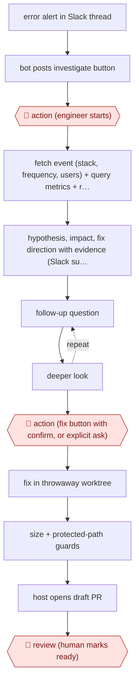

# On-demand alert investigation

`TEC › SWE › DEBUG` · assist · evidence A · **draft: needs a reference example** ([how to add one](../../../../../CONTRIBUTING.md#1-add-an-example-run))

**Shape:** `error alert in Slack thread → bot posts investigate button → 🛑 action (engineer starts) → fetch event (stack, frequency, users) + query metrics + recent deploys + read/grep code → hypothesis, impact, fix direction with evidence (Slack summary + HTML report) → (follow-up question ⟲ deeper look) → 🛑 action (fix button with confirm, or explicit ask) → fix in throwaway worktree → size + protected-path guards → host opens draft PR → 🛑 review (human marks ready)`
**How it differs:** AWF-0071 Reproduce-first bug fix runs from a bug ticket to a fix PR, and reproduction is mandatory. Here the main deliverable is a conversational investigation report started by a person, and a fix is a separate opt-in step. The autonomy is assist, the deliverable is a report, and there are two explicit human triggers.
**Variants:** `claude-agent-sdk` · `sentry` · `new-relic` · `slack-bolt`

<!-- shape diagram: generated by scripts/build_diagrams.py from `shape`; don't edit -->

<!-- end shape diagram -->

## Steps
1. When a Sentry alert lands in a channel the bot is in, and an issue ID can be extracted, the bot posts a usage note and an investigate button in the thread [[1]](#sources).
2. 🛑 **Action**: an engineer presses the button or mentions the bot. The button is replaced with a note saying who started the investigation, which prevents double runs [[1]](#sources).
3. The agent fetches the event details (stack trace, frequency, affected users), runs NRQL queries for error rate, latency and recent deploys, and reads and greps the mirrored repository. The order of investigation steps lives in a Markdown prompt template that grows with in-house observability know-how [[1]](#sources).
4. Report: a summary in the Slack thread plus a detailed HTML report with charts. Evidence includes the query results and code quotes. The session stays open for follow-ups such as asking for more detail on a hypothesis or another time window [[1]](#sources).
5. 🛑 **Action**: the fix starts only from a button with a confirmation dialog, or an explicit mention such as 'fix it'. There is no keyword auto-trigger [[1]](#sources).
6. The agent edits code in a per-request git worktree that is deleted afterwards. The host, not the agent, pushes and calls the GitHub API, so no token sits in the agent's environment. Diffs over the file and line limits get a report only. CI config, infrastructure definitions and lockfiles are blocked by default. The PR body states it is AI-generated and names the Sentry issue and the requester [[1]](#sources).
7. 🛑 **Review**: the PR is always a draft with no auto-merge. A human reviews it and marks it ready [[1]](#sources).

**Output:** An evidence-backed root-cause report in the alert thread, and optionally a guarded draft fix PR for human review.
**Failure modes → guards:** Nobody remembers the bot exists → it posts the button proactively on each alert. Wasted clicks on alerts it can't analyse → the button appears only when an issue ID can be extracted. Investigation quality drifts as prompts or models change → an evaluation framework is being designed.

## Public runs

Coverage as of 2026-11-13: **Strong**: a first-hand, detailed run that matches most of the shape. Collected and re-checked in [Third collection pass](../../../../../research/2026-11-third-pass.md).

- [BASE, SentryアラートをAIで自動調査するSlack Botを作った話](https://devblog.thebase.in/entry/2026/08/29/110000) (2026-08-29). In-house sentry-analyzer bot runs first-pass investigations; manual triage used to take 30–60 min. "運用開始からの約 5 ヶ月で約 150 回の初動調査を実行しています（月 30 回ペース）". *First-hand: yes; confidence: high.*

## Sources

1. BASE product team blog, SentryアラートをAIで自動調査するSlack Botを作った話, 2026-08-29. https://devblog.thebase.in/entry/2026/08/29/110000
