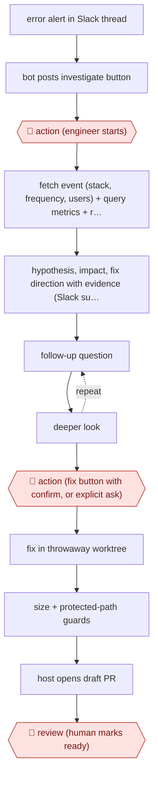

# On-demand alert investigation

`TEC › SWE › DEBUG` · assist · evidence A · **draft: needs a reference example** ([how to add one](../../../../../CONTRIBUTING.md#1-add-an-example-run))

**Shape:** `error alert in Slack thread → bot posts investigate button → 🛑 action (engineer starts) → fetch event (stack, frequency, users) + query metrics + recent deploys + read/grep code → hypothesis, impact, fix direction with evidence (Slack summary + HTML report) → (follow-up question ⟲ deeper look) → 🛑 action (fix button with confirm, or explicit ask) → fix in throwaway worktree → size + protected-path guards → host opens draft PR → 🛑 review (human marks ready)`
**Variants:** `claude-agent-sdk` · `sentry` · `new-relic` · `slack-bolt`

<!-- shape diagram: generated by scripts/build_diagrams.py from `shape`; don't edit -->

<!-- end shape diagram -->

## Background

When a live software service throws an error, an error-tracking tool sends an alert to the team's chat channel. Someone then has to find out what happened: read the error's details, check whether error rates or response times moved, see what was deployed recently, and find the code involved. This first look pulls people away from planned work, so it is often put off and alerts pile up unread. Here an engineer asks the agent to do that first investigation and gets back a report with the evidence behind each hypothesis, and can ask follow-up questions. A fix is a separate request. Engineers decide whether to start, whether to ask for a fix and whether the fix is right, because the agent's hypothesis can be wrong and any change it makes goes into the code that customers use.

**Terms:**
- **Alert**: an automatic message that an error has happened, here posted to a Slack thread by the error tracker.
- **Sentry**: an error-tracking service that groups errors into issues, each with an ID, a stack trace, how often it occurs and how many users it affects.
- **Stack trace**: the chain of function calls that was running when the error happened, which points to the code involved.
- **Metrics, NRQL**: measurements of the running service, such as error rate and response time; NRQL is the query language of the New Relic monitoring service.
- **Deploy**: a release of new code to the live service.
- **grep**: searching the code for a word or pattern.
- **Mirrored repository**: a read-only copy of the code, kept up to date for the bot to search.
- **Git worktree**: a separate working copy of the repository, so changes there do not touch the main checkout.
- **Draft PR**: a pull request (a proposed change, published for review) marked as not ready, so it cannot be merged until a person marks it ready.
- **Protected paths**: files the agent must not change: CI configuration (the automated checks), infrastructure definitions (the servers and networks described as code) and lockfiles (the exact versions of every dependency).
- **Host**: the program that runs the agent; in the source it, not the agent, holds the credentials for pushing code.

## Build it with an agent

**Form:** `project`. One engineer starts each investigation and stays for follow-ups, which a skill can hold, but the fix step needs rules that must hold every time: no edits to protected paths, a size limit and no push without approval. Those need hooks and permission rules.

**You need:** read access to the error tracker and the monitoring service through MCP connectors or small scripts beside the skill; the repository checked out; a `CLAUDE.md` listing the protected paths and the size limit; the investigation procedure, including the queries to try and their order, as the skill's reference file. Error events can contain customer data; keep reports where your organisation allows that data, and do not paste it into the pull request.

| Step | Built as |
|---|---|
| error alert in Slack thread → bot posts investigate button → 🛑 action (engineer starts) | The engineer runs the investigation skill with the issue ID from the alert. See Checkpoints. |
| fetch event (stack, frequency, users) + query metrics + recent deploys + read/grep code | The skill calls the error-tracker and monitoring connectors in the order its reference file gives, and reads and searches the code. Built-in read-only subagents can run the queries and the code search in parallel. |
| hypothesis, impact, fix direction with evidence (Slack summary + HTML report) | The skill writes a short summary in the conversation and a detailed report file with the query results and code quotes. |
| (follow-up question ⟲ deeper look) | The same conversation: the engineer asks, and the agent queries again. |
| 🛑 action (fix button with confirm, or explicit ask) → fix in throwaway worktree | The skill stops after the report. Only an explicit request starts the fix, which the skill makes in a new git worktree. |
| size + protected-path guards | A `PreToolUse` hook blocks edits to the protected paths. A script beside the skill counts files and lines changed; over the limit, the skill reports instead of opening a pull request. |
| host opens draft PR → 🛑 review (human marks ready) | Permission rules ask before `git push` and `gh pr create`; the pull request is opened as a draft, with a body that says it is AI-generated and names the issue and the requester. Merging is denied. |

**Checkpoints:** `action`: the first one is the engineer starting the skill; nothing runs on an alert by itself. The second is the fix: the skill stops after the report and changes no code unless asked, and a permission rule asks before every push and pull request. If no credential for pushing may sit with the agent, as in the source, deny `git push` and `gh pr create` and let the engineer run them. `review`: the pull request is a draft and the agent has no permission to merge or mark it ready; a person reviews it in the code host.

**Since the sources:** Source 1 and its public run date from 2026-08. The source built a Slack bot on the Claude Agent SDK, with its own MCP tools for the error tracker and monitoring, one session per Slack thread resumed for follow-ups, and a host program that pushes the code so that no token reaches the agent. The build above runs the same steps in an interactive Claude Code session, because a person starts every run and stays for the follow-ups. The Slack button, which the source added so people would remember the bot exists, needs the source's own design: an Agent SDK program behind a Slack app. The source's planned evaluation of investigation quality is not part of this build.

*A design based on this entry's steps and the tool documentation as of 2026-11, not a reported run.*

## Steps

*As reported by the sources.*

1. When a Sentry alert lands in a channel the bot is in, and an issue ID can be extracted, the bot posts a usage note and an investigate button in the thread [[1]](#sources).
2. 🛑 **Action**: an engineer presses the button or mentions the bot. The bot replaces the button with a note saying who started the investigation, which prevents double runs [[1]](#sources).
3. The agent fetches the event details (stack trace, frequency, affected users), runs NRQL queries for error rate, latency and recent deploys, and reads and greps the mirrored repository. The order of investigation steps lives in a Markdown prompt template that grows with in-house observability know-how [[1]](#sources).
4. The agent reports: a summary in the Slack thread plus a detailed HTML report with charts. Evidence includes the query results and code quotes. The session stays open for follow-ups such as asking for more detail on a hypothesis or another time window [[1]](#sources).
5. 🛑 **Action**: an engineer starts the fix, either from a button with a confirmation dialog or with an explicit mention such as 'fix it'. There is no keyword auto-trigger [[1]](#sources).
6. The agent edits code in a per-request git worktree that is deleted afterwards. The host, not the agent, pushes and calls the GitHub API, so no token sits in the agent's environment. Diffs over the file and line limits get a report only. CI config, infrastructure definitions and lockfiles are blocked by default. The PR body states it is AI-generated and names the Sentry issue and the requester [[1]](#sources).
7. 🛑 **Review**: the PR is always a draft with no auto-merge. A person reviews it and marks it ready [[1]](#sources).

**Output:** An evidence-backed root-cause report in the alert thread, and optionally a guarded draft fix PR for human review.
**Failure modes → guards:** Nobody remembers the bot exists → it posts the button proactively on each alert. Wasted clicks on alerts it can't analyse → the button appears only when an issue ID can be extracted. Investigation quality drifts as prompts or models change → an evaluation framework is being designed.
**How it differs:** AWF-0071 Reproduce-first bug fix runs from a bug ticket to a fix PR, and reproduction is mandatory. Here the main deliverable is a conversational investigation report started by a person, and a fix is a separate opt-in step. The autonomy is assist, the deliverable is a report, and there are two explicit human triggers.

## Public runs

Coverage as of 2026-11-13: **Strong**: a first-hand, detailed run that matches most of the shape. Collected and re-checked in [Third collection pass](../../../../../research/2026-11-third-pass.md).

- [BASE, SentryアラートをAIで自動調査するSlack Botを作った話](https://devblog.thebase.in/entry/2026/08/29/110000) (2026-08-29). In-house sentry-analyzer bot runs first-pass investigations; manual triage used to take 30–60 min. "運用開始からの約 5 ヶ月で約 150 回の初動調査を実行しています（月 30 回ペース）". *First-hand: yes; confidence: high.*

## Sources

1. BASE product team blog, SentryアラートをAIで自動調査するSlack Botを作った話, 2026-08-29. https://devblog.thebase.in/entry/2026/08/29/110000
